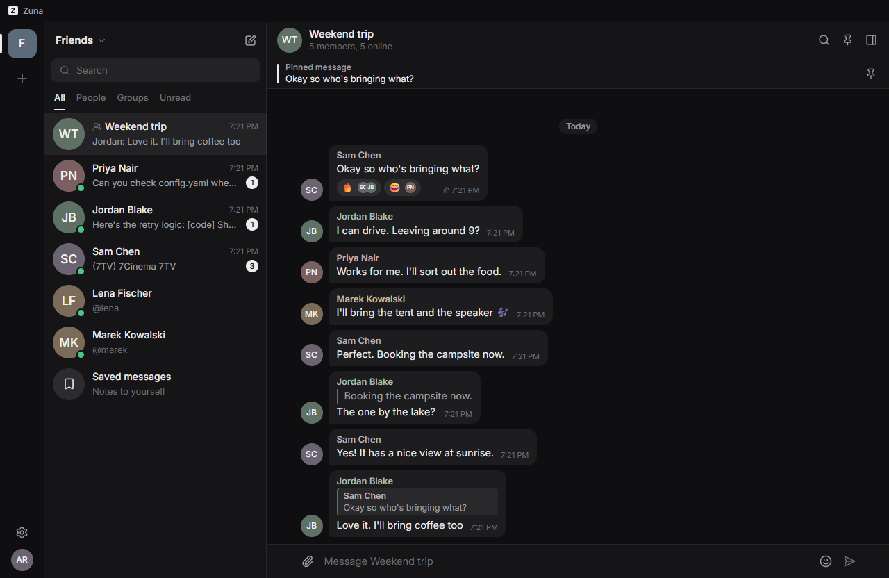

<div align="center">
  
  <h1>Zuna</h1>
  <p><b>Private, end-to-end encrypted chat on servers you and your friends run.</b></p>
  <p>Windows, Linux, macOS, and an iPhone and iPad app on its way. Free and open source under the AGPL-3.0.</p>
</div>



## What it is

Zuna looks and feels like a modern chat app, but nobody owns it. Anyone can run a server in a couple of minutes. On the desktop, each server appears as an icon in your sidebar, as on Discord, and inside it you get a clean Telegram-style layout. On the iPhone and iPad, the app is native and laid out like Telegram's, with your servers listed like mailboxes in Mail.

Everyone on a server can message each other straight away. Group chats are invite-only. Your server only ever handles encrypted data, so even the person running it can't read your messages.

**Conversations**
- Direct messages with anyone on the server, plus invite-only groups
- Replies, editing, deleting, reactions and pinned messages
- Forwarding to any chat, on any of your servers, one message or several picked together
- Voice messages, recorded in the app, with a waveform
- Muting a chat for an hour, eight hours, a day, or until you turn it back on
- Link previews, made by the sender's device and sent encrypted, so neither recipients nor the server contact the site
- Markdown formatting, spoilers, and code blocks with syntax highlighting
- Photos, video, audio and any other file, encrypted before upload
- Search across your history, run entirely on your device
- Saved messages for notes to yourself

**7TV emotes, built in**
- Each server's admins choose one [7TV](https://7tv.app) emote set for everyone
- Animated and zero-width emotes, as messages, inline and as reactions
- Your server caches the images, so 7TV never sees members' addresses

**Presence**
- Online status, last seen, typing indicators and read receipts
- Encrypted wherever the server doesn't need to see them, with privacy switches for the rest

**Notifications**
- Desktop notifications, and phone notifications that show the message, decrypted on the phone
- Pushes carry only sealed IDs, so neither the push relay nor Apple sees who wrote what
- They go where you are, as in Telegram: while you use one device, the others wait 30 seconds and skip what you read there, and what you read on one device disappears from the others
- Reply and Mark as read from the notification on the phone

**iPhone and iPad**
- A native app with everything the desktop has, compatible with it, built on the same client core
- Face ID, Touch ID or passcode lock, and your password only once after the phone restarts
- iPad layout with your servers, chats and the open chat side by side

**Security**
- Built on MLS ([RFC 9420](https://www.rfc-editor.org/rfc/rfc9420.html)) through the independently audited [OpenMLS](https://github.com/openmls/openmls)
- Emoji verification to detect anyone intercepting a conversation
- Message history that follows you to new devices, encrypted so your server can't read it
- Details and honest limits in [SECURITY.md](SECURITY.md)

## Host a server

You need a Linux machine and a domain pointing at it. With Docker:

```bash
git clone https://github.com/zuna-app/zuna.git
```

```bash
cd zuna/deploy
```

```bash
ZUNA_DOMAIN=chat.example.com docker compose up -d
```

```bash
docker compose logs zuna
```

The log shows a one-time setup link. Open it in the Zuna app to create your owner account, then invite people from inside the app. HTTPS certificates are handled automatically, LiveKit runs next to the server for voice channels and calls, and everything is stored in a single folder that's easy to back up. Calls' media has ports of its own, so open 7881/tcp and 7882/udp as well as 80 and 443.

**Without Docker,** an installer asks how people will reach the server, by a domain or the machine's IP address, builds it from git, runs it with systemd, and sets up Caddy in front of it or adds a site to the proxy you have, before checking that it answers:

```bash
sudo git clone https://github.com/zuna-app/zuna.git /opt/zuna
```

```bash
sudo /opt/zuna/deploy/install.sh
```

Update it later with `sudo zuna-update`. The [self-hosting guide](docs/SELF_HOSTING.md) covers all of it, with the single binary, reverse proxies, backups and phone notifications. [LINUX.md](docs/LINUX.md) has the details of the scripts.

## Join a server

1. Install the desktop app. Releases don't carry it yet, so for now build it from source, as [CONTRIBUTING.md](CONTRIBUTING.md) says. Once they do, it comes from the [releases page](https://github.com/zuna-app/zuna/releases), and on Linux that's the `.deb` for Debian and Ubuntu, the `.rpm` for Fedora and openSUSE, the `.pkg.tar.zst` for Arch (`sudo pacman -U`), or the AppImage or the `.tar.gz` anywhere else. The iPhone and iPad app comes through TestFlight and the App Store later. If you'd rather use a browser, a server's admins can also host the [web app](docs/WEB.md): the same chats, channels and calls in a browser, with the limits it lists.
2. Paste the invite link someone sent you.
3. Pick a name and password, and save your recovery key.

## Development

You need Node 22.22+, Go 1.26+ and Rust with the `wasm32-unknown-unknown` target, and the desktop app needs more on each system. [CONTRIBUTING.md](CONTRIBUTING.md) has the details. The iOS app also needs a Mac with Xcode; [IOS_TESTING.md](docs/IOS_TESTING.md) explains how it's built and tested.

```bash
npm install
```

```bash
npm run build:crypto
```

```bash
npm run dev:server
```

```bash
npm run dev:web
```

```bash
npm test
```

## Documentation

- [Self-hosting guide](docs/SELF_HOSTING.md)
- [Hosting the web app](docs/WEB.md)
- [Running Zuna on Linux without Docker](docs/LINUX.md)
- [The push relay for phone notifications](docs/PUSH_RELAY.md)
- [Bots: making, running and writing one](docs/BOTS.md)
- [Security model](SECURITY.md)
- [Architecture and protocol](docs/ARCHITECTURE.md)
- [The iOS app: plan and decisions](docs/IOS_PLAN.md), and [how it's tested](docs/IOS_TESTING.md)
- [Roadmap: voice calls and more](docs/ROADMAP.md)
- [Contributing](CONTRIBUTING.md)

## License

[AGPL-3.0](LICENSE). You can use, change and host Zuna freely. If you distribute a modified version, or run one that others use over a network, you must publish its source under the same license.
