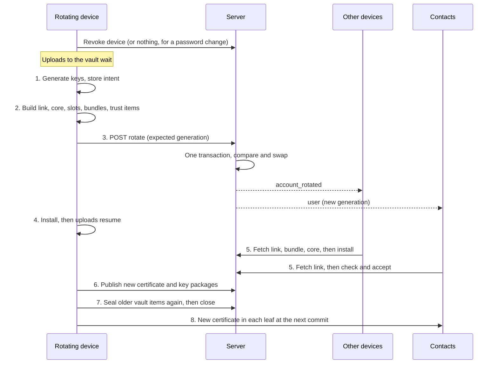

# Rotating the account key

**Status:** built through Stage 5, at the owner's direction, ahead of cryptographic review. **Nobody independent has reviewed it.** Section 13 is what a reviewer should look at first. Stage 6 isn't built. Swift couldn't be compiled where this was built, so the iOS side has only been read, and needs `npm run build:ios` and the iOS tests on a Mac. The web app runs the same core, so it does all of this too, and its check passed in Edge, but not yet in Firefox or WebKit.

**Scope:** finding Z-04 of the security audit of 2026-10-31. Sessions already ended when they should (commit `c8aedbb`), but the keys behind them never changed, so someone who once had an account couldn't really be put out of it.

Section 3 describes how things worked before this, checked against the code at commit `048130c`, and its file and line references are to that commit. The rest of this document describes what's built. The code is in `packages/core/src/generations.ts`, the "Account generations" part of `session.ts`, and `server/internal/api/generations.go` and `store/generations.go`.

**The owner's constraint:** no part of this may add a step, prompt or setting for people using the app.

## 1. Summary

Every device of an account, and anyone who has ever signed in to it, holds the same account key and identity key, for the life of the account. Removing a device or changing a password only works for as long as the server keeps refusing that person. If they also get the server's data, through a malicious operator, a stolen backup or a later breach, they can open every new vault item it holds, including the key of every new epoch. With the operator's help, they can also add a device of their own to any group, with a certificate every contact accepts.

This design gives each account numbered **generations**:

1. Each generation has its own account key, identity key and HPKE key.
2. A new generation is made in the background whenever a device is removed, the password or recovery key changes, or someone signs in with the recovery key.
3. The new account key reaches the remaining devices sealed to a public key each device holds. It reaches the password and recovery paths sealed to public keys whose private halves only that secret can open. So a device can do all this with neither secret.
4. Each generation publishes one signed **link**, which names the new identity key and lists the devices that stay. Contacts follow the chain of links. A certificate signed by an old identity key is then worthless unless its device is on the list.
5. All of it reaches the server as one transaction, guarded by the generation number. A crash at any point resumes from a stored intent, with the same keys.
6. Older clients carry on: they keep seeing the original identity key, and certificates keep a signature by it.

Four limits, stated plainly because they decide whether this is worth building:

- **Someone who still knows the password or recovery key isn't evicted until that secret changes.** To the system, whoever holds the secret is the owner. Removing a device without changing the password evicts a stolen device, not a password thief.
- **Most existing accounts keep a residual risk.** A recovery wrapper can't be converted without the recovery key, and people rarely enter it. Until they do, a **bridge** sealed under the first account key has to carry new keys forward, and someone holding that old key and the server's data can open it. Such an account is evicted against an honest server, and no worse than today against a malicious one. Accounts created after Stage 1 don't have this limit. See section 11.1.
- **A contact can't prove a rotation is genuine if the old identity key is stolen and the server helps.** The design narrows this a lot (section 9), and the emoji check stays the final word.
- **Past history stays exposed.** Whatever someone could already open, they keep. That's the documented cost of history on new devices (`SECURITY.md:45`, `SECURITY.md:109`).

There's no separate MLS change for eviction. A removed device's leaves already go through reconciliation. Rotation closes what MLS doesn't cover: the vault, and who may issue a certificate.

## 2. Terms

| Term | Meaning |
|---|---|
| Generation | A number for one set of account-level keys. Every account starts at 0. |
| Root | The identity key an account was created with, `IK_0`. |
| Head | The identity key of the current generation, `IK_g`. |
| Link | The signed statement that moves an account from one generation to the next. |
| Carried device | A device listed in a link, so its older certificate stays valid. |
| Sibling | Another device of the same account. |
| Seal key | An X25519 key pair belonging to one device, used only to receive account keys. |
| Slot | A public-key wrapper for the password or recovery key: a key pair whose private half is encrypted under a key only that secret derives. |
| Enrollment proof | A signature by a slot's key over a new device, proving that device's owner opened the slot. |
| Bundle | A generation's account key, sealed to one device's seal key. |
| Bridge | A generation's account key sealed under `AK_0`, for accounts with a wrapper that's still the old kind. |
| Intent | The new keys and request of a rotation in progress, stored locally so a crash can resume it. |

## 3. How it worked before this

Short paths in this document are relative to where that code lives: `session.ts`, `account.ts`, `crypto.ts`, `client.ts`, `api.ts` and `db.ts` are in `packages/core/src/`, `mls.rs` and `primitives.rs` in `crypto/src/`, and `api/` and `store/` in `server/internal/`.

### 3.1 What exists

| Secret | Held by | Protects | Where |
|---|---|---|---|
| Account key | Every device, and anyone who opens a wrapper | Vault core, vault items, own read position when receipts are off | `account.ts:36`, `crypto.ts:119`, `crypto.ts:141`, `session.ts:3166` |
| Identity secret | Every device, inside the vault core | Device certificates, the HPKE key's signature, profile signatures | `crypto.ts:111`, `crypto.ts:151`, `crypto.ts:169`, `crypto.ts:206` |
| HPKE secret | Every device, inside the vault core | History grants | `crypto.ts:330`, `session.ts:849` |
| Community key | Every member of the server | Profiles | `crypto.ts:206` |
| Device signing key | One device | MLS leaf, messages, grants, group details | `account.ts:105`, `mls.rs:70` |
| Password and recovery wrap keys | Derived when needed, never stored | One symmetric wrapper of the account key each | `crypto.ts:104`, `account.ts:172` |

### 3.2 Behaviour the design has to work with

1. **Signing in hands over the keys before any device exists.** `handleLogin` returns the wrapper and the vault core in its response (`api/accounts.go:272`). Later limits on sessions with no device (`store/users.go:395`, `api/server.go:409`) restrict what such a session can fetch afterwards, not what it already took. A device that signs in and never registers appears nowhere.
2. **Removing a device needs no secret.** `revokeDevice` is a plain request (`session.ts:3332`, `api/accounts.go:666`). The server ends the device's sessions and deletes its key packages and push registration (`store/users.go:472`). The device keeps everything it holds, by design (`session.ts:401`, `SECURITY.md:78`).
3. **Signing out revokes the device too** (`api/accounts.go:532`), so a device can leave the list on its own say-so.
4. **Wrappers are symmetric** (`crypto.ts:104`). A device can't make a new one without the secret, and neither can anyone else.
5. **Ciphertext doesn't say which key made it.** `aead_seal` outputs nonce and ciphertext only (`primitives.rs:79`). A vault item's label is its ID alone (`crypto.ts:141`).
6. **Whatever opens under the account key is believed.** A `verified:` item overwrites both the verified record and the pin (`session.ts:752`), and the server takes any item from any device session (`api/accounts.go:746`, `store/users.go:592`). So today, the account key and write access to the server's data are enough to change who an account trusts.
7. **A vault item that won't open is skipped for good.** The cursor has already moved past it (`session.ts:727`).
8. **Identity keys are for life, and clients enforce it hard.** A different key sets trust to `changed` with a warning (`session.ts:609`, `session.ts:659`). Certificates are checked against the pinned key and dropped if they fail (`session.ts:614`), and every leaf that fails is removed from the group (`session.ts:1325`, `session.ts:2073`). So simply replacing the identity key on the server would make every contact remove all of that person's devices from every group.
9. **The server has no way to change `identity_key` or `hpke_key`.** They're written once, at sign-up (`store/users.go:111`).
10. **`PUT /api/vault/core` exists, and no client calls it** (`api/server.go:292`, `api/accounts.go:781`). Any device session could overwrite the core.
11. **New epoch keys go straight to the vault under the account key** (`session.ts:818`).
12. **A device's stored account state is written once.** `addAccount` seals it into the index database (`client.ts:165`). Later changes only touch memory (`session.ts:657`).
13. **Grants belong to a user, not a device, and the first device to handle one deletes it, even if it couldn't open it** (`session.ts:866`, `store/groups.go:618`).
14. **Parsing a certificate ignores fields it doesn't know,** inside the payload and outside it (`crypto.ts:177`). An older client checks only `s` over `p`. This is what makes the compatibility in section 11.3 possible.
15. **Contacts can't use the server's device timestamps.** They're zeroed for everyone but the owner (`api/accounts.go:555`).
16. **The emoji digest covers exactly two identity keys** (`crypto.ts:422`, `primitives.rs:194`).
17. **An MLS client's credential is fixed when it's built** (`mls.rs:70`), and every commit includes a self-update (`mls.rs:224`). OpenMLS 0.9.2 has `leaf_node_parameters` and `with_credential_with_key` for changing a leaf's credential in such a commit. Zuna doesn't use them today, and they haven't been tried here.
18. **Sealing to a public key needs no new primitive.** `hpkeKeygen`, `hpkeSeal` and `hpkeOpen` exist on the desktop and iOS (`primitives.rs:166`, `apps/ios/core-bundle/src/crypto.ts:34`).

Limits worth knowing for sizing: 500,000 vault items per account (`api/accounts.go:50`), 4 MiB per vault request (`api/server.go:37`), 1,000 items per read (`api/accounts.go:738`), 200 per client batch (`session.ts:112`), 50 writes a second per account with a burst of 300 (`api/server.go:127`).

## 4. Attackers and goals

| Attacker | Has | How |
|---|---|---|
| **Old-key holder** | Account key, identity, HPKE and community keys as of some generation. No session, no current password | A device that was stolen and removed, or a password that has since changed |
| **Reader** | A copy of the server's data | A stolen backup, a breach |
| **Server** | Reads and writes all server data and everything on the wire. No client secrets | A malicious operator |
| **Password holder** | The current password or recovery key | Phishing, reuse |
| **Enrolled device** | A device still on the list | Anything nobody has noticed yet |

The attackers that matter most are combinations: the old-key holder with the reader, and the old-key holder with the server. Today, against an honest server, removing a device already locks out an old-key holder. Everything here is about what happens when the server's data or the server itself is not on the person's side, which is the threat Zuna is built around.

**Goals**, once generation `g+1` is published and the account has no bridge, with the exceptions listed in section 10:

- **G1.** An old-key holder, even with the server, can't open anything newly sealed for the account.
- **G2.** They can't get a device accepted by the account's own devices, or by a contact who has seen the link.
- **G3.** They can't change who the account trusts by planting vault items.
- **G4.** The person loses no data and does nothing new.

**Not goals:** past history, metadata, a remaining device that's compromised (`SECURITY.md:118`), and a password holder before the password changes.

## 5. What rotates

| Thing | Rotates | How |
|---|---|---|
| **Account key** | Every generation | New random 32 bytes. |
| **Identity key** | Every generation | New Ed25519 pair, announced by a link. The root stays in `users.identity_key` and is still used to sign for older clients until those are retired (section 11.3). |
| **HPKE key** | Every generation | New pair, named in the link. The last 16 secrets stay in the core, because a contact who hasn't heard yet may still seal a grant to an old key. |
| **Vault core** | Every generation | Sealed under the new account key. Holds the keys above and the older account keys until the generation closes. |
| **Vault items that carry trust** (`pin:`, `verified:`, `trust:`, `chain:`, `prefs`, `device:`) | Every generation | Sealed again in the same server transaction as the rotation, since a new device believes them. |
| **Epoch keys in the vault** (`ek:`) | Every generation | Sealed again in the background. They only ever fill gaps (`session.ts:893`), so they can wait. |
| **Device certificates** | Reissued, lazily | Each device publishes a new one after installing the generation, and puts it in its leaves at its next commit. Being carried keeps the old one valid until then. A device that updates also reissues its certificate once at generation 0, so others can tell it understands chains (section 9.4). |
| **History grants** | No | Pending grants open with the retained HPKE secrets. New ones go to the new key. |
| **Password and recovery slots** | The sealed key every generation, the key pair only when the secret changes | Section 7. |
| **Device seal keys** | After each generation, by the device itself, keeping the last one for a rotation already under way | So a copy of a device, taken once without it being removed, stops being useful from the rotation after next. Each says which generation it's from, signed, and a device making a rotation refuses one older than it has seen, so a server can't offer an old one again. Only what this device has seen counts, so one that's never seen a newer one can't tell. |
| **Device signing keys** | No | These are the continuity contacts can check, and the MLS leaf's key. |
| **Sign-in keys** | Only when the password or recovery key changes | As today. |
| **Sessions** | Those with no device end, as on a password change today | `store/users.go:436`. Sessions of removed devices end when they're removed, as today. |
| **Community key** | No | It's shared by the whole server. An evicted person keeps being able to read profiles if they get the server's data: the limit at `SECURITY.md:113`, unchanged. |
| **Epoch keys and file keys already given out** | No | Can't be taken back. |
| **Local database key, push key** | No | Per device. A removed device's push registration is already deleted. |

## 6. When it triggers

A server alone can say a device was removed, and each rotation costs every contact a link to follow. So past 5 in an hour, one for a removal waits its turn, and the person is told. It's never skipped.

| Event | Who rotates | Notes |
|---|---|---|
| A device is removed in Settings | The device that removed it | Right after the server accepts the removal. |
| A device signs itself out, or is removed by an older client | Any other device, after a random delay | Otherwise someone with a stolen device could sign it out and vanish from the list with the keys. |
| The password changes | The device changing it | One transaction with the new password material (section 8.3). |
| The recovery key is regenerated | The device doing it | One transaction, with a new recovery slot. |
| Someone signs in with the recovery key | The new device | One transaction with the new password. |
| Someone signs in with a wrapper of the old kind on an account already past generation 0 | The new device | The secret is in hand, so this is when that wrapper can become a slot. |
| A ban ends | The next device to sign in | Banning revokes every device (`store/users.go:351`), which the next device treats as an uncovered removal. |

Rules that apply to all of these:

- **Any device that sees a sibling revoked and no link covering it rotates after a random delay** of up to 30 seconds, and the server lets one win (section 8.4). A crash of the removing device, or a removal from an older client, can't leave a gap.
- **New uploads wait.** From the moment a device sees an uncovered removal until it has installed the new generation, it uploads nothing to the vault. Epoch keys stay local, flagged as not uploaded, as they are today when an upload fails. MLS reconciliation doesn't wait, so a removed device's leaves still go straight away.
- **Removals close together share one rotation,** with a short wait of about two seconds before starting, to keep the chain short.
- **Nothing periodic.** Rotation costs a link for every contact to follow, and nothing has changed if nothing has happened.
- **Removals from before the server kept generations don't count.** The migration records when it ran (`account_protocol_since`), so updating doesn't make every account that ever removed a device rotate at once, which would cut off devices not updated yet. The next rotation drops those devices anyway. A server could lie about when a removal happened, but only to hide what it could hide by saying nothing.
- **What the server says about a removal is believed,** as it is for reconciliation today. A server that lies makes a device get dropped. That's denial of service, which it can do anyway, and that device keeps its data.

## 7. Rewrapping without the secrets

### 7.1 Assessment of the working idea

The working idea is per-device seal keys and public-key wrappers. **It's the right core, and nothing better fits the constraint, but on its own it doesn't achieve eviction.** Four things needed correcting:

1. **Public keys are the only way.** A symmetric wrapper can only be made by someone who could also open it, and any device that could do that hands the same power to whoever steals it. So a device that doesn't know the password can only encrypt to the password if it's a public-key operation.
2. **Public keys need authenticating against an attacker who holds the old keys.** The old account key and old identity key are exactly what can't be trusted here, and anything authenticated only by them can be forged by the attacker this is meant to evict. So a device trusts slot keys it pinned, changed only through a link. Seal keys are signed by the device's own signing key.
3. **Certifying a device isn't enough to get it the new key.** With a stolen identity key and a malicious server, someone can list a fake device with a perfectly valid certificate, and a naive rotation would seal the new account key straight to them. That would defeat the whole design, and the working idea didn't cover it. This is what enrollment proofs (section 7.4) are for.
4. **Slots can't be created for existing accounts without the secrets.** That's the bridge (section 11.1). It's the design's largest remaining weakness.

And it doesn't evict someone who knows the password. Nothing does, short of changing the password.

### 7.2 Slots

There's one slot for the password and one for the recovery key:

```
slot key    = HKDF(Argon2id master or recovery key, "zuna/slot/v1|kind|server|username")   (lowercase username)
seal pair   = hpkeKeygen()                  (X25519)
sign pair   = signingKeygen()               (Ed25519)

sealed_secret = AEAD(slot key, seal secret + sign secret)     changes only with the secret
sealed_key    = HPKE(seal public, AK_g)                       changes every generation
```

- **A device making a generation** seals to the seal public key. It needs no secret, and no device ever stores a slot's secrets or the slot key.
- **Someone signing in** gets `sealed_secret` and `sealed_key` from the server after proving the sign-in key, as they get the wrapper today. They derive the slot key, open the secret, and open the account key.
- **Changing the secret** replaces the slot, which needs a new generation so that the slot's new public key is announced through a link.
- **Guessing passwords offline costs the same as today.** A server can test a guess against `sealed_secret`, at one Argon2id per guess, as it can test one against `wrapped_key_password` now. The limit at `SECURITY.md:108` doesn't change.
- **The slot key has its own HKDF label** and is bound to the server and username, like the sign-in key (`crypto.ts:74`), rather than reusing `zuna/wrap/v1`.
- **No new crypto functions.** Random key pairs sealed under the slot key need only what exists on both platforms, whereas deriving the pairs from the secret would need a new binding in Rust, wasm and Swift.

### 7.3 Device seal keys

A device generates a seal key the first time it runs a client that knows about them, or when it's created. It registers the public half with a signature by its own signing key. No step is involved.

A rotating device checks that signature against the signing key it already knows for that device, so the server can't swap in a key of its own. An attacker would need the device's signing key, and that only comes with the device, which is the case of a device still enrolled.

Seal secrets stay in the device's sealed account state. They give nothing extra if stolen: anyone who can read a device's seal secret can also read the account key beside it.

### 7.4 Enrollment proofs

When a device signs in, it has just opened a slot, so it signs itself with the slot's signing key:

```
proof = Sign(slot sign secret, "zuna/device-enroll/v1|user|device|" + signing key)
```

A device making a generation only carries a device if one of these is true:

1. The previous link already carried it.
2. It has a valid enrollment proof from a slot this device has pinned.
3. The account still lacks a slot, so an honest device may have no proof to show, and this device already knew that device by the same signing key. A device nobody here has seen, on an account like that, isn't carried. It can't show it's real, and a server could otherwise make one to be given the new key. It catches up from a device that has seen it, or when it gets a proof.

Anything else isn't carried, is revoked in the same transaction, and raises the warning that already exists for a device that isn't really someone's (`session.ts:1025`). The same check applies to leaves of this person's own devices, so a ghost of yourself gets removed from any tree you share, even if its certificate is valid. It also applies to whoever signed a link (section 9.1).

So a stolen identity key and a malicious server can't get a fake device the new account key, unless the attacker also knows the password or recovery key. On an account without both slots, they can still have someone's device carried that they copied before its keys changed, under rule 3, which is one more reason such an account is marked "not evicted" in section 11.1.

### 7.5 Alternatives considered

| Alternative | Verdict | Why |
|---|---|---|
| **An MLS group of the account's own devices,** in place of seal keys | Rejected | It looks stronger, with forward secrecy and healing per device, but a device holds the account key anyway, and the new core holds older ones, so stealing a seal secret gives nothing more. The price is real: a hidden group on every platform, a dependency between a device's identity and a group whose tree checks depend on that identity, and rotation split across two transactions. |
| **Another device approves each new device** | Rejected | A step for the person, and impossible when every device is lost. |
| **Rewrap only when the secret is next entered** | Rejected on its own | A new device can't reach the new key until then, and a recovery sign-in would lose history. It's what the migration has to do for slots, not an alternative to them. |
| **Keep the account key and rotate only what's below it** | Rejected | The holder of the old key opens whatever is below it. |
| **OPAQUE or another OPRF for the password** | Separate question | It would stop offline guessing by someone holding the server's data, without a key from the server. It doesn't help rewrap, and it doesn't stop a malicious server. |
| **Pre-rotation** (each link commits to a hash of the next identity key, as in KERI) | Rejected | The next secret has to reach new devices without a step, so anyone who can enroll gets it. A stolen device already has it. Under the constraint, it stops nobody who isn't already stopped. |
| **Seal to each device's Ed25519 key converted to X25519** | Rejected, for review | It would need no registration, so even a device that hasn't updated could be sealed to. It uses one key for signing and for encryption, and a dedicated key needs only one background request. Question 12 asks the reviewer to confirm. |
| **A key transparency log** | Out of scope | It would catch a server showing people different chains, but it needs someone independent to watch it, and Zuna has no central service by decision. Trees shared with contacts do part of this (section 9.2). |
| **Keep the identity secret out of the vault** | Rejected | A new device could then only get a certificate from another device, which is a step. |
| **Wrap the bridge again with a server key kept outside the database** | Optional | It would protect against stolen backups but not a malicious server. It gives self-hosters a secret to look after. |

## 8. A rotation, step by step

### 8.1 The objects

The exact formats are in appendix A. In short:

- **The link** states the generation, a hash of the previous link, the new identity and HPKE public keys, a commitment to the new account key, a hash of the slots, the devices carried and removed, and who signed. It has three signatures: by the previous identity key (authority), by the new one (possession), and by the signing device (continuity).
- **The key commitment** is `HKDF(AK_g, "zuna/account-key-commit/v1|user|g")`. XChaCha20-Poly1305 doesn't commit to its key, so this lets every device check it was handed the same key the link names, which stops a rotator or server from giving devices different keys.
- **The bundle** seals only `AK_g`, 32 bytes. Everything else comes from the core, opened with that key.
- **The core** holds the head identity and HPKE keys, the root secret, the older account keys and HPKE secrets, the slots' public keys, and the generation closed so far.

### 8.2 The order



1. **Generate and store the intent.** New account, identity and HPKE keys, stored with what prompted the rotation, sealed at rest in one local transaction. From here until it's settled, a restart uses these keys and no others.
2. **Build the request.** Re-read the device list from the server. Decide who's carried (section 7.4). Build the link, core, slots' sealed keys, a bundle for each carried device with a seal key, the re-sealed trust items, and a signature by the new head over the profile. Store the request's hash in the intent.
3. **Send it.** The server does all of this in one transaction, or none of it: checks the expected generation, checks the link, stores everything, replaces the slots' sealed keys, removes the bridge if no wrapper of the old kind remains, ends sessions with no device, and revokes anyone the link lists as removed.
4. **Install.** Replace the account state in the index database, then record the head in the server's database and clear the intent. These are two databases, so this order matters (section 8.3). Uploads resume, under the new key.
5. **Others follow** (section 9).
6. **New certificate and key packages.** Devices build the MLS client again with the new certificate and top up key packages. One-time packages already on the server stay valid, since the device is carried.
7. **Seal everything else again and close** (section 8.5).
8. **Refresh leaves.** A device with an older certificate in a leaf makes an update commit there before it next sends, using `leaf_node_parameters`. A device that never sends in a group keeps its older certificate there, which stays valid because it's carried. Today a commit only comes when someone sends after an epoch has lasted a week (`session.ts:3008`, `session.ts:3059`), which is too slow to count on here.

### 8.3 What a crash does

| Crash | State | What happens on restart |
|---|---|---|
| Before the intent is stored | Nothing has changed, except the revocation if that was sent | The device sees an uncovered removal, and rotates. |
| After the intent, before sending | Only this device knows the keys | Resumes with the same keys. |
| While sending, reply lost | Unknown | Asks the server for its generation. If the generation at the intent's number has the intent's link hash, it succeeded: go to install. If it has another link, another device won: go to section 8.4. If the server is behind, send the same bytes again, which the server treats as the same request. |
| After the server accepted, before installing | Published. Other devices may already be on it | As above, it finds its own link and installs. |
| Between the index database and the server's database | The account state is new, the chain isn't | On start, an intent whose generation equals the account's only finishes the second write. |
| During sealing older items | Partly done | Resumes from a local cursor. Sealing is idempotent, and any device can take over. |
| The device is lost after publishing | Others have the generation | Any device at this generation seals older items and closes. |
| The device is lost before publishing | Nothing happened | Another device sees the uncovered removal and rotates. |

The password change in the same transaction matters. If the rotation came first, the old password's slot would hold the new key for a moment. If the password change came first, a crash would leave the keys unrotated, although the intent would still finish it. One request avoids both.

A recovery sign-in today sets the password before creating the device (`account.ts:294`, `account.ts:301`). That has to change: device first, then one transaction, since rotating needs a device session. A crash before it leaves an extra device on the list and the old password in place, and the person simply tries again.

### 8.4 Two devices at once

The server accepts one rotation per generation, and refuses the other with `409 stale_generation`, as it does for commits (`stale_epoch`).

The loser discards its intent, follows the winner's link like any other device, and then checks whether what it wanted is done: is the device it removed gone from the list, and does the slot it replaced match? If not, it rotates again on top. Its new password is safe in this: the password-change request failed as a whole, so it's sent again.

Devices changing during a rotation:

- **The server refuses a link that doesn't account for every active device,** with `409 devices_changed`, and the device starts again from the new list.
- **The server refuses a link that carries a revoked device,** for the same reason.
- **A device registering at an old generation is refused,** so a sign-in racing a rotation fetches its keys again.

### 8.5 Sealing older items, and closing a generation

Vault items gain a `generation` column that the client supplies and the label binds, so a server that lies about it only makes the item fail to open. Generation 0 keeps today's label, and no account changes format until its first rotation.

- **Only epoch keys are sealed again.** Anything else older is deleted, since the rotation already carried what the rotating device believes, and an older copy may be something planted under a stolen key.
- **Sealing again keeps an item's `seq`,** so other devices, which already hold the contents, don't fetch up to 500,000 items again.
- **A write can't lower an item's generation,** and writes at anything but the current generation are refused.
- **Pace:** 200 items a request, in the background, under the write limit. The largest vault possible takes 2,500 requests.
- **Closing:** once nothing older remains, a device publishes a new core, under the same key, saying that generation is closed. From then on clients refuse anything older, and the older account keys leave the core.

What does this buy, given that an old-key holder may have copied the ciphertext already?

1. An old-key holder who gets the server's data only later sees nothing they can open.
2. Trust items can never again be planted under an old key. They're only ever accepted at the current generation, which is why they're sealed in the rotation's own transaction rather than in the background.
3. Planted `ek:` items can't block a gap after closing. Before closing, a planted key can make one old epoch unreadable on a new device (it fills the gap first, `session.ts:903`), which is denial of service, and it's possible today.

A read position sealed under the account key stays until it's next written, so clients try the keys they hold, newest first (`session.ts:1164`). The worst an old-key holder with the server can do is mark messages as read, since positions only go forward (`session.ts:1169`), and that stops at closing.

## 9. How devices and contacts learn

### 9.1 The account's other devices

A device learns from an `account_rotated` frame, from the `user` frame, or from its first sync, which checks the generation before reading the vault, ahead of the existing order (`session.ts:442`). It then:

1. Fetches the links it's missing, and takes them in order. A device that was offline through several generations needs only the newest bundle, since the core holds the older keys.
2. Checks each link: its generation is the next one, its previous hash is right, the previous and new identity keys signed it, and the signer is a device this device accepts (section 7.4).
3. Checks that it's carried. **If it isn't,** it has been removed: this is the existing signed-out state (`session.ts:401`), and it erases nothing.
4. Opens the bundle with its seal secret, and checks the result against the link's key commitment.
5. Opens the core with that key, and checks that the generation, identity key, HPKE key and slot hash all match the link.
6. Saves the account state. This needs a new path from the session to the index database (item 12 of section 3.2).

An attacker with the old identity key and the server can write a link that passes step 2's signature checks, but the signer also has to be accepted, and that takes a carried device or a slot. Sealing a bundle to a device is something anyone can do, which is why step 4 checks it against a link that had to pass step 2.

A stolen device that was carried by the previous link does pass, for a sibling that hasn't seen the real link yet, so this is listed in section 10.

A device with no seal key yet, because it hasn't updated, is carried with no bundle (section 11.3). Once it has updated and registered a seal key, any device at the current generation seals a bundle to it, once it has checked the device is carried and the key is signed by that device. This is **late delivery**, which needs no new link.

### 9.2 Contacts

Contacts learn from the `user` frame or `GET /api/users` (`store/users.go:194`), since a rotation bumps `updated_at`. A contact fetches the links it's missing and checks that each follows from the one before, signed by the previous and new keys. Then it applies this rule:

**A leaf or device of a person counts only if its certificate is signed by that person's identity key at some generation, for the signing key the leaf uses, and the device is carried by every link after that generation.**

Certificates from before any rotation count as signed by the root. Beyond that it's today's check (`session.ts:1318`), and failing it leads where it does today: not genuine, removed, warned about. So a certificate made with an old identity key after the fact fails, because its device isn't on the list, and it's the signed list rather than the server's `revoked_at` that says so.

Details that follow from this:

- **The first valid link for a generation wins, and stays.** A contact keeps its chain in `identity_chain`, and shares its position through the vault in `chain:` items, so a new device of theirs starts from what the account knows (the same reasoning as `session.ts:441`). A separate item is needed because an older device would read `pin:` as a key change. A different valid link for a generation already held is proof of a fork: the contact keeps its chain and raises the existing `changed` warning.
- **A shorter chain from the server changes nothing.** A server can't take a contact back.
- **A certificate with a newer generation than the contact holds** makes it fetch the links. If the chain really doesn't reach that generation, the leaf is treated as not genuine. A server that withholds links can therefore get a real device removed, and it rejoins with the existing warning (`session.ts:1864`). That's disruption, and it shows.
- **Trees are how a contact can't be kept in the dark.** The tree is shared and its hash binds every member, so once a real device refreshes its leaf, every contact in that group sees a newer generation and asks for it. To hide a rotation from a contact, a server has to split the group, which stops the real person's messages reaching them. This is the closest thing to gossip available without a central service.
- **Devices that have left stay usable for checking old messages.** A device a contact already knew stays as `revoked`, whatever the server says. A device first seen after the link, with a certificate from an older generation, isn't accepted at all, unless this contact has no history with the person, in which case it's accepted as revoked only. Messages use the device's signing key as they do today (`session.ts:2285`), with `couldBeSent` still applied.
- **The HPKE key for grants comes from the head link,** which is signed, rather than from the server's field.
- **Profiles are checked against the head,** with a signature the rotating device makes over the existing ciphertext, so nothing has to be encrypted again.

### 9.3 What a contact sees

| | Rotation with continuity | Rotation without continuity | Fork, or a link that doesn't verify |
|---|---|---|---|
| **Updated client, not verified** | Nothing | Nothing | The existing `changed` warning |
| **Updated client, verified** | Nothing. Stays verified | The badge goes back to unverified, with a neutral line in the chat (owner's decision 2) | The existing `changed` warning |
| **Older client** | Nothing | Nothing | Nothing: it can't tell (section 11.3) |

**Continuity** means that the device that signed the link has held a leaf in a tree this contact shares with that person for at least a week, as this contact observed it. It's measured on the contact's own clock, in a local table written when a tree is checked. A week matches the longest an epoch stays unrotated on an active conversation (`session.ts:100`), and the period the owner has to see the alert about a new device (`session.ts:632`).

The tree is what gives this its force: a fake device in a tree shared with the real person is seen by their real devices, which remove it and warn (section 7.4). So a malicious server can't quietly age a fake device.

An everyday password change on a device someone has had for months therefore shows nothing to anyone. Someone who signs in on a new device and changes their password there, or signs out and back in on their only device, loses their badge with verified contacts, because that's the same thing an attacker would look like.

### 9.4 Pinning and the emoji check

The current tables stay as they are, keeping the root:

- `pinned_identities` and `pin:` items keep the root key.
- `verified` and `verified:` items keep the root key, which an older device needs.
- New `trust:<user>` items record the generation a verification reached.

So someone is verified if the root matches and `trust:` reaches the current head, whether by comparing emoji at that head or through a link with continuity.

Pressing "they match" (`markVerified`) says which key the emoji covered, and that's the only key it goes by, since the press is exactly when a server would choose to answer differently. That's also how someone gets out of `changed` after a fork: they keep the chain they hold if that's what they compared, or adopt the one the server shows if it ends in exactly that key. A server's `identity_key` is only pinned if the emoji covered it, with no chain held. If nothing fits any more, nothing changes, and they're asked to compare again.

**The emoji covers the heads,** because only that catches a fork: two people comparing see the same emoji only if they hold the same head. If either person has any active device with an older certificate, both compute it over the roots, so that a person on an older client still gets a match.

| Emoji compared | Means |
|---|---|
| Both on updated clients, match | Each holds the other's real head, and no fork stands between them |
| One on an older client, match | Each holds the other's root, which is what it means today |
| Mismatch | Today's meaning, except that a server can cause it by showing the two people different device lists. That's a false alarm, and the same people can compare again |

A server could list a fake older device for someone, to force the root formula. It needs to show that to both people, or they'd get a mismatch. If it does, the person whose fake it is gets the existing new-device alert.

## 10. What an attacker can do at each step

"Holder" is the old-key holder. Where the holder is listed with the server, read the same for a reader, without the writes.

| Step | Holder, honest server | Server alone | Holder and server together |
|---|---|---|---|
| **Before anyone acts** | With the password: sign in, get all keys, register a device (which is listed, and raises the alert). With a device: everything it can do. Without either: nothing | Can't read content. Can delay or withhold, and guess passwords offline | Open all new vault items, and so read new messages. Sign a device any contact accepts. Plant trust items. Today's worst case |
| **1. Removal accepted, not published** | Session gone. Nothing, without the password | Can refuse the rotation. The device retries, and uploads stay paused, so nothing new is sealed under the old key. Can claim other devices were removed | Open what's already there. New epoch keys from updated devices stop arriving. Older clients' uploads still reach a malicious server. Can still add a ghost to contacts' groups, but own devices won't carry it |
| **2. Published, others not yet updated** | Nothing | Can withhold the link from contacts or siblings. Can serve an old generation to a brand-new device (below). Can't forge a link | Can forge a fork at this generation and show it to contacts who haven't got the real one. Unverified contacts accept it silently, verified ones drop their badge. Siblings refuse it, unless it's signed by a stolen device from the previous link and they haven't seen the real one. Doesn't get the real new account key |
| **3. Contacts updated, older items being sealed** | Nothing | Can stall the sealing, which is safe | Can open older items it has. Planted trust items are refused. Planted `ek:` items can block a gap on a new device. A ghost signed by the old key is removed and warned about by updated contacts |
| **4. Closed, leaves refreshed** | Nothing | Metadata and delay, as today | Can read what was sealed under keys it holds, from its own copies. Can show a chain of its own to someone with no history with this person, until they compare emoji |

### What can't be stopped

1. **Reading what they could already read.** Everything under keys they hold, for as long as they keep a copy, or as long as the items stay there. That includes all past history in the vault.
2. **Someone who knows the password or recovery key,** until it changes. No device stores the recovery key, so a password thief never sees it, and it needn't change with the password. A stolen recovery key needs replacing, and that remains the person's choice, in Settings as today.
3. **A rotation by someone with a session.** Someone with the password can register a device and rotate first, leaving the real person's devices off the list. They could already remove those devices and change both secrets today (`api/accounts.go:666`, `api/accounts.go:453`, `api/accounts.go:497`). Rotation adds no power, and the devices dropped see themselves signed out. Question 9 asks whether the recovery key should outrank this.
4. **Forks shown to anyone who hasn't got the real link.** A contact who sees the attacker's link first follows it until a shared tree or the emoji shows otherwise. This needs the old identity key and the server together. If the attacker also holds a stolen long-standing device, the fork even passes the continuity check, and a sibling that was offline during the real rotation can be misled too, into installing an account key the attacker chose. The server would then have to keep that sibling apart from the real chain, and every tree it shares with the person's other devices or with an updated contact gives the fork away.
5. **A brand-new device being served an old generation.** It has nothing to compare with, so it believes the newest thing the server shows. It's found out quickly: an updated contact sees a certificate from an old generation that isn't carried, and removes and warns about it, and other devices of the account do the same.
6. **The bridge,** for accounts that still have one (section 11.1).
7. **Older clients as contacts,** which go on trusting the root (section 11.3). In a group with an updated member, that member still removes the ghost and warns everyone concerned.
8. **Forged old messages.** A removed device with old epoch keys and a colluding server can still present a message in an epoch before it left, which is possible today. `couldBeSent` only stops it for later epochs (`session.ts:2362`).
9. **Denial of service.** A server can refuse rotations. Keys stay safe, since uploads wait, but a new device's history falls behind. After a day of failing, the device says so with the existing security event (owner's decision 4).
10. **Metadata.** The server sees when an account rotates, and can guess why. It already sees devices being removed.

## 11. Migration and older clients

### 11.1 Existing accounts

No account changes format until it first needs to. A wrapper of the old kind becomes a slot whenever the secret is in hand:

| Moment | Password | Recovery key |
|---|---|---|
| Signing up after Stage 1 | Slot from the start, with no old wrapper | Slot from the start, with no old wrapper |
| Signing in on a new device | Becomes a slot | |
| Changing the password | Replaced by a new slot | |
| Regenerating the recovery key | Becomes a slot, since this asks for the password | Replaced by a new slot |
| Signing in with the recovery key | Replaced by a new slot | Becomes a slot for the same key, with nothing new to save |

At generation 0, a new slot's public keys are added to the core, under `AK_0`, and other devices pin them when they first see them. On an existing account, the old wrapper stays until the first rotation, so older clients can go on signing in until then.

At each rotation, a wrapper with a slot beside it is deleted, and a wrapper with no slot gets a **bridge**: `AK_g` sealed under `AK_0`. The server hands it out with the old wrapper, only after the sign-in proof. Someone who opens the old wrapper gets `AK_0`, opens the bridge, and checks the result against the link's commitment.

Which leaves these states:

| Account | Password path | Recovery path | Holder and honest server | Holder and reader or server |
|---|---|---|---|---|
| Created after Stage 1 | Slot | Slot | Evicted | **Evicted** |
| Existing, recovery key since used or regenerated, password entered | Slot | Slot | Evicted | **Evicted** |
| Existing, password entered, recovery key never touched | Slot | Bridge | Evicted | Not evicted |
| Existing, nothing entered | Bridge | Bridge | Evicted | Not evicted |

"Not evicted" means no worse than today, but that's still the honest word. `AK_0` opens the bridge, the bridge opens the newest key, and that opens everything new.

**Why this can't be closed for existing accounts without a step:** the recovery wrapper is `AEAD(HKDF(recovery key), AK_0)`. A device holds `AK_0`, not the recovery key or anything derived from it. Knowing the plaintext of a ciphertext doesn't give its key, and the server's hash of the recovery sign-in key is one-way. There's no conversion. Without a bridge, a person who recovers after losing every device would lose everything since the first rotation, and their identity would no longer connect to their chain. That's owner's decision 1, and the recommendation is to keep the bridge.

An account leaves the bridge the moment its owner regenerates their recovery key in Settings, which exists today. That asks for the password too, so both slots exist from then on, and since a rotation runs at that moment, nothing after it is bridged.

Slots created at generation 0 are only as trustworthy as the account was at that moment, because a device can't tell whether the person making a slot really knew the secret. An old-key holder with a malicious server could fake one during that window. They'd also break the real person's next sign-in, since the real password wouldn't open it, so it wouldn't go unnoticed. Question 8 asks the reviewer about this.

### 11.2 Clients and servers on different versions

Servers are self-hosted, so they update when their operators get to it.

- **New client, old server.** `GET /api/info` gains an `account_protocol` field. Without it, a client behaves as it does today: no rotation and no pause on uploads.
- **Downgrades are noticed.** A client that has seen the field remembers, and if it later disappears, the client raises the existing security event once, and pauses nothing. A malicious server can always refuse rotations, so this only makes it visible.
- **Old client, new server.** Existing routes keep their meaning for accounts at generation 0. The rest is below.

### 11.3 Older clients

An older client is one that doesn't use the `/api/v2` routes. Here's what it does, from reading its code, and what the server has to do:

| What an older client does | Why | Consequence and handling |
|---|---|---|
| Treats any other identity key as `changed`, and removes that person's leaves | `session.ts:609`, `session.ts:1325`, `session.ts:2073` | **Never shown one.** `users.identity_key` stays the root forever. The head is a new field that older clients ignore. |
| Checks a certificate with `s` under the root | `crypto.ts:177`, `crypto.ts:196` | **Certificates keep `s`,** signed by the root, with the extra fields inside. New clients check the new signature `h` instead. So every device keeps the root secret, and this is why the core holds it. Those older clients stay exposed to someone with the root, exactly as they are today. |
| Checks `hpke_key_sig` against the pinned key before granting history | `session.ts:3425` | **The server's `hpke_key` becomes the new key, with a signature by the root.** Grants still reach the person. |
| Checks a profile's signature against the pinned key, and keeps the previous profile if it fails | `session.ts:639`, `session.ts:647` | **Profiles keep their signature by the root in place,** with the head's in a new field. |
| Computes the emoji over the two identity keys it knows | `session.ts:3359` | Handled by the rule in section 9.4. |
| As a device of a rotated account: can't open items under newer keys, and skips them for good | `session.ts:727` | **The old `GET /api/vault` returns only generation 0 items.** Otherwise, updating later would leave those items skipped. |
| Keeps uploading epoch keys under the old account key | `session.ts:826` | **The old `PUT /api/vault` answers success and stores nothing at generation 1 or later.** Storing them would leak new epoch keys to the old-key holder. The client marks them as uploaded (`session.ts:828`), which is harmless, since other devices upload the same keys. A malicious server keeps them anyway. That's a residual until the device updates. |
| Handles and deletes grants it can't open | `session.ts:866` | **The old `GET /api/history-grants` returns nothing at generation 1 or later,** so an older device can't destroy grants meant for updated devices. |
| Reads a read position under a key it doesn't have | `session.ts:1164` | Fails to open and is ignored. Nothing needs doing. |
| Signs in on a rotated account, or one with no old wrapper | `account.ts:252` | **`426 update_required`,** with a message the app already shows (`api.ts:191`, `Onboarding.tsx:21`, `OnboardingComponents.swift:169`). |
| Changes the password or recovery key on a rotated account, or one that has slots | `account.ts:336`, `account.ts:367` | **`426` too,** since it would write a wrapper around an old key, or leave the old secret's slot working. |
| Removes a device | `session.ts:3333` | Works. Updated devices rotate after their delay. If there's no updated device, nothing rotates until one appears. |

A device left on an old client stays carried, so its MLS groups keep working, and it just stops following the vault. It can't reach the new keys, so it doesn't weaken them.

Once it updates, it registers a seal key and gets late delivery from any updated device. If there's no other device online by then, it waits. If it's the only device left, a sign-in gets it there, through the sign-in screen it would meet anyway after being signed out.

**Retiring compatibility** (Stage 6) means no more signing with the root, no more dual fields, and dropping the root secret. It's owner's decision 3, when enough older clients are gone. Until then, the root secret sits in every core. It's burned from the moment of the first rotation anyway, and only older clients still trust it.

### 11.4 Wording and documents that change

"Zuna accounts keep the same key for life" stops being true at Stage 3. It's on the desktop and iOS verify screens (`Overlays.tsx:581`, `VerifyView.swift:60`), in `SECURITY.md:60`, and in a comment at `session.ts:595`. `SECURITY.md:110` and the key hierarchy in `docs/ARCHITECTURE.md` change at Stage 2, and the limit in section 11.1 goes into `SECURITY.md` at the same time.

## 12. Implementation plan

Each stage ships on its own and leaves things working. Rotation stays off until Stage 2's tests pass and review has signed off on what it depends on.

End-to-end tests go in a new `packages/core/test/rotation.test.ts`, driving real clients against a real server, as the current suite does. To stand in for an older client, tests call the old routes, and use `verifyCertificate` and `verifyHpkeKey` against the first key, which is exactly what an older client does. The attack tests are permanent, as the existing ones in `security.test.ts` are.

### Stage 0: review

This document, and answers to section 13. The owner chose to build ahead of this, so the review is still to come, and its answers may change what's below.

### Stage 1: slots, seal keys and proofs, with no rotation

**Change:** server tables and `/api/v2` routes. `account_protocol`. Slots at sign-up and whenever a secret is entered. Seal keys on every device. Enrollment proofs. A local path for saving account state. Remove `PUT /api/vault/core`. Rework `recover()` so the device comes first.

Existing accounts keep their old wrappers, so older clients aren't affected there. An account created from now on has no old wrapper, so an older client signing in to it is told to update.

**Tests:**
- Signing in opens a slot, and on an existing account the old wrapper still opens the same key.
- An older client still signs in to an existing account with slots, and gets `426` on a new one.
- A wrong password can't open a slot, and costs one Argon2id to test.
- A seal key not signed by its device is refused.
- A server can't swap a seal key or slot key on a device that has pinned it.
- Crash partway through a recovery: the old password still works, and trying again works.
- A new client on a server without `account_protocol` behaves as today.
- iOS: `npm run test:ios:check` and `test:ios`, which need a Mac.

### Stage 2: rotating the account and HPKE keys

**Change:** generations, the intent, compare-and-swap, the paused uploads, sealing again, closing, and all the triggers. Keeps the identity key. This gets G1 and G3 on its own, and it's the part worth having soonest.

**Tests:**
- After a device is removed, its copy of the old account key opens nothing the account seals from then on, read straight from the server's database. This is the test for Z-04.
- A password change: the same, and the old password's slot is gone.
- Recovery sign-in: everything readable afterwards, on a new device, with all others lost.
- A crash at every row of section 8.3, by stopping the core at each point and starting a new one from the same database.
- Two devices rotating at once: one winner, both end up at the same generation with the same key, and the loser's removal or password change takes effect.
- A device registering during a rotation.
- A device offline through three generations catches up.
- A device not carried ends up signed out, with its data kept.
- A forged bundle (right device, wrong key) fails the commitment check.
- A forged `verified:` under an old key, inserted directly on the server, is refused.
- Epoch keys wait during a rotation, and go up under the new key.
- On an account with both slots, a fake device with a valid certificate and no proof gets no bundle, and raises the warning.
- A device that signed in from an older client on an existing account is carried by the first rotation.
- An attacker's sign-out on a stolen device still causes a rotation.
- Older client on the same account: it keeps messaging, its uploads aren't stored, it doesn't delete grants, and after updating it gets late delivery.
- `PUT /api/vault` at generation 1 or later stores nothing. Password and recovery routes return `426`.
- A large vault: sealing again without hitting the write limit. The test uses a few thousand items rather than 500,000, which is a matter of arithmetic from there: 2,500 requests.
- Grants sealed to an older HPKE key still open.
- `node apps/desktop/test/smoke.mjs`, because how the app starts changes.

### Stage 3: the identity chain

**Change:** links, certificates with `h`, the carried rule, the `identity_chain` table, `chain:` items, profile signatures by the head, and HPKE keys from the head link. Clients that check links ship one release before clients that write them.

**Tests:**
- A certificate signed by an old identity key for a new device: refused when claiming key packages, removed from trees, and warned about, on updated clients. This is the second half of Z-04.
- A carried device's old certificate stays valid through several generations.
- A device removed in a link stops being genuine even if the server still lists it as active.
- A fork: the first link stays, the second raises `changed`.
- A server serving a shorter chain changes nothing.
- A new device starts from `chain:` rather than from what the server says, as in the existing test for Z-11.
- An older client sees no warning and no removal, for a contact on any generation, and its leaves aren't touched by updated clients.
- A link that fails any one of the three signatures is refused.
- A chain of many generations for a contact long offline.

### Stage 4: verified contacts

**Change:** continuity, `trust:` items, the emoji over heads, the neutral line, and the changed wording. This changes something people can see, so it goes to every platform: `validate.ts`, `MessageItem.tsx`, `Models.swift` and `MessageRow.swift`.

**Tests:**
- A rotation by a long-standing device: verified stays.
- A rotation by a new device: unverified, with no warning.
- Comparing emoji after a rotation: they match for both people on updated clients.
- Comparing with someone on an older client: they match.
- The forged case: emoji differ, and adopting the chain that matches works.
- `node apps/desktop/test/ui-check.mjs`, and `npm run test:ios:ui`.

### Stage 5: refreshing leaves

**Change:** new certificates in leaves at the next commit. This is a Rust change, so `mls.rs`, `wasm.rs`, `native.rs`, `apps/ios/core-bundle/src/crypto.ts` and `CryptoBridge.swift` move together.

**Tests:**
- A crypto test in `mls.rs`: a commit changes a leaf's credential, and other members see it, including one who joined by Welcome and one by external commit.
- A key package and an external join use the new credential.
- A contact held back from a link learns of it from a leaf.
- A server withholding a link: a real device is removed, rejoins, and is warned about, without looping quickly.

### Stage 6: retiring compatibility

**Change:** owner's decision 3. Stop signing with the root, remove the old routes and dual fields, and drop the root secret from the core.

**Tests:** update the Stage 3 fixture so that old clients get `426`.

## 13. Questions

### For the reviewer

1. **Slots.** Is a random HPKE pair and a random Ed25519 pair, both sealed under an HKDF output of the Argon2id master, a sound replacement for a symmetric wrapper? Anything in using one Argon2id output for the sign-in key, the old wrap key and the slot key beyond the labels (`crypto.ts:72`)?
2. **Enrollment proofs.** Do they really stop a fake device from getting the new key on an account with both slots, as section 7.4 claims? Can rule 3 of that section be narrowed for accounts with one slot?
3. **Key commitment.** Is `HKDF(AK_g, label)` in a public link safe, and enough to stop different keys being given to different devices? Should sealed-to-slot and sealed-to-device keys bind the link's hash in HPKE's associated data as proposed, or is there a better way?
4. **The link.** Is it right that there are three signatures, and is the possession signature worth having? Does signing exact JSON bytes, as certificates do (`crypto.ts:170`), leave any ambiguity worth closing with a binary format?
5. **Dual signatures.** Is there any harm in signing with a burned root for older clients, beyond those clients not being protected? The intended answer to a downgrade is that a certificate with no `gen` or `h` counts as generation 0, and so has to be carried like any other old one. Does that hold?
6. **Continuity.** Does "held a leaf in a shared tree for a week" mean what section 9.3 says, against a server that splits trees? Is a week right, and should the rule apply to unverified contacts at all? Is it right that a non-continuous rotation is quiet, rather than the loud `changed`?
7. **The emoji.** Is the fallback to roots in section 9.4 safe against a downgrade? Is there a better way of supporting people on older clients for a while?
8. **Generation 0 slots.** Section 11.1 accepts that a slot made at generation 0 can be faked by someone with the old keys and the server. Is that acceptable, given that it also breaks the real person's next sign-in? Can a device do better?
9. **Who outranks whom.** Should the recovery key outrank a hostile rotation? A recovery slot's signing key could sign a link that wins over another at the same generation, so someone who took over with a stolen password couldn't keep the owner out. That only holds if a password alone can no longer replace the recovery key, as it can today (`api/accounts.go:511`), which would be a change in itself.
10. **Replay within a generation.** A server can still serve an older copy of a vault item under the same key, for instance a `verified:` from before a re-verification, since items have no version. That's possible today. Should items carry a counter, and how much does that matter here?
11. **Credential changes in MLS.** Is changing a `BasicCredential` in a self-update, keeping the signature key, sound in RFC 9420 terms, given that the tree check is what validates it? OpenMLS 0.9.2 accepts it, including for members who joined afterwards by Welcome and by external commit (`a_commit_gives_a_leaf_its_new_certificate` in `mls.rs`), which says it works, not that it's sound.
12. **Seal keys.** Do you agree with rejecting the conversion of Ed25519 device keys to X25519 (section 7.5), given that it would remove the late-delivery case entirely?
13. **Post-quantum.** Slots and bundles are classical X25519 and could be recorded now and opened later. MLS here is classical too (`mls.rs:15`), so this doesn't seem the place to start, but it's a long-lived key, so do you agree?
14. **Rule 3, narrowed.** Section 7.4's rule 3 used to accept any device on an account lacking a slot, which let a server alone be sealed the new key. It now takes one this device already knew by the same key. Is that enough, and does the honest device left out (one nobody has seen, with no proof) always get back in?
15. **Seal key generations.** A seal key now also has a signature saying its generation, and only what a device has seen counts. Is memory on each device enough, or should a rotation refuse a seal key from too far behind the current generation, at the cost of leaving out a device that's been away?

### For the owner

These were built as this document recommended, when the owner said to build it without waiting for answers. Each is still the owner's to change.

1. **The bridge.** It's kept: no data loss, and no worse than before. Retiring it would close the residual for existing accounts at the cost of a person who recovers after losing every device losing everything since the first rotation, with their contacts seeing a `changed` warning. Nobody has to act either way, so the constraint doesn't decide this.
2. **The neutral line.** When a verified contact's badge drops, a line in the chat says so and asks for nothing: "Dave's security key changed since you verified it. You can compare keys again if you'd like." The alternative is only the badge changing. The line is more honest, since a dropped badge is easy to miss, but it's worth checking against the constraint: it's a notice, not a step.
3. **Retiring compatibility.** Not built. When, and by what measure, is still open.
4. **A rotation that keeps failing.** After a day, the device raises the existing security event. It asks for nothing, but it's a message people didn't get before. The alternative is silence, with uploads paused.
5. **Signing out and back in.** With one device, this rotates and drops badges with verified contacts (section 9.3). An attacker signing out a stolen device looks the same, which is why it isn't exempt.

## 14. What people see

Checked against the constraint. Nothing here asks anyone to do anything they don't already do.

| Who | What | Asked to do |
|---|---|---|
| Someone removing a device or changing a password | Nothing new | Nothing |
| Someone recovering | Nothing new. No new recovery key to save | Nothing |
| A contact, usually | Nothing | Nothing |
| A verified contact, when the person signed in on a new device | The badge goes back to unverified, possibly with a line in the chat | Nothing. Comparing again stays optional |
| A contact, during an actual attack | The existing `changed` warning | The existing choice to compare |
| Someone on an older client | "Update Zuna" when signing in or changing a secret on a rotated account | Update, which they need anyway |
| A device left behind on an old client, alone on the account | Stops following the vault until it updates. May need signing in, on the existing screen | The existing sign-in |

## Appendix A: formats

Hashes are SHA-256. Signed JSON is signed as the exact bytes sent, as certificates are today (`crypto.ts:170`).

### Link

```
payload = {
  v: 1, user, gen,
  prev,                 H(previous payload), or H("zuna/identity-chain/v1/root" | user | IK_0) at gen 1
  identity, hpke,       public keys of this generation
  key_commit,           HKDF(AK_gen, no salt, "zuna/account-key-commit/v1|user|gen", 32)
  slots_hash,           H(password seal, password sign, recovery seal, recovery sign), absent parts empty
  devices,              [{ id, key }], sorted by id
  removed,              [device id]
  signer                device id
}
by_prev   = Sign(IK_(gen-1), "zuna/identity-link/v1" | payload)
by_new    = Sign(IK_gen,     "zuna/identity-link/v1" | payload)
by_device = Sign(signer,     "zuna/identity-link/v1" | payload)
```

### Keys sealed for someone

```
bundle     = HPKE(device seal public, info "zuna/account-bundle/v1|user|device|gen", aad H(link payload), AK_gen)
sealed_key = HPKE(slot seal public,   info "zuna/account-slot/v1/key|kind|username|gen", aad H(link payload), AK_gen)
bridge     = AEAD(AK_0, AK_gen, "zuna/account-bridge/v1|user|gen")
```

The slot's label uses the lowercase username because a new account's slots are made before it has an ID. At generation 0 there's no link, so the associated data is empty.

### Slots and devices

```
slot key      = HKDF(master or recovery key, no salt, "zuna/slot/v1|kind|server|username", 32)
sealed_secret = AEAD(slot key, { seal, sign }, "zuna/account-slot/v1/secret|kind")
seal key sig  = Sign(device key, "zuna/device-seal/v1|user|device|" | seal public)
enroll proof  = Sign(slot sign,  "zuna/device-enroll/v1|user|device|" | device key)
```

### Certificates

```
p = { v: 1, user, device, key, gen }              v stays 1, so older clients accept it
s = Sign(IK_0,   "zuna/device-cert/v1" | p)       what older clients check
h = Sign(IK_gen, "zuna/device-cert/v2" | p)       what new clients check
certificate = { p, s, h }
```

A certificate with no `gen` or `h` counts as generation 0, checked with `s`.

### Sealed at rest on the server

```
core       = AEAD(AK_gen, { gen, closed, root pair, identity pair, hpke pair, older account keys,
                            older hpke secrets, first key while a slot is missing, community key,
                            slot public keys },
                  "zuna/vault-core/v2|user|gen")                     gen >= 1
core       = AEAD(AK_0, the same, "zuna/vault-core/v1")              gen = 0, which older clients still read
vault item = AEAD(AK_gen, data, "zuna/vault-item/v2|gen|id")        gen >= 1
vault item = AEAD(AK_0,   data, "zuna/vault-item/<id>")             gen = 0, as today
profile_sig = Sign(IK_gen, "zuna/profile-sig/v2|user|gen|" | profile ciphertext)
```

The core has to fit in `maxDetailBytes` (16 KiB) or a new limit, which it does for a long time: closing a generation removes its account key, and the HPKE secrets that stay cost 32 bytes each.

### Server

New columns on `users`: `key_generation`, `identity_head`, `profile_sig`, `bridge`. On `devices`: `seal_key`, `seal_sig`, `enroll_proof`. On `vault_items`: `generation`.

New tables: `identity_links`, `account_slots`, `account_bundles`. All of this is added to the end of `migrations` (`store/store.go:98`).

| Route | Wrapper | Purpose |
|---|---|---|
| `POST /api/v2/account/rotate` | `withDevice`, tightly limited | The transaction in section 8.2 |
| `GET /api/v2/account` | `withDevice` | Generation, this device's bundle, the core |
| `POST /api/v2/account/bundles` | `withDevice` | Late delivery |
| `POST /api/v2/account/slots` | `withDevice` | A slot on a generation 0 account |
| `POST /api/v2/account/core` | `withDevice` | Closing a generation. Guarded by the generation |
| `PUT /api/v2/devices/{id}/seal-key` | `withDevice`, own device only | Registering a seal key. Tells the account's other devices, which is what late delivery starts from |
| `PUT /api/v2/devices/{id}/certificate` | `withDevice`, own device only | Publishing a new certificate |
| `GET /api/users/{id}/identity-links` | `withDevice` | A person's links, after a given generation |
| `GET`, `PUT /api/v2/vault`, `POST /api/v2/vault/reseal` | `withDevice` | The vault, with generations |
| `GET /api/v2/history-grants` | `withDevice` | Grants for updated devices, who delete them as before |

`POST /api/auth/login` and `/recover` gain slots, a bridge if there is one, and the link at the head, and accept `client: 2`. Without that, they answer as they do today at generation 0 where there's an old wrapper, and with `426` otherwise. `POST /api/devices` gains the generation the device signed in at and its enrollment proof, and refuses an old generation.

### On the device

`AccountState` gains the seal key pair and the last one, and whether the server keeps generations. The generation, head and root keys, older keys and pinned slot public keys are in its `core`. A local migration adds `identity_chain`, `identity_state` and `device_first_leaf`, at the end of `MIGRATIONS`. The intent goes in `kv`.
