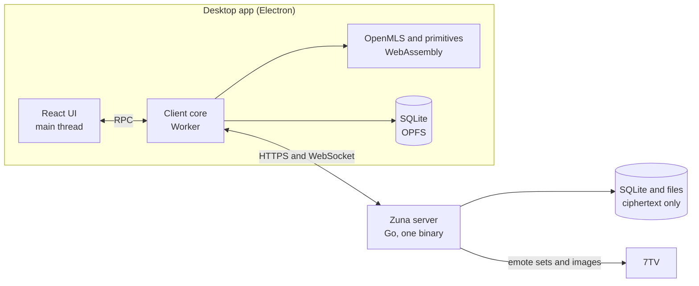
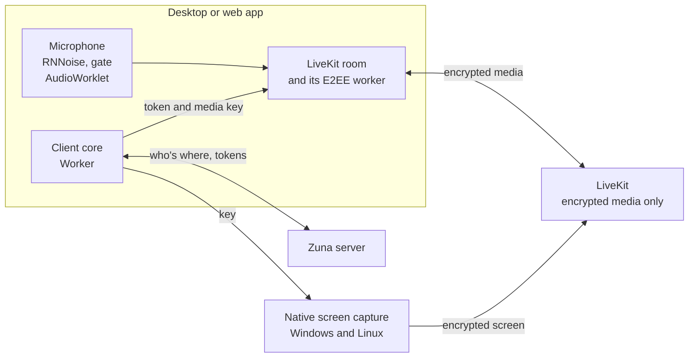

# Architecture



| Part | Location | Technology | Why |
|---|---|---|---|
| Crypto core | `crypto/` | Rust, OpenMLS, WebAssembly | One audited MLS implementation, reusable natively on mobile |
| Client core | `packages/core/` | TypeScript | All protocol logic, independent of any UI, so it can power a mobile app |
| Interface | `packages/ui/` | React, Motion | The desktop's screens, shared with the web app. Each host gives it a `Platform` for what's outside the page |
| Desktop app | `apps/desktop/` | Electron | The same Chromium everywhere: consistent animation, animated emotes and full WebRTC for voice channels |
| Web app | `apps/web/`, `server/cmd/zuna-web` | The same interface in a browser, served by its own Go program | For people who'd rather not install anything, on a host they run themselves (`docs/WEB.md`) |
| Server | `server/` | Go, pure-Go SQLite | A single static binary for every platform, with no dependencies to install |

The core runs in a Worker so that cryptography and database work can never block scrolling or animation. The whole client core runs headless in Node, and the end-to-end tests use it to drive a real server.

## Data model

A server has **users** and **groups**. A group's `kind` is `dm`, `group` or `channel`. A DM is created the first time someone sends a message, and a user's DM with themselves is their saved messages.

The conversation list merges groups with every user on the server, since anyone can message anyone from the start.

Each user has **devices**, and each device is a separate member of every MLS group its user belongs to.

## The server's job

The server is a delivery service and a blob store:

1. **Orders commits.** `POST /api/groups/{id}/commit` carries `expected_epoch`. In one transaction the server checks it against the group's epoch, then advances. If two members commit at once, one gets `409 stale_epoch` and retries from the new state. This is the total ordering MLS requires from a delivery service.
2. **Requires current keys for content.** A message for an old epoch is refused the same way, so an honest sender who hasn't seen a removal can't encrypt with a key the removed person knows. Clients don't rely on this alone: before encrypting, they remove anyone who shouldn't hold the keys, and they refuse messages from a device in an epoch after it left, or that came after their epoch had ended. An edit keeps its message's place, so a change to a message they already hold, from a device they've seen leave, is refused too.
3. **Stores and relays ciphertext.**
4. **Reads the outside of commits.** It can't read MLS content, but it refuses bytes that aren't a commit or group info for this group and epoch, since advancing a group on anything else would strand every member. A commit that gets past this but that nobody can apply is undone by an admin's app, which still holds the last good state: it takes the group back to that epoch, and everyone who never got past it carries on. Nobody has to accept anything new.

## Who holds a group's keys

Each device's MLS credential is a certificate signed by its owner's identity key, naming the key it signs with. Certificates are public, so holding one proves nothing. Clients run one check on every leaf, whenever the tree may have changed and before encrypting: the certificate is signed by the identity key known for that person, for the very signing key the leaf uses, and each device has one leaf. A leaf that fails is removed and warned about.

Epoch keys only ever come from the MLS exporter for the current epoch. A history grant can fill in epochs from before this device joined, if an admin's device signed it, and it never replaces anything. So there's no way to plant a key for an epoch still to come.

## Channels and voice

A **channel** is a group anyone on the server can see and join, made by a server admin. The server lists channels to everyone, with what they're called sealed with the community key, which comes with invite links and which the server doesn't hold, and signed by the device that wrote it.

A device comes into a channel by itself, with an external commit, so it needs nobody else online. On the roster, each person has a **proof** that they hold the community key, worked out from that key, the channel and their user ID, which other members check. Someone without a good proof isn't on the roster as far as members are concerned, so their leaf is stale and gets removed. A server that makes up an account therefore can't get into a channel, or read what any is called.

History comes from whichever member's device gets there first: it seals the channel's older epoch keys to the newcomer, signed, as a history grant. They only ever fill in epochs from before that device joined, like any grant.

A **voice channel** is a channel with a room on [LiveKit](https://livekit.io), which is a server of its own and only sees encrypted media.



**Keys.** A room's key comes straight from the channel's MLS group, for its current epoch, and is kept nowhere:

```
room key   = MLS-Exporter("zuna/voice/v1", epoch, 32)
sender key = HKDF(room key, "zuna/voice/sender/v1|" + identity)
```

Each person's frames are under a key of their own, bound to who they are in the room (`<user>.<device>`), and carry the index of the epoch's key. Everyone in the group can work them all out, but LiveKit can't pass one person's voice off as another's, and a device can listen under a new key before it sends under it. That's how a change goes: whoever comes into the group or is removed from it moves it to a new epoch, every device starts listening under the new key as soon as it hears, and 1.5 seconds later it starts sending under it. Someone removed can go on hearing for those 1.5 seconds.

**Who's there** is what each device tells the Zuna server over its socket, which passes it on to everyone. It's for showing who's in a channel, so it isn't a matter of trust: what a device can do in the room is up to LiveKit, from the token, and what it can hear is up to MLS. A device that goes quiet is taken out after 20 seconds, and being in a channel on a second device ends it on the first.

**The microphone** goes through an AudioWorklet before it's published: RNNoise takes out noise and says how likely each 10 ms is to be speech, and a gate only lets speech through, holding 20 ms back so it opens before a word starts. Past the gate, the track is silent, which costs almost nothing to send. It can go by a level instead, or a key being held. The track stays the same when the device changes, so nothing has to be published again.

**Screens** come from a native program where that's possible, as [SCREEN_SHARE.md](SCREEN_SHARE.md) explains, and from the browser otherwise. Either way a device has to ask first, since being in a room doesn't allow one, and the server's rules decide.

## Sync

Each group has one sequence counter. Everything that changes a group takes the next number.

Sync is state-based. `GET /api/groups/{id}/changes?after=N` returns the current state of every message changed after N, plus commits and roster events, in order. Many edits to a message arrive as one final state, and a client offline for a month catches up as quickly as one offline for a minute.

The socket carries the same rows live. A client applies an item if it's the next number; otherwise it fetches the feed to fill the gap. Message rows are applied either way, because that's safe. Commits only apply in order.

## Staying reliable

MLS state can go wrong: a crash mid-commit, a lost database, a bug. Zuna treats this as normal:

- **One operation at a time.** All MLS work on a group runs under that group's lock.
- **Commits are staged.** A commit only takes effect locally after the server accepts it. A rejected one is cleared.
- **Crash recovery.** Finding our own commit in the feed after a restart means we crashed before merging: if it's still pending, merge it.
- **Self-repair.** A device that can't apply a commit rejoins with an **external commit**, which needs no other member online. It also replaces the device's old place in the group. Past content keys come from the vault, so no history is lost.
- **A reliable outbox.** Sends go to a local queue first and survive restarts, and message IDs are generated by the client, so a retry can't create a duplicate.
- **Reconciliation.** After changes, clients compare the MLS tree with the roster and device list, and remove what shouldn't be there. A random delay lets one client do it; the others see its commit.

## Key hierarchy

```
password --Argon2id--> master --HKDF--> auth key   (proves identity to the server)
                                   \--> wrap key   (decrypts the account key)

recovery key --HKDF--> recovery auth key, recovery wrap key

password or recovery key --> slot key --> slot's secrets (sealed on the server)
                                           \--> account key (sealed to the slot's public key)

account key (random, one per generation)
  |- vault core: identity key, HPKE key, community key, older keys
  \- vault items: every epoch's content key, preferences, verifications, and a manifest
                 listing every pin and verification under a number that only goes up

MLS epoch --exporter--> content key --> messages, reactions, group details, read state, typing

file key (random, per file) --> STREAM-encrypted chunks
```

Each device also has an MLS signing key, certified by the identity key, and a seal key that new account keys are sealed to.

An account's keys are replaced as **generations**, in the background, whenever a device goes or a secret changes. Each publishes a link, signed by the old and new identity keys and by a device, which lists the devices that stay. Older clients go on seeing the first identity key and a signature by it. `docs/ACCOUNT_KEY_ROTATION.md` has the design, and what happens at each step.

History reaches new members with an **HPKE-sealed grant**: an admin seals the group's older content keys to the new member's public key. The new member's device merges them into their vault.

## Local storage

SQLite runs as WebAssembly in the Worker, with files in the origin-private file system. The core encrypts sensitive columns itself with a key derived from the device key in the OS keychain, or in IndexedDB in the web app, which has no keychain. MLS state is stored as an encrypted key-value table, with changes written atomically after each operation.

Search uses an FTS5 table holding keyed hashes of words and their prefixes, which supports prefix search without readable text on disk. A second table counts each message's photos, videos, files, audio files, voice messages and links, for the lists in a chat's details, and marks the ones that mention you or reply to you, for jumping to unread mentions, naming each kind by a keyed hash the same way.

## Emotes

Admins pick one 7TV set. The server fetches it from `7tv.io`, prefetches the images from `cdn.7tv.app`, and serves them under `/api/emotes/{id}/{file}`. Only emotes that have been in the server's set are served, so it can't be used as an open proxy.

Clients know emotes by name. A message records the emotes it uses, so it keeps rendering if the set changes later. A word that exactly matches an emote's name renders as that emote, and typing `:` opens autocomplete. Zero-width emotes draw on top of the previous one.

## Testing

| Layer | Command | What it covers |
|---|---|---|
| Crypto | `npm run test:crypto` | MLS flows and primitives, as WebAssembly under Node |
| Server | `npm run test:server` | HTTP and WebSocket behavior, permissions, epoch ordering |
| Client core | `npm run test:core` | Real clients against a real server: DMs, groups, new devices, recovery, self-repair, attacks |
| Desktop | `node apps/desktop/test/smoke.mjs` | The production build in real Electron |
| Interface | `node apps/desktop/test/ui-check.mjs` | Every screen in real Electron with live bots: chat-open speed, spacing, keyboard focus, plus screenshots for review |
| Sending | `node apps/desktop/test/send-check.mjs` | What each frame paints while messages are sent in real Electron: no jumps or blanks, notices in place, always all the way down |
| Attacks | `node apps/desktop/test/attack-check.mjs` | What a modified client could send, against real Electron: the app stays up, contacts nobody and starts again afterwards |
| Voice | `node apps/desktop/test/voice-check.mjs` | Real apps against a real LiveKit: audio that decrypts on every side, noise kept out, a new key mid-call, cameras, screens both ways, push to talk |

`npm run dev:server` opens a fully set up test server for UI work, using the bots in `packages/core/test/dev-bots.ts`. `CONTRIBUTING.md` describes it.
