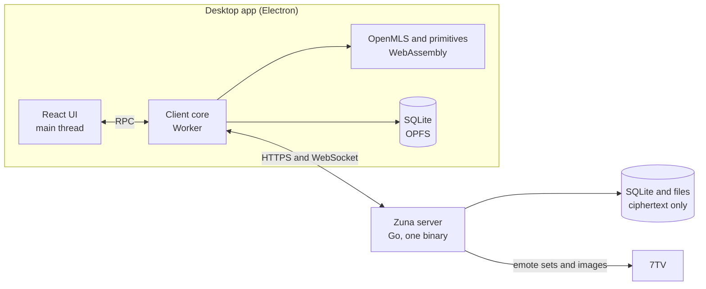

# Architecture



| Part | Location | Technology | Why |
|---|---|---|---|
| Crypto core | `crypto/` | Rust, OpenMLS, WebAssembly | One audited MLS implementation, reusable natively on mobile |
| Client core | `packages/core/` | TypeScript | All protocol logic, independent of any UI, so it can power a mobile app |
| Desktop app | `apps/desktop/` | Electron, React, Motion | The same Chromium everywhere: consistent animation, animated emotes and full WebRTC for future calls |
| Server | `server/` | Go, pure-Go SQLite | A single static binary for every platform, with no dependencies to install |

The core runs in a Worker so that cryptography and database work can never block scrolling or animation. The whole client core runs headless in Node, and the end-to-end tests use it to drive a real server.

## Data model

A server has **users** and **groups**. A group's `kind` is `dm` or `group`. A DM is created the first time someone sends a message, and a user's DM with themselves is their saved messages.

The conversation list merges groups with every user on the server, since anyone can message anyone from the start.

Each user has **devices**, and each device is a separate member of every MLS group its user belongs to.

## The server's job

The server is a delivery service and a blob store:

1. **Orders commits.** `POST /api/groups/{id}/commit` carries `expected_epoch`. In one transaction the server checks it against the group's epoch, then advances. If two members commit at once, one gets `409 stale_epoch` and retries from the new state. This is the total ordering MLS requires from a delivery service.
2. **Requires current keys for content.** A message for an old epoch is refused the same way, so a sender who hasn't seen a removal can't encrypt with a key the removed person knows.
3. **Stores and relays ciphertext.**

## Sync

Each group has one sequence counter. Everything that changes a group takes the next number.

Sync is state-based. `GET /api/groups/{id}/changes?after=N` returns the current state of every message changed after N, plus commits and roster events, in order. Many edits to a message arrive as one final state, and a client offline for a month catches up as quickly as one offline for a minute.

The socket carries the same rows live. A client applies an item if it's the next number; otherwise it fetches the feed to fill the gap. Message rows are applied either way, because that's safe. Commits only apply in order.

## Staying reliable

MLS state can go wrong: a crash mid-commit, a lost database, a bug. Zuna treats this as normal:

- **One operation at a time.** All MLS work on a group runs under that group's lock.
- **Commits are staged.** A commit only takes effect locally after the server accepts it. A rejected one is cleared.
- **Crash recovery.** Finding our own commit in the feed after a restart means we crashed before merging: if it's still pending, merge it.
- **Self-repair.** A device that can't apply a commit rejoins with an **external commit**, which needs no other member online. It also replaces the device's old place in the group. Past content keys come from the vault, so no history is lost.
- **A reliable outbox.** Sends go to a local queue first and survive restarts, and message IDs are generated by the client, so a retry can't create a duplicate.
- **Reconciliation.** After changes, clients compare the MLS tree with the roster and device list, and remove what shouldn't be there. A random delay lets one client do it; the others see its commit.

## Key hierarchy

```
password --Argon2id--> master --HKDF--> auth key   (proves identity to the server)
                                   \--> wrap key   (decrypts the account key)

recovery key --HKDF--> recovery auth key, recovery wrap key

account key (random)
  |- vault core: identity key, HPKE key, community key
  \- vault items: every epoch's content key, preferences, verifications

MLS epoch --exporter--> content key --> messages, reactions, group details, read state, typing

file key (random, per file) --> STREAM-encrypted chunks
```

Each device also has an MLS signing key, certified by the identity key.

History reaches new members with an **HPKE-sealed grant**: an admin seals the group's older content keys to the new member's public key. The new member's device merges them into their vault.

## Local storage

SQLite runs as WebAssembly in the Worker, with files in the origin-private file system. The core encrypts sensitive columns itself with a key derived from the device key in the OS keychain. MLS state is stored as an encrypted key-value table, with changes written atomically after each operation.

Search uses an FTS5 table holding keyed hashes of words and their prefixes, which supports prefix search without readable text on disk.

## Emotes

Admins pick one 7TV set. The server fetches it from `7tv.io`, prefetches the images from `cdn.7tv.app`, and serves them under `/api/emotes/{id}/{file}`. Only emotes that have been in the server's set are served, so it can't be used as an open proxy.

Clients know emotes by name. A message records the emotes it uses, so it keeps rendering if the set changes later. A word that exactly matches an emote's name renders as that emote, and typing `:` opens autocomplete. Zero-width emotes draw on top of the previous one.

## Testing

| Layer | Command | What it covers |
|---|---|---|
| Crypto | `npm run test:crypto` | MLS flows and primitives, as WebAssembly under Node |
| Server | `npm run test:server` | HTTP and WebSocket behavior, permissions, epoch ordering |
| Client core | `npm run test:core` | Real clients against a real server: DMs, groups, new devices, recovery, self-repair, attacks |
| Desktop | `node apps/desktop/test/smoke.mjs` | The production build in real Electron |
| Interface | `node apps/desktop/test/ui-check.mjs` | Every screen in real Electron with live bots: chat-open speed, spacing, keyboard focus, plus screenshots for review |
| Sending | `node apps/desktop/test/send-check.mjs` | What each frame paints while messages are sent in real Electron: no jumps or blanks, notices in place, always all the way down |

`npm run dev:server` opens a fully set up test server for UI work, using the bots in `packages/core/test/dev-bots.ts`. `CONTRIBUTING.md` describes it.
