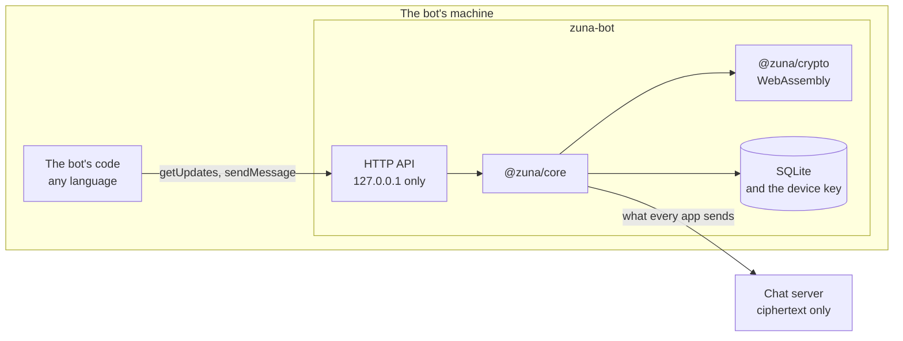

# Bots: plan

Status: being built, a stage at a time. "Stages" says how far it's got.

Scope: bots that are members of the chats they're in, as Telegram's are, made and run by the people on a server. Left for later: bots that see only the commands sent to them, bots in voice, and small programs that run inside a group.

## Summary

- **A bot is an account with its own keys.** It's a member of each chat it's in, like a person, and encrypts and decrypts for itself. The server still reads nothing.
- **A small program runs it: `zuna-bot`.** It holds the client core, as every app does, and gives the bot's author a plain HTTP API on the same machine. Whoever writes a bot never touches MLS.
- **That API is shaped like Telegram's.** `getUpdates`, webhooks, `sendMessage`, buttons. A bot written for Telegram should need little more than a new address.
- **A person makes a bot in Settings and owns it.** There's no central service to ask. The app gives a setup link, and the bot's machine makes the keys, so not even its owner holds them.
- **A bot is listed or private.** Everyone sees a listed bot. Only its owner sees a private one, and whoever is in a chat with it. Other admins don't.
- **Nobody is in a chat with a bot without seeing it.** A bot shows in a chat's members with a badge, always. Private means it can't be found, never that it can't be seen.

## Trust model

This is the part to agree on first.

- **A bot reads everything said in a chat it's in,** from when it was added. The app says so once when someone adds one, and the line in the chat names it as a bot.
- **It gets nothing from before.** Adding a person to a group that shares its history hands them the older keys (`addMembers` in `session/management.ts`). Adding a bot never does.
- **Whichever machine runs a bot can read that bot's chats.** That includes the chat server's own machine, if the bot runs there. `docs/SELF_HOSTING.md` would say so beside the example that runs one.
- **A bot's keys are in a folder.** There's no keychain on a server, so the device key is a file only its user can read, as on Linux without a secret store. Whoever copies the folder is the bot.
- **A bot can't be given a weak password.** It signs up with 32 random bytes nobody sees, so the server guessing passwords, the first limit in `SECURITY.md`, doesn't apply to it.
- **The owner's app knows the bot's key is the real one.** The setup link holds a secret the server never sees. The bot signs its identity key with it, and the owner's app checks that and marks the bot verified, with nothing to compare. Everyone else trusts the first key they see and is warned if it changes, as with people.
- **A bot keeps its own rules.** The server refuses what a bot isn't allowed, and `zuna-bot` refuses it too: it leaves a chat it was added to by someone who isn't allowed to add it. A server that lies can't put a bot where its owner didn't want it.

## How it fits

The core already runs this way. `TestApp` in `packages/core/test/helpers.ts` is the whole client in Node, on `node:sqlite`, and the test server's people in `dev-bots.ts` are built on it. `zuna-bot` is that host made into a program people run.

## Making a bot

What its owner does:

1. **Settings, Bots, New bot.** A name, a username, listed or private, and what it may do.
2. **The app shows a setup link,** once. It works for one use, for an hour.
3. **On the bot's machine:** `zuna-bot init "<link>"`, then `zuna-bot run`, or a container that does both.
4. **The app says the bot is set up** and opens a chat with it. Its picture and description are set from there.

What happens underneath:

- **The server makes a bot that's waiting,** with its owner, its settings and a one-use invite (`POST /api/bots`). Invites already say which role they grant (`grants_role`), and this one says it grants a bot.
- **The link is an invite link with more in it.** The server's address, the invite's code and, in the part that never reaches the server, the community key, the bot's name and the setup secret.
- **`zuna-bot init` signs up through `register` in `account.ts`,** as a person's app does. It makes the identity, account and device keys, publishes key packages, and writes the recovery key to a file beside its data.
- **The owner changes a bot's profile through their chat with it.** A profile is sealed by the account it belongs to, so the owner's app sends the new picture or description to the bot as a message only the owner's are obeyed for, and the bot sets it.

A lost data folder is brought back with the recovery key, as an account is. Without that file, the bot is made again.

## Adding one to a chat

| Where | Who adds it | How |
|---|---|---|
| A direct message | The person, by opening one with it | A bot can't write to anyone first |
| A group | An admin of that group, as for people, if the bot's settings let them | The app says what a bot can read, once. No history goes with it |
| A channel | A server admin, from the bot's settings | The bot joins the channels it was given, and the server refuses any other |

- **A bot can't make a group or a direct message.** The server sees both being made, so it refuses them from a bot (`POST /api/groups`).
- **Who may add a bot is the owner's choice:** only the owner, the server's admins too, or anyone. A private bot is always the first. So a private bot is only ever in groups its owner is an admin of.
- **The server keeps that by refusing the bot's key packages** to anyone else (`POST /api/users/{id}/key-packages/claim`), and the bot keeps it by leaving.
- **Private bots stay out of channels.** Channels are the open places.

## Taking one away

- **Out of a chat:** an admin of the group removes it, as a person.
- **For good:** its owner deletes it. A server admin can delete a listed one, and ban any bot they share a chat with. The server signs it out, and each chat's members remove it before they next encrypt, as they do for anyone banned (`ensureTreeClean`).
- **With its owner:** banning or deleting an account takes its bots with it.

## What a bot may do

A server can only refuse what it sees. What's inside a message is kept by the apps, as a channel's roster is today.

**The server's settings,** beside `allow_member_invites`:

| Setting | Default |
|---|---|
| Who may make listed bots | Server admins, always |
| Whether members may make private bots | No. Admins always may |
| How many bots one person may have | 5 |

**Each bot's settings,** chosen by its owner:

| Permission | Default | Kept by |
|---|---|---|
| Listed or private | Private | The server, in what it lists |
| Who may add it to groups | Its owner | The server and the bot |
| Send files | Yes, within the server's limit | The server |
| Delete others' messages, remove people | No. It needs to be a group's admin, as a person does | The apps and the server, as for people |
| Invites, server settings, making bots | Never | The server |

A bot is never the server's owner or one of its admins. A bot has its own limits on how fast it may send, apart from people's.

## Who sees a bot

| | Listed | Private |
|---|---|---|
| Its owner | Yes | Yes |
| People in a chat with it | Yes | Yes |
| Everyone else on the server | Yes | No |
| Server admins, in the app | Yes | No, unless they share a chat |
| Whoever holds the server's data | That it exists, that it's a bot, its owner, its chats, when it's active | The same |

- **The list of people stays the list of people.** Bots have a section of their own, and a bot someone has written to is in their conversations like any chat.
- **The server leaves a private bot out** of `GET /api/users`, of who's online, and answers as if it didn't exist to anyone who can't see it.
- **A bot shows a badge wherever its name does,** and no last seen.
- **Bots don't count** in how many people a server has.
- **A private bot's name is sealed with the community key,** as every profile is, so a member with a copy of the server's data could read it. "Open questions" has what closing that would take.

This changes a decision `CLAUDE.md` records: everyone on a server can be messaged from the start. It stays true of people and of listed bots. Private bots are the first accounts not everyone sees.

## `zuna-bot`

- **Where:** a new workspace, `apps/bot`. Node 22, `@zuna/core`, the WebAssembly crypto, and `node:sqlite`.
- **One bot, one data folder, one process.** It can trust a server without a domain by its pin, as the installed apps do.
- **What it leaves out:** calls, voice and link previews. A bot fetching every link it's sent would tell those sites where it runs.
- **Its API listens on 127.0.0.1,** with a token from a file in its data folder.
- **Updates are kept until they're taken,** in order, as Telegram's are, so a bot's code can restart without missing any.

The first methods, by Telegram's names:

| For | Methods |
|---|---|
| Receiving | `getUpdates`, `setWebhook`, `deleteWebhook` |
| Sending | `sendMessage`, `sendPhoto`, `sendDocument`, `sendChatAction` |
| Changing | `editMessageText`, `deleteMessage`, `pinChatMessage` |
| Asking | `getMe`, `getChat`, `getChatMember`, `getFile` |
| Commands and buttons | `setMyCommands`, `answerCallbackQuery` |

- **Telegram's IDs are numbers and Zuna's aren't,** so `zuna-bot` keeps a table from one to the other.
- **Text goes both ways** between Telegram's formatting and Zuna's markup, for what both have.
- **What has no place here is refused by name:** payments, inline mode, stickers, games, topics.

## Commands and buttons

- **Commands.** A bot keeps its list in its profile. Typing `/` in a chat it's in offers them.
- **Buttons.** A message can end with rows of buttons. One opens a link, through the same question a link asks. The other sends its data back to the bot.
- **A press goes to the whole chat,** since a chat's messages go to its members, and only the bot acts on it. Other people's apps receive it and show nothing.
- **Both are new parts of a message,** so both go through `validate.ts` before anything shows them.

## What changes where

| Part | Work |
|---|---|
| Server | Whether an account is a bot, its owner and its settings, at the end of both lists of migrations. Routes to make, change and delete one. Leaving private bots out. Refusing what a bot may not do. Its own rate limits |
| Core | Bots in `types.ts`, and with it `Models.swift` and `models.rs`. Making and adding one. No history for a bot. Commands and buttons in `validate.ts` |
| `apps/bot` | The host, the API, the table of IDs, the queue of updates |
| The three interfaces | Settings, Bots. The badge. The question when adding one. The bots section. Commands and buttons. In GPUI, React and SwiftUI |
| Docs | `SECURITY.md` and `docs/SECURITY_DETAILS.md`, `docs/SELF_HOSTING.md`, `.agents/FEATURE_PARITY.md`, and the site once it's built |

## Tests

- **In `packages/core/test`,** with real clients and a real server: a bot is made, set up, added to a group, and answers. It gets no history. A third person and a second admin never learn a private bot exists. Someone who isn't its owner can't add it, and the bot leaves if a server lets them. A bot can't make a group. Deleting it takes it out of its chats. Banning its owner takes it too.
- **In `server/internal/api`:** each route's access, in SQLite and in PostgreSQL.
- **For `zuna-bot`:** a small bot written against a Telegram library runs on it unchanged, through a chat with a test client.

## Stages

Built so far: B0, in the server (`server/internal/api/bots.go`, `server/internal/store/bots.go`) and the core (`// --- Bots ---` in `packages/core/src/session/server.ts`, tested in `packages/core/test/bots.test.ts`), and the core's part of B3: commands in a bot's profile, buttons under its messages, and the press that goes back to it.

| Stage | What | Shows it works |
|---|---|---|
| B0 | Bot accounts, the setup link, who sees them and what they may do, in the server and the core | The core's tests, with `TestApp` as the bot |
| B1 | `zuna-bot`: text, files, edits, updates and webhooks | A Telegram library's echo bot |
| B2 | The three interfaces | Each platform's own checks |
| B3 | Commands and buttons | The same |

## Open questions

1. **Sealing a private bot's profile apart from the community key.** Its name would be hidden from members who hold a copy of the server's data. People in a chat with it still need its name, so each chat would have to carry the bot's own profile key. Worth it?
2. **Who may add a listed bot, by default.** Only its owner is safest. Anyone is what makes a listed bot useful.
3. **Button presses reach everyone's devices** and are only hidden. Is that acceptable, or should a press go to the bot alone, in the direct message with it?
4. **How close to Telegram's API.** Close enough that its libraries work unchanged is the aim. Each method that can't be matched exactly makes that less true.
5. **Read receipts and typing.** A bot shouldn't mark what it reads as read. Should it show as typing when it says it is?
6. **A bot as a group's admin.** Moderation needs it. It also lets a bot add and remove people.
