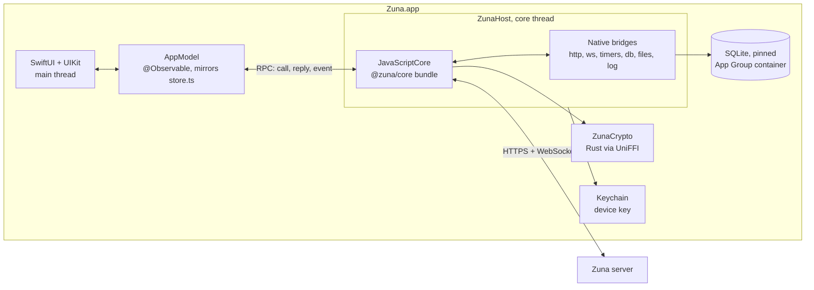

# The iPhone and iPad app

A native app in SwiftUI, with UIKit where SwiftUI falls short, in `apps/ios`. It isn't released yet: each nightly that changes it goes to TestFlight for the team's testers ([RELEASES.md](RELEASES.md)), and [ROADMAP.md](ROADMAP.md) says what's left before it reaches people. This page is its design. How it's tested is in [IOS_TESTING.md](IOS_TESTING.md).

## Summary

- **Native app: SwiftUI, with UIKit where SwiftUI falls short. The protocol is not rewritten:** the existing `@zuna/core` runs unchanged inside JavaScriptCore on iOS. All MLS, envelope, vault, outbox, sync and self-repair logic stays one implementation, covered by the existing end-to-end tests.
- **Cryptography is the same Rust crate**, compiled natively for iOS and exposed to Swift through UniFFI. JavaScriptCore on iOS has no JIT, so WebAssembly isn't an option, and native code is faster anyway.
- **A phone is one more device on an account:** it signs in with the password, joins each group with an external commit and downloads history from the vault. What the server does for phones alone is push notifications ("Notifications").
- **Signing:** the paid Apple Developer team `SGKB9R23YT`, automatic signing, bundle ID `chat.zuna.mobile`, App Group `group.chat.zuna.mobile`, shared Keychain access group `SGKB9R23YT.chat.zuna.shared`.

## Architecture



### Cryptography: Rust through UniFFI

- **The crate** keeps what only WebAssembly uses under `[target.'cfg(target_arch = "wasm32")'.dependencies]`, its WebAssembly bindings in `wasm.rs`, and `staticlib` among its crate types.
- **`crypto/src/native.rs`** exposes through UniFFI what `wasm.rs` exposes: the primitives, hybrid signatures, HPKE, the emoji check's digest, and an `MlsClient` object with every method, its state behind a `Mutex`, as UniFFI requires `Send + Sync`. Errors are `Result`s, so they surface as exceptions, which the core relies on.
- **`scripts/build-crypto-apple.mjs`** builds an XCFramework for `aarch64-apple-ios`, `aarch64-apple-ios-sim` and `aarch64-apple-darwin`. The macOS slice lets the whole host run headless in tests.
- **In the core bundle**, `@zuna/crypto` is aliased to a small JavaScript shim with the same exports. It calls native functions through the JavaScriptCore C API, passing typed arrays without copying through JSON. `MlsClient` becomes a JS class wrapping a native handle. `takeChanges()`, `commitChanges()` and the other methods keep their exact return shapes.

### Core runtime: ZunaHost

- **One `JSContext` on a dedicated thread** with its own run loop. Every JS call, timer and network callback is delivered on that thread, so the core keeps the single-threaded behavior it was written for, as in the web app's Worker.
- **The core bundle:** `apps/ios/core-bundle/entry.ts`, built with esbuild into a resource of `ZunaHost`. It contains:
  - the polyfills;
  - the crypto shim, a `DbProvider` and a `FileAdapter` that call native bridges;
  - a boot handler that creates `ZunaClient`;
  - `serveCore` from `rpc.ts`, attached to a native-backed port.

| Needed by the core | Provided by |
|---|---|
| `fetch`, `AbortSignal.timeout` | JS wrapper over a native `URLSession` bridge, with binary bodies, a timeout and errors mapped to `ApiError(0)` |
| `WebSocket` | JS class over an `NWConnection` from Network.framework, with the same events and close codes. `URLSession` can't pass on a custom close code such as 4401, which signs a removed device out |
| timers, `queueMicrotask` | native `DispatchSourceTimer` on the core thread |
| `TextEncoder`/`TextDecoder`, `atob`/`btoa` | native bridge for speed, JS fallback |
| `URL`, `URLSearchParams` | bundled polyfill |
| `console` | `os_log`, subsystem `chat.zuna`, category `core` |
| `LocalDb` | synchronous native bridge to SQLite |
| files | `FileAdapter`: range reads from file URLs, decrypted output written to protected files |

- **JavaScriptCore itself provides** what the core uses from the language: `String.prototype.normalize`, Unicode property escapes and lookbehind in regexes, `BigInt` with `DataView`, `Intl`. Golden parity tests check them against V8 (see [IOS_TESTING.md](IOS_TESTING.md)).
- **Performance:** there's no JIT on iOS, so the core runs interpreted, on its own thread apart from the interface, where it can't cause dropped frames. On a Mac at interpreter speed, signing in and syncing 10,000 messages took 10.3 s, about 1 ms a message to decrypt, verify, store and index; opening a chat 17 ms, a search 1 ms, and Argon2id 98 ms natively.

### Storage

- **SQLite amalgamation** at a pinned version (`scripts/fetch-sqlite.mjs`), vendored as a C target with FTS5, so as not to depend on the system's SQLite for `contentless_delete`, which needs 3.43 or later.
- **The `LocalDb` bridge** behaves like `packages/ui/src/core/sqlite.ts`:
  - synchronous calls, nested transactions through a depth counter;
  - BLOBs returned as `Uint8Array`;
  - multi-statement `run` for migrations.
- **Files live in the App Group container**, protected with `NSFileProtectionCompleteUntilFirstUserAuthentication` and excluded from backups. Without the device-only key they're useless anyway.

### Device key and unlocking

Decided on 2026-10-31: **the Zuna password is asked for once after every restart of the phone**, and at no other time. Built in `DeviceLock.swift`, `DeviceKeyStore.swift` and `CoreController.swift`.

- **On disk the device key exists only sealed with a password.** Each account signed in on the device gets its own copy, sealed with a key derived from that account's password: Argon2id with 64 MiB and 3 iterations, a local salt, then HKDF and XChaCha20-Poly1305. So any of the accounts' passwords unlocks the app. These copies live in `device-lock.json` in the data directory.
- **After unlocking**, the key goes into the Keychain (`AfterFirstUnlockThisDeviceOnly`, shared access group), tagged with the current boot session (`kern.bootsessionuuid`, with the boot time as a fallback). Reopening the app during the same boot session doesn't ask. After a restart of the phone, the session no longer matches: the copy is deleted and the unlock screen appears.
- **The lock follows the accounts automatically.** The core bundle reports every sign-up, sign-in, recovery and password change, with the new password, and every sign-out, including ones the server forces (`AccountEvent`). The app adds, replaces or removes that account's copy. Nothing in the UI has to remember to do it.
- **Forgot the password:** the unlock screen offers to erase the device's data and sign in again with a new password or the recovery key. The account and its history stay on the server.
- **No accounts left:** without a lock there's nothing to protect, so the app starts clean with a new key.
- **Visible before unlocking:** `device-lock.json` holds usernames, server addresses and server names unencrypted, because the unlock screen shows them. Everything else stays encrypted.
- **Effect on notifications:** until the password has been entered after a restart, an extension can't decrypt anything, so notifications in that window can only say that a message arrived. Afterwards they can show content.
- **Optional app lock:** Face ID, Touch ID or the device passcode each time the app opens, on top of the above. It locks the interface only. While locked, the app switcher shows a blurred cover.
- **App Store detail:** the boot-time fallback is one of Apple's "required reason" APIs, so the app ships a privacy manifest declaring it.
- **Device name:** "iPhone" or "iPad". It travels encrypted in the vault and shows under Settings → Devices on other devices.

### UI and state

- **`ZunaModels`:** Codable mirrors of `packages/core/src/types.ts`. Drift is caught automatically by the tests.
- **`CoreConnection`:** the Swift side of `connectCore`, giving async methods for the client and each session, plus a stream of events.
- **`AppModel`** (`@Observable`) mirrors `packages/ui/src/state/store.ts`: per-server state, message lists, debounced refreshes, typing expiry, upserts, jump targets, drafts, toasts.
- **Navigation** (decided with the user on 2026-10-31):
  - The layout follows Telegram for iOS: the chat list, chat screen, bubbles, input bar, context menus and settings lists.
  - Servers are listed like Mail's mailboxes (changed from a Discord-like drawer on 2026-10-31, at the user's request for something more native to iOS). With more than one server, the Chats tab starts at the list of servers, with the newest message and unread count on each, and a server's chats are pushed over it; the server opened last opens again at launch. With one server, the Chats tab opens on its chats, and joining another is in the menu under the server's name.
  - The bottom tab bar has Channels, Chats and Settings.
  - iPad: the same structure in a `NavigationSplitView`: the servers in the sidebar when there's more than one, the conversations beside them, and the open chat.
- **Look:**
  - the web's dark theme from `tokens.css`, with its five accents and three message sizes, scaled with Dynamic Type;
  - system fonts (SF Pro, SF Mono) rather than the web's Inter, as Telegram does on iOS;
  - no light theme (decided with the user on 2026-10-31); chat wallpapers are an open question.
- **Where UIKit is used:**
  - the message list: `UICollectionView` with a diffable data source, anchored to the bottom, loading older pages without jumps;
  - message text: TextKit 2 with attachments for inline emotes (animated, zero-width stacking), spoilers, links and mentions;
  - the composer: a growing `UITextView` with autocomplete and image paste;
  - context menus: `UIContextMenuInteraction` with a reaction bar.
- **Platform features:** PhotosPicker, document picker, QuickLook, AVPlayer, the share sheet, haptics.
- **Third-party dependencies:** none.
  - Animated WebP uses ImageIO (frames and delays from `CGImageSource`).
  - Code blocks use Shiki inside a second JavaScriptCore context, with its JavaScript regex engine and the web's themes and languages, so highlighting matches exactly.
- **Logic that must match the web exactly is ported to Swift and held to the web's output by golden tests:**
  - the markup parser and `jumboSize`;
  - mention and emote extraction (they decide how a message renders for everyone else);
  - preview text.

### Files and media

The core gets a `FileAdapter` instead of using `Blob` directly:

```ts
interface FileAdapter {
  size(source: unknown): number;
  type(source: unknown): string;
  read(source: unknown, start: number, end: number): Promise<Uint8Array>;
  assemble(parts: Uint8Array[], mime: string): Promise<unknown>;
}
```

- **The default implementation uses `Blob`,** for the web and the tests.
- **Decrypted media on iOS** go to `Caches/decrypted/` with `NSFileProtectionComplete`. The cache is capped (LRU, 300 entries) and cleared at launch and on signing out of a server. The web app keeps them in memory only, but AVPlayer and QuickLook need files, which `SECURITY.md` says.
- **Media formats the other apps can read:**
  - iPhone photos are HEIC, which Chromium can't show. They're converted to JPEG before sending, keeping `width`, `height` and the 48 px JPEG `thumb` exactly like the desktop's `prepareFile`.
  - iPhone videos are HEVC in `.mov`. They're exported as H.264 MP4.
  - WebM, Ogg or Opus sent from a desktop can't be played by AVPlayer. They show as a file card with save and share.
  - WebP (images, 7TV emotes, desktop avatars) displays through ImageIO.
  - Avatars and server icons are sent as 256 px JPEG or PNG with the correct `mime`. The desktop renders those.

### Lifecycle and connectivity

- **Going to the background:** a background task gives the outbox and the current upload up to about 30 seconds, then `client.suspend()` closes sockets and stops timers.
- **Returning:** `resume()` reconnects and runs `syncAll`. "Updating" shows until it's done.
- **The network coming back** (`NWPathMonitor`) calls `nudge()`, like the desktop's `online` event.
- **An upload interrupted by the app being killed** shows "Not sent. Try again" through the existing `markStaleSendsFailed`.
- **Marking messages as read** requires an active app with the chat on screen, the equivalent of `windowFocused`.

### Links

- **`zuna://join?link=…`** is registered in `CFBundleURLTypes`. The server's invite page already produces it, and `parseInviteLink` already reads it. Universal links can't work for arbitrary self-hosted domains.
- **Links in messages** (`http(s)` only) open in Safari, like `shell.openExternal`.
- **Development:** the core allows plain HTTP only for loopback addresses, so the simulator reaches a local server at `127.0.0.1`. A physical device needs an HTTPS tunnel; the rule in the core isn't loosened. Debug builds allow local networking in ATS.

## Project layout

```
apps/ios/
  project.yml                 XcodeGen spec; the .xcodeproj is generated and not committed
  Zuna/                       app: SwiftUI screens, UIKit message list, text and composer
  ZunaNotifications/          notification service extension
  ZunaShare/                  share extension
  ZunaBroadcast/              broadcast extension, for sharing the screen before iOS 27
  ZunaUITests/                XCUITest, TestKit (peers, launcher), A11y identifiers
  ZunaKit/                    SwiftPM package, iOS 18 and macOS
    ZunaCryptoFFI             binary target: Rust XCFramework
    ZunaCrypto                UniFFI Swift bindings
    CSQLite                   pinned SQLite amalgamation with FTS5
    ZunaHost                  JavaScriptCore runtime, bridges, RPC, control server (test builds only)
    ZunaModels                Codable mirrors of types.ts
    ZunaMarkup                Swift ports checked against the web (markup, previews, mentions, emotes)
    zuna-host                 macOS executable running the host headless, for tests
  core-bundle/                esbuild entry for JavaScriptCore
```

The app needs iOS 18.

## What building it found

- **`JSObjectGetTypedArrayBytesPtr` points at the start of the buffer, not the view,** so the bridge adds the view's offset. The core slices buffers constantly.
- **`UITextView` with TextKit 2 asks attachments for view providers but never shows their views,** so message text is a small TextKit 2 view that draws the text itself and places emotes' views at `frameForTextAttachment`, wrapping, animating and stacking zero-width ones.
- **ImageIO decodes 7TV's animated WebP,** with frames, timing and transparency, so there's no third-party image library.
- **The web's Shiki setup runs in JavaScriptCore,** with its regex engine targeting ES2018, and its tokens match the web's for every language. The first TypeScript block takes about 190 ms while the grammar compiles.
- **A plain `JSContext` on macOS runs at interpreter speed,** as a phone does without a JIT, so `zuna-host` stands in for one in the tests.

## Notifications

Notifications show the message content, as the owner asked from the start, without the server, the relay or Apple seeing it. Messages are encrypted with the epoch's content key, a symmetric key exported from MLS, so the extension can decrypt them without touching MLS state, while the app may be running too.

- **The relay** (`zuna-push`, in `server/cmd/zuna-push`) runs at `https://relay.zuna.chat`, which the app and servers use by default, with the APNs key of the owner's Apple Developer account once it's set there. How to run one: [PUSH_RELAY.md](PUSH_RELAY.md).
- **A push carries only identifiers,** encrypted: the group and message IDs, sealed with a key the device gave the server. The phone fetches the message itself.
- **Muted chats:** the owner applies to Apple for the notification filtering entitlement (`com.apple.developer.usernotifications.filtering`). It's needed for development, TestFlight and App Store builds alike. Until Apple grants it, the phone gives each server the list of its muted chats, and the server skips them, so mentions in muted chats don't notify. Once it's granted, the list goes, and the extension decides, as the desktop does.
- **Reply and Mark as read** work from a notification, even with the app in the background: it resumes the core, sends through the outbox, marks the chat read, and closes its connections again.

### How it works

1. **Registration.** The app gets an APNs token and registers it with the relay, which returns a handle: the token sealed with the relay's own key, so the relay stores nothing. The app gives each of its servers the handle, the relay's address and a random push key, and updates them when the token changes. Signing out, being banned or removing the device deletes the registration.
2. **A new message** (not an edit, reaction or read receipt) makes the server push to every device of the other members, skipping muted chats while that list exists. The payload is the group and message IDs, sealed with the device's push key. The server only talks to relays its configuration allows.
3. **The relay** opens the handle and sends an APNs alert with `mutable-content`, the sealed payload, and a generic fallback text. APNs answers that a token is gone, and the relay tells the server, which drops the registration.
4. **The Notification Service Extension** opens the payload, fetches the message from the server with the device's session, checks the sender's signature, decrypts it with the content key from the local database, or, for an epoch the app slept through, with the key MLS gives once the commits that led there are applied to a copy of the group's state in memory (`follow` in `packages/core/src/push.ts`), and shows the title and text the desktop would show, from the same core function. Notifications are grouped by chat, carry the sender's picture (Communication Notifications), and set the badge.
5. **Fallbacks:** after a restart of the phone, until the password is entered, "New message" with the server's name; when the message can't be fetched after a few tries, or can't be read with what the device holds or can follow to, as from a device that signed in since the app last ran, "New message" with the chat's name and picture.
6. **Who sees what:** the server, what it sees today plus the push registrations (and the muted list until the entitlement); the relay, a handle, the server's address, timing and the size of a sealed payload; Apple, the token, timing and the sealed payload.

### The extension

- **The core fits.** The extension runs the app's own core bundle in JavaScriptCore, without booting a client: `previewPush` (packages/core/src/push.ts) reads only the rows it needs, never writes, fetches the one message and decrypts it. A process doing exactly that, without JIT as on a phone, peaks at about 12.6 MB, against the extension's 24 MB. The cross-client tests run it beside a running host on every run (`zuna-host --preview-push`).
- **Same words as the desktop:** the session's `notify` event and the push preview share `notificationText`, and core tests check that a pushed message reads exactly as the connected session's notification, with mutes, mentions, your own messages and unreadable ones.
- **The extension** (`ZunaNotifications`) shares the App Group container and the Keychain group with the app. It shows the push's own generic text when the device key is locked, and keeps it for muted or hidden messages until the filtering entitlement arrives.
- **Sender pictures:** notifications are laid out as conversations (Communication Notifications, `INSendMessageIntent`), as in Messages and Telegram: the sender's picture with Zuna's icon in its corner, and in a group the group's name and picture, with the message itself below. The core downloads and decrypts the pictures with the preview, unless notifications show nothing. A Debug-only command has the app build the same notification, since `simctl push` skips the extension, and a UI test looks at a DM's and a group's.

### Where notifications go

As in Telegram (`System::countTiming` in Telegram Desktop, with its server's default timings), a device in use notifies at once. One that isn't waits 30 s while the person is on another device, or was in the last 5 minutes and more recently than on this one, and 1.5 s while they use both, and doesn't show what they read meanwhile. The server holds a phone's push the same way, and lets it go when the chat is read or the message deleted (`pushWait` in `hub.go`, `waitingPushes` in `push.go`), and clients do it in the core (`notificationDelay` in `notify.ts`). **In use** is Telegram Desktop's on a computer: the window has focus and there was input in the last 30 s, 5 s after it loses focus it isn't, and locking the screen ends it at once. On the phone it's the app on screen. Devices tell the server over their socket, and it tells each person's other devices.

- **Read or deleted elsewhere:** the server sends a silent push, sealed like the others, to the phones that showed a notification for that chat, and they clear it. iOS delivers silent pushes when it can, so the app also clears notifications of chats with nothing unread, and of deleted messages, once it has caught up with the server.

### What keeps a notification from going missing, or staying

Found on 2026-11-09, after notifications went missing on phones, or stayed once read elsewhere:

- **The app went by whether it was on screen.** It showed a message itself in front and left it to the push in the background, while the server pushes by whether it takes the phone to be in use. The two differ for a moment as the app leaves the screen, when the server pushed nothing and the app showed nothing, and they differ the other way while another server's chats are open, when the message showed twice. The core now says with each `notify` whether the server took the device to be in use as the message came (`inUse`, from the server's `activity` frames, which come in order with the messages), and `showLive` goes by that. A device the server still took to be in use notifies as one in use, at once or after 1.5 s, not after the 30 s of one put away, which the app wouldn't be running for.
- **A chat read on another device kept its notification** in four cases. The phone had shown it itself, which the server didn't count: it does now. The server had restarted, which forgot what it had pushed: it's kept with the registration (`push_registrations.notified`). The silent push overtook the message's own on its way to Apple, or arrived while the extension was still fetching the message, so it cleared nothing: a phone's pushes now go out one after another, and the app clears what a silent push names again 2 s and 5 s later. Or iOS never handed the silent push over, as it doesn't to an app its person closed, with Background App Refresh off, in Low Power Mode, or past its budget for them. For that the phone asks the server which chats it still counts it as showing (`GET /api/push/notified`, `notifiedChats` in `push.ts`) and clears the rest (`PushStore.clearRead`), whenever something wakes it: a silent push, or the extension for the next message, which iOS runs whatever state the app is in. Until then such a notification stays. Only Apple's filtering entitlement would take it away at once: the clearing would go as an alert that the extension drops.
- **A silent push handed over late cleared a newer message's notification.** It now says when the chat was read, and a notification says when its message was sent (`sentAt`), both by the server's clock, so what came after the read stays.
- **Pushes went missing on the server.** One held back for someone at another device was dropped by a restart: a server that's stopping sends them as it goes. One the relay didn't take, as while it restarts, was dropped without a word: it's sent again, twice, and the server logs what the relay refused, since the relay's own log only has what reached it and Apple then refused.
- **A server that couldn't be loaded for a moment lost its push key** (`PushStore.keep`), so its pushes showed as "New message" without a sound until it registered again. The key is kept by where the device is signed in.

None of it has run on a phone: the simulator gets no silent push, and `simctl push` skips the extension.

## On the App Store

- **Export compliance:** the app uses only standard, published algorithms beyond the system's own (MLS through OpenMLS, AES-256-GCM, XChaCha20-Poly1305, Ed25519, X25519, HKDF-SHA256, Argon2id). Apple then needs documentation only for the App Store in France: a declaration to ANSSI. So `ITSAppUsesNonExemptEncryption` is `NO`, and France stays out of the app's availability (decided 2026-10-31). Offering it there means filing that declaration, uploading it to App Store Connect, and setting the key to `YES` with the `ITSEncryptionExportComplianceCode` Apple gives. A yearly self-classification report to the US government may also apply; that's the owner's to check.
- **The AGPL.** GPL-family code distributed through the App Store is widely considered incompatible with Apple's terms (VLC is the known case): the App Store's usage rules and DRM count as further restrictions, which section 10 of the AGPL forbids. The usual fix is an extra permission for app stores under section 7, granted by every copyright holder, which is still to come. All third-party code in the app (MIT, BSD, Apache-2.0, MPL-2.0, public domain) is compatible with the AGPL and raises no App Store issue.
