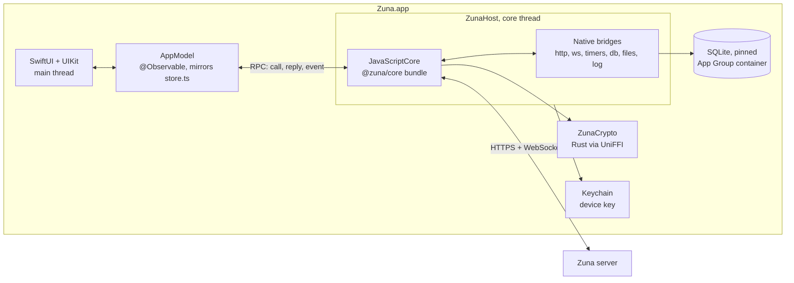

# iOS app: plan

Status: agreed direction, not started. Scope: feature parity with the 0.1 desktop app, **without notifications** (system notifications, sounds, previews and the icon badge). Testing is described in [IOS_TESTING.md](IOS_TESTING.md).

## Summary

- **Native app: SwiftUI, with UIKit where SwiftUI falls short. The protocol is not rewritten:** the existing `@zuna/core` runs unchanged inside JavaScriptCore on iOS. All MLS, envelope, vault, outbox, sync and self-repair logic stays one implementation, covered by the existing end-to-end tests.
- **Cryptography is the same Rust crate**, compiled natively for iOS and exposed to Swift through UniFFI. JavaScriptCore on iOS has no JIT, so WebAssembly isn't an option, and native code is faster anyway.
- **The server needs no changes**, apart from two optional environment variables that let tests use a fake 7TV. A phone is one more device on an account: it signs in with the password, joins each group with an external commit and downloads history from the vault.
- **Changes to existing code are small and backward compatible:**
  - Rust: target-specific dependencies and a UniFFI module next to the WASM bindings.
  - Core: a `FileAdapter` instead of `Blob`, plus `suspend()`/`resume()` for the iOS lifecycle.
  - Nothing changes in the data the server sees.
- **Conventions:** code, commits, UI text and docs in English. Work happens directly on `main`, one commit per finished, tested feature, never pushed without asking.
- **Signing:** the paid Apple Developer team `SGKB9R23YT`, automatic signing, bundle ID `chat.zuna.mobile`, App Group `group.chat.zuna.mobile`, shared Keychain access group `SGKB9R23YT.chat.zuna.shared`.

## How Zuna works

| Layer | Where | Role |
|---|---|---|
| Crypto | `crypto/` (Rust, OpenMLS) | MLS (RFC 9420), Argon2id, HKDF, XChaCha20-Poly1305, STREAM for files, Ed25519, HPKE, the digest for emoji verification. `mls.rs` and `primitives.rs` don't depend on the WASM bindings in `lib.rs`. |
| Client core | `packages/core` (TypeScript) | The whole protocol: accounts, REST, the socket, one `ServerSession` per server, the encrypted search index, and the RPC boundary to the UI (`rpc.ts`). |
| Desktop | `apps/desktop` | Electron shell (window, tray, Keychain via `safeStorage`, `zuna://` links, notifications). React UI. The core runs in a Worker with SQLite WASM on OPFS. |
| Server | `server/` (Go) | Orders commits per group, stores and relays ciphertext, files, 7TV emotes, invites, administration. |

What matters for a new platform:

- **The core needs little from its host:**
  - a synchronous `LocalDb`, a 32-byte device key, a device name and an event callback;
  - the globals `fetch`, `WebSocket`, timers, `TextEncoder`/`TextDecoder`, `atob`/`btoa`, `URL` and `AbortSignal.timeout`;
  - `Blob`, which goes away with the `FileAdapter`.
- **The UI talks to the core only through RPC calls and `CoreEvent`s.** Swift can be the UI side of that same protocol.
- **Local data is encrypted by the core**, so the local database format is a private detail of each platform.
- **Sync works from a feed of current state.** An app woken after a week catches up as quickly as after a minute, which suits iOS, where the socket doesn't survive in the background.

## Architecture



### Cryptography: Rust through UniFFI

- **`crypto/Cargo.toml`:**
  - dependencies used only by WASM (`wasm-bindgen`, `js-sys`, `console_error_panic_hook`, the `js` feature of `openmls` and `getrandom`) move under `[target.'cfg(target_arch = "wasm32")'.dependencies]`;
  - `lib.rs` bindings go behind `#[cfg(target_arch = "wasm32")]`;
  - `staticlib` is added to `crate-type`.
- **New `crypto/src/native.rs`** exposes through UniFFI exactly what `lib.rs` exposes:
  - `randomBytes`, `argon2id`, `hkdfSha256`, `sha256`;
  - `aeadSeal`/`aeadOpen`, `streamSeal`/`streamOpen`;
  - `signingKeygen`, `sign`, `verify`, `hpkeKeygen`, `hpkeSeal`/`hpkeOpen`, `safetyDigest`;
  - an `MlsClient` object with every method. Its state sits behind a `Mutex`, because UniFFI requires `Send + Sync`.
  - Errors are `Result`s, so they surface as exceptions: the core relies on those.
- **`scripts/build-crypto-apple.mjs`** builds an XCFramework for `aarch64-apple-ios`, `aarch64-apple-ios-sim` and `aarch64-apple-darwin`. The macOS slice lets the whole host run headless in tests.
- **In the core bundle**, `@zuna/crypto` is aliased to a small JavaScript shim with the same exports. It calls native functions through the JavaScriptCore C API, passing typed arrays without copying through JSON. `MlsClient` becomes a JS class wrapping a native handle. `takeChanges()`, `commitChanges()` and the other methods keep their exact return shapes.

### Core runtime: ZunaHost

- **One `JSContext` on a dedicated thread** with its own run loop. Every JS call, timer and network callback is delivered on that thread, so the core keeps the single-threaded behavior it was written for, just like in the desktop Worker.
- **The core bundle:** `apps/ios/core-bundle/entry.ts`, built with esbuild into a resource of `ZunaHost`. It contains:
  - the polyfills;
  - the crypto shim, a `DbProvider` and a `FileAdapter` that call native bridges;
  - a boot handler that creates `ZunaClient`;
  - `serveCore` from `rpc.ts`, attached to a native-backed port.

| Needed by the core | Provided by |
|---|---|
| `fetch`, `AbortSignal.timeout` | JS wrapper over a native `URLSession` bridge, with binary bodies, a timeout and errors mapped to `ApiError(0)` |
| `WebSocket` | JS class over `URLSessionWebSocketTask`, with the same events and close codes (4401 included) |
| timers, `queueMicrotask` | native `DispatchSourceTimer` on the core thread |
| `TextEncoder`/`TextDecoder`, `atob`/`btoa` | native bridge for speed, JS fallback |
| `URL`, `URLSearchParams` | bundled polyfill |
| `console` | `os_log`, subsystem `chat.zuna`, category `core` |
| `LocalDb` | synchronous native bridge to SQLite |
| files | `FileAdapter`: range reads from file URLs, decrypted output written to protected files |

- **JavaScriptCore itself provides** what the core uses from the language: `String.prototype.normalize`, Unicode property escapes and lookbehind in regexes, `BigInt` with `DataView`, `Intl`. Golden parity tests check them against V8 (see [IOS_TESTING.md](IOS_TESTING.md)).
- **Performance:** there is no JIT on iOS, so the core runs interpreted. The core thread is separate from the UI, so this can't cause dropped frames. Sync time is measured in F0.

### Storage

- **SQLite amalgamation** at the same version as the desktop's `@sqlite.org/sqlite-wasm` (3.54), vendored as a C target with FTS5. This avoids depending on the system SQLite version for `contentless_delete`, which needs 3.43 or later.
- **The `LocalDb` bridge** behaves like `packages/ui/src/core/sqlite.ts`:
  - synchronous calls, nested transactions through a depth counter;
  - BLOBs returned as `Uint8Array`;
  - multi-statement `run` for migrations.
- **Files live in the App Group container**, protected with `NSFileProtectionCompleteUntilFirstUserAuthentication` and excluded from backups. Without the device-only key they're useless anyway.

### Device key and unlocking

Decided on 2026-10-31: **the Zuna password is asked for once after every restart of the phone**, and at no other time. Built in `DeviceLock.swift`, `DeviceKeyStore.swift` and `CoreController.swift`.

- **On disk the device key exists only sealed with a password.** Each account signed in on the device gets its own copy, sealed with a key derived from that account's password: Argon2id with 64 MiB and 3 iterations, a local salt, then HKDF and XChaCha20-Poly1305. So any of the accounts' passwords unlocks the app. These copies live in `device-lock.json` in the data directory.
- **After unlocking**, the key goes into the Keychain (`AfterFirstUnlockThisDeviceOnly`, shared access group), tagged with the current boot session (`kern.bootsessionuuid`, with the boot time as a fallback). Reopening the app during the same boot session doesn't ask. After a restart of the phone, the session no longer matches: the copy is deleted and the unlock screen appears.
- **The lock follows the accounts automatically.** The core bundle reports every sign-up, sign-in, recovery and password change, with the new password, and every sign-out, including ones the server forces (`AccountEvent`). The app adds, replaces or removes that account's copy. Nothing in the UI has to remember to do it.
- **Forgot the password:** the unlock screen offers to erase the device's data and sign in again with a new password or the recovery key. The account and its history stay on the server.
- **No accounts left:** without a lock there's nothing to protect, so the app starts clean with a new key.
- **Visible before unlocking:** `device-lock.json` holds usernames, server addresses and server names unencrypted, because the unlock screen shows them. Everything else stays encrypted.
- **Effect on notifications (later):** until the password has been entered after a restart, an extension can't decrypt anything, so notifications in that window can only say that a message arrived. Afterwards they can show content.
- **Optional app lock** (F7): Face ID, Touch ID or the device passcode each time the app opens, on top of the above. It locks the UI only. While locked, the app switcher shows a blurred cover.
- **App Store detail:** the boot-time fallback is one of Apple's "required reason" APIs, so the app ships a privacy manifest declaring it.
- **Device name:** "iPhone" or "iPad". It travels encrypted in the vault and shows under Settings → Devices on other devices.

### UI and state

- **`ZunaModels`:** Codable mirrors of `packages/core/src/types.ts`. Drift is caught automatically by the tests.
- **`CoreConnection`:** the Swift side of `connectCore`, giving async methods for the client and each session, plus a stream of events.
- **`AppModel`** (`@Observable`) mirrors `packages/ui/src/state/store.ts`: per-server state, message lists, debounced refreshes, typing expiry, upserts, jump targets, drafts, toasts.
- **Navigation** (decided with the user on 2026-10-31):
  - The layout follows Telegram for iOS: the chat list, chat screen, bubbles, input bar, context menus and settings lists.
  - Servers are listed like Mail's mailboxes (changed from a Discord-like drawer on 2026-10-31, at the user's request for something more native to iOS). With more than one server, the Chats tab starts at the list of servers, with the newest message and unread count on each, and a server's chats are pushed over it; the server opened last opens again at launch. With one server, the Chats tab opens on its chats, and joining another is in the menu under the server's name.
  - The bottom tab bar has "Chats" and "Settings". "Calls" comes later, when calls exist.
  - iPad: the same structure in a `NavigationSplitView`: the servers in the sidebar when there's more than one, the conversations beside them, and the open chat.
- **Look:**
  - the desktop's dark theme from `tokens.css`, with its five accents and three message sizes, scaled with Dynamic Type;
  - system fonts (SF Pro, SF Mono) rather than the desktop's Inter, as Telegram does on iOS;
  - no light theme (decided with the user on 2026-10-31); chat wallpapers are an open question.
- **Where UIKit is used:**
  - the message list: `UICollectionView` with a diffable data source, anchored to the bottom, loading older pages without jumps;
  - message text: TextKit 2 with attachments for inline emotes (animated, zero-width stacking), spoilers, links and mentions;
  - the composer: a growing `UITextView` with autocomplete and image paste;
  - context menus: `UIContextMenuInteraction` with a reaction bar.
- **Platform features:** PhotosPicker, document picker, QuickLook, AVPlayer, the share sheet, haptics.
- **Third-party dependencies:** none planned.
  - Animated WebP uses ImageIO (frames and delays from `CGImageSource`).
  - Code blocks use Shiki inside a second JavaScriptCore context, with its JavaScript regex engine and the desktop's themes and languages, so highlighting matches exactly.
  - Both are proven in F0.
- **Logic that must match the desktop exactly is ported to Swift and held to the desktop's output by golden tests:**
  - the markup parser and `jumboSize`;
  - mention and emote extraction (they decide how a message renders for everyone else);
  - preview text.

### Files and media

The core gets a `FileAdapter` instead of using `Blob` directly:

```ts
interface FileAdapter {
  size(source: unknown): number;
  type(source: unknown): string;
  read(source: unknown, start: number, end: number): Promise<Uint8Array>;
  assemble(parts: Uint8Array[], mime: string): Promise<unknown>;
}
```

- **The default implementation uses `Blob`**, so the desktop and existing tests behave exactly as before. `Api.updateIcon` takes bytes.
- **Decrypted media on iOS** go to `Caches/decrypted/` with `NSFileProtectionComplete`. The cache is capped (LRU, like the desktop's 300 entries) and cleared at launch and on signing out of a server. The desktop keeps them in memory only, but AVPlayer and QuickLook need files. This difference goes into `SECURITY.md`.
- **Compatibility of media formats with the desktop:**
  - iPhone photos are HEIC, which Chromium can't show. They're converted to JPEG before sending, keeping `width`, `height` and the 48 px JPEG `thumb` exactly like the desktop's `prepareFile`.
  - iPhone videos are HEVC in `.mov`. They're exported as H.264 MP4.
  - WebM, Ogg or Opus sent from a desktop can't be played by AVPlayer. They show as a file card with save and share.
  - WebP (images, 7TV emotes, desktop avatars) displays through ImageIO.
  - Avatars and server icons are sent as 256 px JPEG or PNG with the correct `mime`. The desktop renders those.

### Lifecycle and connectivity

- **Going to the background:** a background task gives the outbox and the current upload up to about 30 seconds, then `client.suspend()` closes sockets and stops timers.
- **Returning:** `resume()` reconnects and runs `syncAll`. "Updating" shows until it's done.
- **The network coming back** (`NWPathMonitor`) calls `nudge()`, like the desktop's `online` event.
- **An upload interrupted by the app being killed** shows "Not sent. Try again" through the existing `markStaleSendsFailed`.
- **Marking messages as read** requires an active app with the chat on screen, the equivalent of `windowFocused`.

### Links

- **`zuna://join?link=…`** is registered in `CFBundleURLTypes`. The server's invite page already produces it, and `parseInviteLink` already reads it. Universal links can't work for arbitrary self-hosted domains.
- **Links in messages** (`http(s)` only) open in Safari, like `shell.openExternal`.
- **Development:** the core allows plain HTTP only for loopback addresses, so the simulator reaches a local server at `127.0.0.1`. A physical device needs an HTTPS tunnel; the rule in the core isn't loosened. Debug builds allow local networking in ATS.

## Changes to the repository

| Where | Change | Effect on the desktop |
|---|---|---|
| `crypto/` | dependencies per target, `cfg`, `staticlib`, `native.rs` with UniFFI | none; the WASM build is identical |
| `packages/core` | `FileAdapter`, `suspend()`/`resume()` | none; the `Blob` default keeps behavior, and `npm run test:core` stays green |
| `server/internal/emotes`, `cmd/zuna-server` | optional `ZUNA_7TV_API`, `ZUNA_7TV_CDN` for tests | none unless set |
| `apps/ios/` (new) | XcodeGen spec, app, `ZunaKit` package, core bundle, UI tests | – |
| `tests/e2e/` (new) | cross-client scenarios: desktop core against the iOS host | – |
| `scripts/` | `build-crypto-apple.mjs`, `ios-e2e.mjs`, `crypto-vectors.mjs`, fixture generation | – |
| `.github/workflows` | macOS job running the iOS checks | – |
| `docs/` | this plan, the testing plan; updates to `ROADMAP.md` and `SECURITY.md` | – |

## Project layout

```
apps/ios/
  project.yml                 XcodeGen spec; the .xcodeproj is generated and not committed
  Zuna/                       app: SwiftUI screens, UIKit message list, text and composer
  ZunaUITests/                XCUITest, TestKit (peers, launcher), A11y identifiers
  ZunaKit/                    SwiftPM package, iOS 18 and macOS
    ZunaCryptoFFI             binary target: Rust XCFramework
    ZunaCrypto                UniFFI Swift bindings
    CSQLite                   pinned SQLite amalgamation with FTS5
    ZunaHost                  JavaScriptCore runtime, bridges, RPC, control server (test builds only)
    ZunaModels                Codable mirrors of types.ts
    ZunaMarkup                Swift ports checked against the desktop (markup, previews, mentions, emotes)
    zuna-host                 macOS executable running the host headless, for tests
  core-bundle/                esbuild entry for JavaScriptCore
```

Minimum iOS version: 18 (proposed).

## Feature parity

### Accounts and servers

| Desktop | iOS | Phase |
|---|---|---|
| Join with an invite link, with a preview (icon, name, member count); join an open server by address | start screen with a Paste button; `zuna://` links | F2 |
| Set up a new server: owner account, then the server's name (or skip) | same | F2 |
| Sign up: display name, username suggested and validated (`^[A-Za-z0-9_][A-Za-z0-9_.-]{1,31}$`), password of 10+ characters with the strength meter (score 2+) | same, with iOS password AutoFill | F2 |
| Recovery key: grouped display, Copy, Save as file, confirmation | Copy, and the share sheet with `zuna-recovery-key.txt` | F2 |
| Sign in; "Forgot your password?" leads to recovery with the key and a new password | same | F2 |
| Several servers, switching, unread counts per server (muted excluded) | list of servers | F3 |
| Sign out of a server and erase its local data | settings | F7 |
| Signed out by the server (banned, session ended, device revoked): toast and removal | same | F3 |
| Connection state: "Connecting", "Waiting for network", "Updating" | in the list and chat headers | F3 |
| Security alerts from the core (new device, changed key, unsigned device) | security toasts, shown longer | F3 |

### Conversation list

| Desktop | iOS | Phase |
|---|---|---|
| Everyone on the server as a conversation, groups, "Saved messages" | same | F3 |
| Order: pinned, activity, title; rows animate to new places | animated diffable updates | F3 |
| Row: avatar with online dot, group icon, verified or changed-key mark, muted icon, time, preview ("You:", sender's first name in groups, Photo, Video, Voice message or file name, "Membership changed", "Waiting for keys"), "typing…", pin, unread badge (grey when muted) | same | F3 |
| Muting for 1 hour, 8 hours, 1 day or until unmuted, from the chat's menu and its details; "Muted until …" | a menu, and a dialog from the swipe action and the details' switch | Later |
| Filters All, People, Groups, Unread | segmented control | F3 |
| Search people and groups by title and username, and messages in the local index (2+ characters), jumping to a hit | searchable list | F3, F4 |
| Pin, Mute, Hide, synced through the vault | swipe actions and a context menu | F3 |
| "Hidden (n)" section | same | F3 |
| Server menu: Invite people, New group, Server settings (admins), Leave this server | header menu | F6, F7 |
| Empty states with actions | same | F3 |

### Chat: reading

| Desktop | iOS | Phase |
|---|---|---|
| Header: title, verified mark, status (who's typing, members and online count, notes to yourself, removed from the server, online, last seen or hidden) | same | F4 |
| Banner when a contact's key changed, with Verify | same | F4 |
| List: virtualized, day separators, grouping by sender within 5 minutes, avatar on the last message of a group, name colors, loading older messages, jumping to a message with a highlight, detached view around a target with a way back, scroll-to-bottom button with unread count, scroll position remembered per chat, scrolling to own sent messages, new messages animating in, marking as read at the bottom, bottom anchored while the composer grows | `UICollectionView` | F4 |
| Markup: inline code, spoilers revealed by a tap, bold, strikethrough, italic with `*` or `_`, http(s) links, @mentions (highlighted, own ones stand out, a tap opens verification), `>` quotes, fenced code with language, highlighting and Copy | Swift parser checked against the desktop, TextKit rendering, Shiki tokens | F4 |
| 7TV emotes: inline, animated, zero-width stacked on the previous one, large emoji or emote-only messages (up to 6 words and 8 glyphs, two sizes), emote card with name, author and who reacted | ImageIO animation; the card opens on long press instead of hover | F4 |
| Meta: pin mark, "edited", time, ticks (clock, failed, sent, read from `readBy`) | same | F4 |
| States: deleted, "Waiting for this message's keys", invalid signature | same | F4 |
| Reply quote with author; a tap jumps to the original | same | F4 |
| "Forwarded from" with the author on the same server, a tap opens them; only "Forwarded" from another server | same | Later |
| Link preview card: site, title, description, picture beside the text or below it when wide; opens the link | same | Later |
| Attachments: grid of 1 to 4 images with blurred thumbnail and fixed size, upload progress ring, full-screen viewer that zooms and pans, with Save; videos with the frame the sender took (or their first frame, up to 20 MB) and never playing by themselves; audio on tap; files downloaded and decrypted, with a progress bar while they go up | pictures in a viewer that zooms and closes with a drag, as in Telegram; videos and files in QuickLook; share sheet | F4 |
| Voice messages: play and pause, a waveform that fills as it plays and seeks on a click, the time; one plays at a time | AVAudioPlayer, playing even with the phone set to silent | Later |
| Reactions: emoji or emote chips, avatars of up to 3 people, otherwise a count; names | same | F4 |
| System messages: 8 kinds, warnings with an icon | same | F4 |

### Chat: writing and actions

| Desktop | iOS | Phase |
|---|---|---|
| Composer: draft per conversation, grows with content, placeholder, disabled when the other person is banned | `UITextView` | F5 |
| Sending through the outbox: local echo, "sending", retry or discard, survives restarts | from the core | F5 |
| Reply and edit, with a context bar and cancel | plus swipe to reply | F5 |
| Autocomplete for `:emote` (2+ characters, prefix matches first, up to 8, author) and `@person` (group members or everyone, not banned) | bar above the keyboard | F5 |
| Picker: server emotes tab named after the set, emoji by category, search, name and author | bottom sheet | F5 |
| `emotes` and `mentions` extracted into the message body | Swift port checked against the desktop | F5 |
| Typing signal (throttled by the core) | same | F5 |
| Attachments: up to 10 files, preview, size, removal, server size limit, progress; paste and drag files | PhotosPicker, document picker, paste; drag and drop on iPad | F5, F8 |
| Message actions: quick reactions (👍 ❤️ 😂 🔥 😮 😢) and the full picker, Reply, Forward, Copy text, Edit (own text messages that weren't forwarded), Pin or Unpin, Try again or Discard, Delete for everyone (own messages, or group admins) | native context menu with a reaction bar | F5 |
| Forwarding: chats on every server, this one first, with search; sends at once and opens the chat | sheet; sends at once and says where it went, as Telegram does on the phone | Later |
| Picking several messages from the menu ("Select"), with a bar in place of the composer: Copy (with authors and times), Forward (in the chat's order), Delete for everyone (when all are yours, or you're a group admin) | a tap picks; deleting asks first | Later |
| Recording voice messages: the microphone in place of Send when the composer is empty, a click to start, Send or Enter to send, Delete or Escape to throw away, a live level; AAC in MP4 | hold to record and let go to send, slide left to throw it away, as in Telegram | Later |
| Link previews while writing: the first link's page fetched on this device after a pause, a bar with the title and picture and a way to remove it; edits keep theirs | pages fetched natively without cookies, pictures shrunk with ImageIO | Later |
| Pinned messages: nothing above the chat; a button in the header opens the list, with Unpin, and a pin jumps to its message | a pin button in the bar pushes the list | F5 |
| Search in a chat with a note when history is still downloading | a sheet over the chat | F5 |
| Keyboard: Enter, Ctrl+Enter, Esc, Up to edit the last message; "Press Enter to send" | hardware keyboards; on the software keyboard Return inserts a new line | F8 |

### Details, groups and verification

| Desktop | iOS | Phase |
|---|---|---|
| DM details: avatar, name, @username, online or last seen, bio; encryption card leading to verification; Notifications (mute), Pin, Hide | details screen. Mute stays even without notifications: it's synced and affects unread counts | F6 |
| Group details: avatar and name with description (admins edit), what the server can see, members (admins first, crown, verified), adding people (admins), member menu (Message, Verify, Make or remove admin, Remove), "New members can read earlier messages" (admins), Leave group, Delete group for everyone (admins) | same | F6 |
| New group: name, people with search, history for new members | sheet | F6 |
| Add members, with history shared when enabled | sheet | F6 |
| Invites: expiry (1, 7, 30 days, never), uses (1, 5, 25, unlimited), create and copy, active links with copy and revoke, a note when members can't invite | plus the share sheet | F6 |
| Emoji verification: 16 emoji with names, three states, "They match", "They don't match", "Remove verification", own key | same | F6 |

### Settings and administration

| Desktop | iOS | Phase |
|---|---|---|
| Profile: avatar (change, remove), display name, bio | photo picker with a square crop | F7 |
| Privacy: read receipts (synced), "Show when I'm online"; link previews, on this device | same | F7 |
| Appearance: accent (5), message size (S, M, L), reduce motion, Enter sends | stored on the device; reduce motion also follows the system setting | F7 |
| Security: own key, devices (current first, names, dates, remove), change password, new recovery key | same | F7 |
| About: version, license, links to the source and the security model, server version | same | F7 |
| – (new on iOS) | App lock with Face ID, Touch ID or passcode on every launch; privacy cover in the app switcher | F7 |
| Server administration (owner and admins): icon (256 px square), name, address, version; invites with "Let members create invite links" and "Open sign-ups" (with the community key warning); members with roles, ban and unban; 7TV emote set with a preview; upload limit and retention; signing out with local data erased | same | F7 |
| Notifications (section, sound, previews, badge) | through a push relay and a Notification Service Extension; see "Notifications" | N1–N6 |
| Keep running when closed (tray), title bar, resizable sidebar | don't apply on iOS | – |

## Phases

| Phase | Scope | Size |
|---|---|---|
| **F0. Spike** | Install the toolchain and get the desktop's `npm test` green on this Mac. XCFramework with UniFFI. The core bundle running in `zuna-host` and in the simulator: sign up, sign in, send and receive with the test server. SQLite bridge with FTS5. Syncing 10,000 messages with the JIT off. Animated WebP through ImageIO. Prototype message list with inline animated emotes in TextKit. Shiki in JavaScriptCore. Ends with a short report and decisions. | M |
| **F1. Foundations** | Test infrastructure first (see IOS_TESTING.md). `FileAdapter` and `suspend()`/`resume()` in the core. Complete `ZunaHost`, models, `CoreConnection`, `AppModel`, theme and fonts, boot and failure screens, lifecycle, CI job. | L |
| **F2. Onboarding and accounts** | Accounts and servers, except signing out | S |
| **F3. Servers and conversation list** | server drawer, list, filters, search, row actions, connection state, alerts | M |
| **F4. Chat: reading** | message list, markup, emotes, media, reactions, ticks, system messages | L |
| **F5. Chat: writing and actions** | composer, autocomplete, picker, attachments, message actions, pins, search in a chat | L |
| **F6. Groups, invites, verification** | details screens, new group, add members, invites, verification | M |
| **F7. Settings and administration** | every settings section except notifications, server administration | S |
| **F8. Finishing** | iPad layout and keyboard, accessibility (VoiceOver, Dynamic Type), performance, polish, TestFlight preparation | M |

Each phase is done when its features work **against a desktop client in both directions**, with tests as described in IOS_TESTING.md.

## F0 results (2026-10-31)

The spike is done; every question it set out to answer has an answer backed by a test.

| Question | Result | Decision |
|---|---|---|
| Does the Rust crate build natively? | Yes, for iOS devices, the simulator and macOS, without code changes. The desktop's generated JavaScript bindings are byte for byte the same as before. | UniFFI it is. `npm run build:ios` builds the XCFramework. |
| Does the unchanged core run in JavaScriptCore? | Yes. The bundle is 328 KB. 10 of 10 cross-client scenarios pass against the desktop's core, both with `zuna-host` and with the real app in the simulator. | Keep the core unchanged behind the RPC boundary. |
| Bridge pitfalls | `JSObjectGetTypedArrayBytesPtr` points at the start of the buffer, not the view, so the offset has to be added; the core slices buffers constantly. URLSession can't pass on custom WebSocket close codes such as 4401, which signs a removed device out. | Bridge tests cover the offset. WebSockets use Network.framework, and the sign-out test proves 4401 arrives. |
| Performance without a JIT | A plain `JSContext` on macOS runs at interpreter speed (85 ms for a loop V8 runs in 15 ms; `JSC_useJIT` changes nothing), so it stands in for a device. Signing in and syncing 10,000 messages takes 10.3 s, about 1 ms per message (decrypt, verify, store, index). Opening a chat takes 17 ms, a search 1 ms, Argon2id (64 MiB) 98 ms natively. | No separate worker is needed: the core already runs on its own queue. Show "Updating" during a first sync. Measure on an iPhone at the first L7 check. |
| Inline animated emotes | `UITextView` with TextKit 2 asks attachments for view providers but never shows their views. A small TextKit 2 view that draws the text itself and places views at `frameForTextAttachment` works, including wrapping, animation and zero-width stacking. | Message text uses that view (`EmoteTextLabel` in the spike). |
| Animated WebP | ImageIO decodes 7TV-style animated WebP with frames, timing and transparency, and `CGAnimateImageAtURLWithBlock` plays it. | No third-party image library. |
| Code highlighting | The desktop's Shiki setup runs in JavaScriptCore. With the regex engine targeting ES2018, tokens match the desktop for all six languages tested. The first TypeScript block takes about 190 ms while the grammar compiles. | Shiki in its own `JSContext`, off the main thread, with a cache. |
| Signing and storage | Built with team `SGKB9R23YT`. In the simulator, the device key is stored in the shared Keychain group and the databases live in the App Group container. | As planned. A physical device still needs a provisioning profile through automatic signing. |

Found along the way:

- The server limits each person to about 15 messages a second (burst of 60). Only test seeding notices this; the benchmark uses ten senders.
- A new device reads a group's earlier messages only if one of that person's devices filed the group's keys in the vault. That's the protocol's normal behavior, and the benchmark scenario now respects it.

Carried into F1:

- `FileAdapter` and `suspend()`/`resume()` in the core;
- Swift 6 language mode for `ZunaHost` and `ZunaControl` (they use Swift 5 mode for now);
- linking `ZunaControl` into Debug builds only, with a CI check on the Release binary;
- the remaining `test.` hooks, TestKit for XCUITest, the result summaries;
- an app icon without transparency (App Store requirement).

The message list itself (`UICollectionView`) moves to the start of F4: its riskiest part, the text, is settled.

## F1 results (2026-10-31)

F1 is done. Each item has tests:

- **Core:** `FileAdapter`, `suspend()`/`resume()` (desktop unchanged, 44 core tests pass).
- **iOS host:**
  - files read from disk and decrypted into the protected cache;
  - the app lifecycle: background task, then suspend; resume; network watch;
  - `ZunaModels` and `CoreConnection` with the drift check;
  - Swift 6 mode throughout `ZunaKit`.
- **Test infrastructure:**
  - control channel hooks (offline, crash after a server response, movable clock, access to internals);
  - fake 7TV with committed emote fixtures;
  - XCUITest with TestKit, peers and the `ui-run` orchestrator writing summaries with screenshots;
  - the Release guard.
- **App state and frame:**
  - `AppModel`, the counterpart of the desktop's store, applying the core's events in order on the main actor;
  - the theme from the desktop's tokens, with system fonts; appearance settings kept on the device;
  - Chats and Settings tabs, the server drawer, and a chat list with live data, as decided under "UI and state";
  - `plainText` in Swift for previews, checked against the core.
- **Crypto (L1):** the native build against WebAssembly, run where the core calls it: in the host's JavaScript context, through the Swift bridge and UniFFI. It covers derived keys and digests, sealed data both ways, tampering, signatures, HPKE, and MLS between a desktop and a phone (Welcome, commits both ways, an external join, restoring persisted state, removal).
- **Checks and CI:**
  - `npm run test:ios:check` runs L0 to L2 in about a minute, with the app built with warnings as errors;
  - `npm run test:ios:all` runs everything;
  - an `ios` job in `.github/workflows/ci.yml` runs on macOS. It hasn't run on GitHub yet, since nothing is pushed.
- **Results:**
  - 16 cross-client scenarios pass against the app in the simulator, 15 against `zuna-host`;
  - 11 crypto cross tests, 20 `ZunaKit` tests and 6 UI tests pass.
- **Bugs found and fixed by these tests:**
  - a lost unlock entry if the app closed right after a sign-in;
  - the control channel reading key order;
  - a leak of a test hook into Release;
  - a deprecated API and two other warnings, found by building with warnings as errors.
- **App icon:** square, without an alpha channel.

The golden corpus for markup moves to F4, where the Swift parser is written.

## F2 results (2026-10-31)

F2 is done. Each item has tests:

- **Join flow:** the same steps as the desktop, laid out like Telegram's sign-in. They're the first screens, and a sheet from the drawer's "+" for another server:
  - the welcome screen with the invite link field and a Paste button;
  - joining with a preview (icon, name, member count), or setting up an unclaimed server as its owner;
  - the recovery key in groups, with Copy (kept off Universal Clipboard, cleared after 5 minutes), Save as file through the share sheet, and the confirmation;
  - naming a new server, or skipping;
  - sign in, and "Forgot your password?" leading to recovery with the key and a new password.
- **Rules ported to Swift:** the username suggestion, its validation and the password strength meter, checked against the desktop's functions.
- **AutoFill:** fields carry their content types, so iOS offers a strong password and to save it.
- **Links:** `zuna://join?link=…` opens the join screens, also while the app is locked (the link waits for the unlock) or already signed in.
- **Tests:** 5 UI tests (join, sign in with a wrong password first, recover, links, set up a second server from the drawer); the world now has a second, unclaimed server. 23 `ZunaKit` tests.

## F3 results (2026-10-31)

F3 is done, except the server menu (see below). Each item has tests:

- **Conversation list:**
  - search by title and username, with message hits from the local index from two characters on (opening a hit comes with the chat in F4);
  - the All, People, Groups and Unread filters, as a segmented control;
  - Pin from a leading swipe, Mute and Hide from a trailing swipe, all three in the context menu, synced through the vault; only the changed list is sent, so another device's change to the others isn't undone;
  - the "Hidden (n)" section, and empty states;
  - rows move to their new places with an animation, unless Reduce motion is on.
- **Connection state** in the title ("Connecting…", "Updating…", "Waiting for network…").
- **Signed out by the server:** a toast and the server's removal, back to the welcome screens when it was the last one. Toasts now show over every screen.
- **Security alerts:** shown as security toasts, which stay 12 seconds instead of 4.5.
- **Bugs found and fixed by these tests:**
  - the server could close a banned or revoked device's connection before sending the reason, so the client reported a plain sign-out (fixed in the server, with a Go test);
  - the host's offline test hook dropped requests and sockets without telling the core, which then believed it was still online.
- **Moved:** the server menu goes to F6, with its first item (Invite people). Its other items come with F6 (New group) and F7 (Server settings, Leave), so a menu now would have nothing in it.
- **Tests:** 5 UI tests (filters and search, row actions, connection state, removal by the admins, the new-device alert), 16 UI tests in all.

## F4 results (2026-10-31)

F4 is done. Each item has tests:

- **Chat screen:** the title with its status (who's typing, members and online, notes to yourself, removed from the server, online, last seen), the banner when a contact's key changed, empty states, and the tab bar hidden, as in Telegram.
- **Message list:** a `UICollectionView` turned upside down, as chat apps do, with SwiftUI cells:
  - day separators, grouping by sender within five minutes, avatars on the last message of a group in groups, name colors;
  - older pages load out of sight as you scroll up, so nothing jumps; new messages slide in at the bottom;
  - jumps to a reply's original, a search hit or a message out of range, with a highlight and a detached window with a way back;
  - the button back to the newest message with the unread count, the position remembered per chat, marking as read at the bottom while the app is active.
- **Markup:** a Swift parser checked against the desktop's own renderer through a golden corpus, drawn by a TextKit 2 label: inline code, spoilers revealed by a tap, bold, strikethrough, italics, links, @mentions (your own stand out), quotes, and fenced code.
- **Code blocks:** colored by the desktop's Shiki setup with every desktop language, in a JavaScriptCore context of its own, checked token for token against the desktop; Copy.
- **7TV emotes:** inline and animated through ImageIO with each frame's own timing, zero-width emotes over the one before, large emoji and emote-only messages, and the emote card on a long press.
- **Bubbles:** your own on the right in the accent's color; the time tucked into the last line, with the pin mark, "edited" and ticks (sending, failed with "Try again", sent, read); deleted, waiting for keys and invalid signature; reply quotes; the eight kinds of system message.
- **Attachments:** pictures in a grid of up to four, sized up front, with the blurred thumbnail until the picture is decrypted; videos, recordings and files as cards; everything opens in QuickLook under its own name, with Share and Save.
- **Reactions:** chips with the emoji or emote, avatars of up to three people or a count, inside the bubble beside the time; a tap toggles yours.
- **Bugs found on the desktop by the golden corpus, fixed there:** words like "toString" rendered as broken emotes, and a lone digit, "#" or "*" showed as a large emoji.
- **Tests:** 6 UI tests (markup and emotes with the emote card and a reply, sent and read ticks both ways, a picture from the desktop opened in QuickLook, reactions both ways, history with the saved position, a search hit); golden files for markup and highlighting; 27 `ZunaKit` tests.
- **For later:** VoiceOver reads the upside-down list newest first; F8 orders it. Tapping a mention and the banner's Verify button open verification, which comes in F6.

## F5 results (2026-10-31)

F5 is done; the hardware keyboard's shortcuts stay with F8. Each item has tests:

- **Composer:** laid out like Telegram's (attach, the text growing up to six lines with the emoji button inside, send in the accent's color), a draft per conversation, the desktop's placeholder, and a bar instead when the other person was removed from the server. Return on a hardware keyboard sends, Shift-Return makes a new line.
- **Sending** goes through the core's outbox: the local echo, "sending", Try again or Discard, kept across restarts. `emotes` and `mentions` go into the message body exactly as the desktop's composer puts them; a test compares what the desktop receives.
- **Reply and edit** with the context bar and Cancel; swiping a message to the left answers it, as in Telegram.
- **Autocomplete** above the field: `:emote` from two characters, prefix matches first, up to eight, with the author; `@person` from the group's members or everyone, not banned.
- **Picker** as a sheet: the server's emotes under the set's name, the desktop's emoji by category (copied from the desktop and kept in step by a test), and search.
- **Typing signals** on every change; the core throttles them.
- **Attachments:** up to ten from the photo picker, the document picker, or a picture on the clipboard; previews, sizes and removal before sending; sizes, the blurred preview and a recording's length recorded as the desktop does; pictures the desktop can't show (HEIC) sent as JPEG; the server's size limit and upload progress from the core.
- **Message menu** on a long press: the six quick reactions in a row and the full picker, Reply, Copy text, Edit (your text messages), Pin or Unpin, Try again or Discard, Delete for everyone (your messages, or a group's admins).
- **Pinned bar** under the title, cycling through the pins; **search in a chat** with the note while history downloads; **the pinned list** with Unpin. Both open from the chat's menu under the avatar, until the details screen comes in F6.
- **Bugs found and fixed:** none in shared code this time; the tests caught their own ordering assumptions and a SwiftUI task on an empty `Group` that never ran.
- **Tests:** 4 UI tests (markup, emotes and mentions as the desktop receives them; reply by swipe, edit and delete; pin, react, search and unpin; a picture and a file); a Debug-only hook adds files to the composer, so tests don't go through the system's pickers.

## F6 results (2026-10-31)

F6 is done. Each item has tests that check the desktop's side too:

- **Details**, pushed from the chat's title or its menu, laid out like Telegram's profile pages:
  - for a person: the picture, name, @username, online or last seen, bio, the encryption card leading to verification, and Notifications (mute), Pin to top, Hide from list;
  - for a group: the picture (admins change it), name and description (admins edit them), what the server can see, the members with admins first, crowns and verified marks, and each member's menu (Message, Verify security key, Make or remove admin, Remove from group); for admins, adding people and "New members can read earlier messages"; Leave group and Delete group for everyone, both confirmed.
- **New group** from the button beside the server's name or its menu: the name, people with search, and history for newcomers; the group opens when created.
- **Invites** from the server's menu: expiry and uses as on the desktop, the new link with Copy and Share, active links with copy and revoke, and the note when members can't invite.
- **Verification** from the details, a mention or the changed-key banner: the sixteen emoji with names, the three states, "They match", "They don't match", "Remove verification", and your own key.
- **Group pictures** go up as 256-pixel squares, as the desktop's `prepareAvatar` makes them, in WebP when the system can write it and JPEG otherwise.
- **An argument left out** of a call now travels as `{"$undefined": true}`, since JSON's null can mean something else: in `updateGroupMeta`, null removes the picture, so turning history on must not send it.
- **Tests:** 4 UI tests (the sixteen emoji on the phone match the desktop's and verification is kept; a group created, members added, promoted and removed, renamed and deleted, each seen by the desktop peers; an invite link the desktop can read until it's revoked; muting from the details).

## F7 results (2026-10-31)

F7 is done, except notifications, which come later. Each item has tests:

- **Settings**, laid out like Telegram's: your profile on the active server at the top, then Privacy and Security for that server, Appearance and App lock for the device, Server settings for owners and admins, signing out, and About.
- **Profile:** the picture (picked and cut to a 256-pixel square, or removed), display name and bio, seen by the desktop.
- **Privacy:** read receipts (synced) and "Show when I'm online", seen by the desktop.
- **Appearance:** the accent, message size, Reduce motion (also on when the system's is), and Return sends on a hardware keyboard.
- **Security:** your key, devices with this one first and removal, changing the password (the device lock follows, so the new password unlocks after a restart and the old one doesn't), and a new recovery key.
- **App lock** (new on iOS): Face ID, Touch ID or the passcode each time the app opens; turning it on asks first, so nobody locks themselves out; the chats aren't drawn at all while it waits, and a cover hides them in the app switcher.
- **Server settings:** the picture and name, address and version; invite links, "Let members create invite links" and "Open sign-ups" with its warning; members with roles, ban (confirmed) and unban; the 7TV emote set with a preview; the upload limit and retention.
- **Sign out** of a server, confirmed, erasing its local data and its entry in the device lock.
- **Tests:** 5 UI tests (profile and privacy on the desktop; the password change through a restart; signing out; administration as the owner, with a ban; App lock with the simulator's Face ID, which the orchestrator enrolls and drives).

## F8 results (2026-10-31)

F8's technical part is done; TestFlight waits on the decisions below.

- **iPad:** the conversations beside the open chat (marked in the list) with its details filling the rest (`NavigationSplitView`), and Settings from the list's toolbar. Files dragged onto a chat go into the composer.
- **Hardware keyboards,** as on the desktop: Return sends and Shift-Return makes a new line (or Return makes lines and Command-Return sends, if "Return sends" is off), Escape cancels an edit or reply, Up in an empty message edits your last one, and the arrows and Tab pick a suggestion.
- **VoiceOver** reads the upside-down message list top to bottom, as it looks, rather than newest first.
- **Dynamic Type:** a screen tour at the largest accessibility sizes checks that the list, the chat with its composer, and settings stay usable.
- **Tests:** an iPad layout test (run with `ZUNA_E2E_SIMULATOR="Zuna E2E iPad"`, and skipped on the iPhone) and a large-text tour; 36 UI tests pass on the iPhone and the iPad test on the iPad.

## Servers like Mail's mailboxes (2026-10-31)

The Discord-like drawer gave way to something more native to iOS, as the user asked:

- **The list of servers** is the Chats tab's first screen once there are two or more: each server's picture, name, newest message and unread count, or how it's connecting while it isn't. Edit reorders them (synced to the core's order, as dragging on the desktop's rail is), "+" joins another, and a long press offers Invite people and Sign out.
- **One server** opens straight on its chats; "Join a server" is in the menu under its name.
- **The server opened last** opens again at launch, with "Servers" as the way back. Signing out of the open server goes back to the list.
- **Settings** has a picker for the server the account's sections are for, when there's more than one.
- **iPad:** the servers in the sidebar of a three-column `NavigationSplitView` when there's more than one, two columns otherwise.
- **Tests:** a one-server test (no list, the menu with "Join a server"), the second-server test now checks the list, reopening the last server and the Settings picker, and an iPad test of the sidebar with a third server from the test world.

## Prerequisites on this Mac

Installed on 2026-10-31:

- Xcode 27.1 with iOS 27 simulators;
- Node 26, Go 1.27, XcodeGen 2.46, `webp` (all through Homebrew);
- Rust 1.99 through Homebrew's `rustup`, with targets `wasm32-unknown-unknown`, `aarch64-apple-ios`, `aarch64-apple-ios-sim` and `aarch64-apple-darwin`;
- `wasm-bindgen-cli` 0.2.130, matching `crypto/Cargo.lock`.

Homebrew's `rustup` is keg-only and isn't on the default `PATH`. Scripts that call `cargo` should prepend `/opt/homebrew/opt/rustup/bin` and `~/.cargo/bin` themselves.

Baseline, all green:

- `npm run build:crypto`;
- `npm test`: 15 crypto tests, server tests, 43 core end-to-end tests;
- `npm run typecheck`;
- `cargo test` natively on macOS.

The crate already cross-compiles for `aarch64-apple-ios` and `aarch64-apple-ios-sim` without changes. The target-specific dependencies planned for F1 are for cleanliness, not a blocker.

## Waiting on the owner's decisions

Work that needs a decision was set aside, as agreed, so the rest could go on:

1. **App Store requirements that need new server features:** deleting an account from the app (guideline 5.1.1(v)), and reporting content and blocking people (guideline 1.2). Until then, TestFlight with internal testers or ad hoc builds only.
2. **AGPL-3.0 on the App Store** (see risk 3): the project moved from AGPL-3.0 to GPL-3.0 and back to AGPL-3.0 on 2026-10-31. Distributing through the App Store still needs an extra permission under section 7 of the AGPL from both authors, or another decision.
3. **Signing and TestFlight:** done on 2026-10-31 at the owner's go-ahead. Version 1.0.0, build 10, was archived with Xcode's automatic signing (`-allowProvisioningUpdates`) and uploaded to App Store Connect with `xcodebuild -exportArchive` (method `app-store-connect`, destination `upload`).
4. **Look:** chat wallpapers, left open since F1. A light theme was ruled out on 2026-10-31.
5. **Notifications:** built and tested on the simulator; see "Notifications" below. The relay runs at `https://relay.mgalazka.pl`, and both the app and the servers' default point at it. What's left needs the owner: the APNs key on the relay, and applying for the notification filtering entitlement.

## Risks and open questions

1. **App Store, account deletion (guideline 5.1.1(v)).** Apps that let people create accounts must let them delete them in the app. The server has no such endpoint, so this needs a new server feature. Until then, only internal TestFlight or ad hoc distribution is possible.
2. **App Store, user-generated content (guideline 1.2).** Reporting content and blocking users are required. Blocking is built on every platform, kept in each account's synced preferences; reporting isn't, and admins can only ban.
3. **AGPL-3.0 and the App Store.** The project is under AGPL-3.0 again since 2026-10-31, after a few hours under GPL-3.0; the question is the same under both. GPL-family code distributed through the App Store is widely considered incompatible with Apple's terms (VLC is the known case): the App Store's usage rules and DRM count as further restrictions, which section 10 of the AGPL forbids. A license binds those who receive the code, not its authors, so the problem is each author's code in the other's hands, and later contributions. Zuna has two authors, so whoever publishes the app also publishes the other's code. The usual fix is an extra permission for app stores under section 7, granted by every copyright holder, or a contributor agreement. Without it, this is a legal risk for the project's authors to decide on. All third-party code in the app (MIT, BSD, Apache-2.0, MPL-2.0, public domain) is compatible with the AGPL and raises no App Store issue.
4. **Export compliance:** the app uses only standard, published algorithms beyond the system's own (MLS through OpenMLS, AES-256-GCM, XChaCha20-Poly1305, Ed25519, X25519, HKDF-SHA256, Argon2id). Apple then needs documentation only for the App Store in France: a declaration to ANSSI. So `ITSAppUsesNonExemptEncryption` is `NO`, and France stays out of the app's availability (decided 2026-10-31). Offering it there means filing that declaration, uploading it to App Store Connect, and setting the key to `YES` with the `ITSEncryptionExportComplianceCode` Apple gives. A yearly self-classification report to the US government may also apply; that's the owner's to check.
5. **No JIT on iOS.** The core is interpreted. F0 measured about 1 ms per synced message on a Mac running at interpreter speed. A first check on an iPhone is still due.
6. **Settled in F0:** reproducing the no-JIT condition, animated WebP in ImageIO, and Shiki under JavaScriptCore. See "F0 results".
7. **Decrypted media on disk** rather than in memory. Protected, capped and cleared; documented in `SECURITY.md`.
8. **Notifications** depend on a relay the owner runs, and on Apple granting the notification filtering entitlement for muted chats; see "Notifications".

## Notifications (decided 2026-10-31)

Notifications show the message content, as the owner asked from the start, without the server, the relay or Apple seeing it. Messages are encrypted with the epoch's content key, a symmetric key exported from MLS, so the extension can decrypt them without touching MLS state, while the app may be running too.

### Decisions

- **The relay** (`zuna-push`, a small Go service in this repository) runs on the owner's server, at `https://relay.mgalazka.pl`. It holds the APNs key of the owner's Apple Developer account. Self-hosted servers use it by default. How to run it: [PUSH_RELAY.md](PUSH_RELAY.md).
- **A push carries only identifiers,** encrypted: the group and message IDs, sealed with a key the device gave the server. The phone fetches the message itself.
- **Muted chats:** the owner applies to Apple for the notification filtering entitlement (`com.apple.developer.usernotifications.filtering`). It's needed for development, TestFlight and App Store builds alike. Until Apple grants it, the phone gives each server the list of its muted chats, and the server skips them, so mentions in muted chats don't notify. Once it's granted, the list goes, and the extension decides, as the desktop does.
- **Quick reply and "Mark as read"** from a notification are part of this stage.

### How it works

1. **Registration.** The app gets an APNs token and registers it with the relay, which returns a handle: the token sealed with the relay's own key, so the relay stores nothing. The app gives each of its servers the handle, the relay's address and a random push key, and updates them when the token changes. Signing out, being banned or removing the device deletes the registration.
2. **A new message** (not an edit, reaction or read receipt) makes the server push to every device of the other members, skipping muted chats while that list exists. The payload is the group and message IDs, sealed with the device's push key. The server only talks to relays its configuration allows.
3. **The relay** opens the handle and sends an APNs alert with `mutable-content`, the sealed payload, and a generic fallback text. APNs answers that a token is gone, and the relay tells the server, which drops the registration.
4. **The Notification Service Extension** opens the payload, fetches the message from the server with the device's session, checks the sender's signature, decrypts it with the content key from the local database, and shows the title and text the desktop would show, from the same core function. Notifications are grouped by chat, carry the sender's picture (Communication Notifications), and set the badge.
5. **Fallbacks:** after a restart of the phone, until the password is entered, "New message" with the server's name; when the epoch isn't known yet, or the fetch fails, "New message" with the chat's name.
6. **Who sees what:** the server, what it sees today plus the push registrations (and the muted list until the entitlement); the relay, a handle, the server's address, timing and the size of a sealed payload; Apple, the token, timing and the sealed payload.

### Already in place

- Databases are in the App Group container, and the device key is in a shared Keychain access group with `AfterFirstUnlock` protection, so both stay readable in the background.
- SQLite runs in WAL mode, so the app and the extension can share the database.
- The core's `notify` event and mute preferences are unchanged, and Settings has room for a Notifications section.

### Stages

| Stage | Work |
|---|---|
| N0 | A spike: the extension running a slim core bundle in JavaScriptCore, measured against its memory limit (about 24 MB). If it doesn't fit, the extension's path is written in Swift instead, with parity tests against the core. |
| N1 | Server: push registrations per device, the fan-out on new messages, sealed payloads, the relay allowlist, the temporary muted list, cleanup. Go tests. |
| N2 | Relay `zuna-push`: stateless handles, APNs over HTTP/2 with a token key, sandbox and production, rate limits, a Dockerfile. Go tests against a fake APNs. |
| N3 | Core: a function that fetches one message and returns what `notify` would, with mentions and mutes; read-only use of the database. Node tests. |
| N4 | App: asking for permission, registration, Settings → Notifications as on the desktop (on, sound, previews, badge), banners while the app is open but not in that chat, opening the chat on a tap, clearing notifications of chats that were read, Reply and Mark as read. |
| N5 | Extension: decryption, threads per chat, sender pictures, the badge, the fallbacks. |
| N6 | End-to-end tests on the simulator: a test relay delivers with `simctl push`; a desktop peer's message shows on the lock screen with its text, a tap opens the chat, a reply reaches the desktop. |

Real APNs and the relay's deployment wait for the domain and the APNs key; everything up to N6 runs on the simulator.

### N0 and N3 results (2026-10-31)

- **The core fits.** The extension runs the app's own core bundle in JavaScriptCore, without booting a client: `previewPush` (packages/core/src/push.ts) reads only the rows it needs, never writes, fetches the one message and decrypts it. A process doing exactly that, without JIT as on a phone, peaks at about 12.6 MB, against the extension's 24 MB. The cross-client tests run it beside a running host on every run (`zuna-host --preview-push`).
- **Same words as the desktop:** the session's `notify` event and the push preview share `notificationText`, and core tests check that a pushed message reads exactly as the connected session's notification, with mutes, mentions, your own messages and unreadable ones.
- **The extension** (`ZunaNotifications`) shares the App Group container and the Keychain group with the app. It shows the push's own generic text when the device key is locked, and keeps it for muted or hidden messages until the filtering entitlement arrives.
- **Simulator limits:** `simctl push` hands a push straight to the system and never starts the extension, so the UI test covers asking for permission and showing a push, and the extension's decryption is covered by the cross-client test. A real push to the simulator will run the extension too, once there's an APNs key.
- **The app asks for notifications** once a server's chats first show, as Telegram does after signing in.

### N1 to N6 results (2026-10-31)

- **Server (N1):** `PUT /api/push` and `DELETE /api/push` for a device's registration: the relay (one in `ZUNA_PUSH_RELAYS`), its handle, a 32-byte key and the app's registration ID, plus the muted groups. A new message, not a retry, edit or reaction, pushes to the other members' signed-in devices, with the group and message IDs sealed with AES-256-GCM under the device's key. Signing out, revocation, bans, and a relay's "gone" drop registrations. Go tests check all of it against a fake relay.
- **Relay (N2):** `zuna-push` (server/cmd/zuna-push): handles are tokens sealed with the relay's own key, so it stores nothing; pushes go to APNs over HTTP/2 with a token-key JWT, in the sandbox or production; rate limits and forged-handle checks. Go tests run it against a fake APNs. Deployment: [PUSH_RELAY.md](PUSH_RELAY.md).
- **Core:** `setPush` registers a device with its server, remembers it, sends it again after reconnecting, and keeps the muted list current. Core tests check what reaches a fake relay and that it opens with the key.
- **App (N4):**
  - asks for notifications once the chats first show, registers with the relay and every server, and keeps doing so as servers come and go;
  - Settings → Notifications as on the desktop: on or off, sound, and "Sender and message", "Sender only" or "Nothing", with a note for servers that don't allow the app's relay and a way to iOS Settings when notifications are off there;
  - while the app is open, notifications show as banners, except for the chat on screen; a tap opens the chat;
  - Reply and Mark as read work from the notification, even with the app in the background: it resumes the core, sends through the outbox, marks the chat read, and closes its connections again;
  - the icon's badge follows the unread count, and notifications of chats read here or elsewhere are cleared when the app sees it.
- **Extension (N5):** opens the sealed push, previews it with the core, follows the preview setting and sound, groups notifications by chat, and adds one to the badge. Muted and hidden messages keep the push's generic text until the filtering entitlement arrives; then they're dropped.
- **Sender pictures:** notifications are laid out as conversations (Communication Notifications, `INSendMessageIntent`), as in Messages and Telegram: the sender's picture with Zuna's icon in its corner, and in a group the group's name and picture, with the message itself below. The core downloads and decrypts the pictures with the preview, unless notifications show nothing. A Debug-only command has the app build the same notification, since `simctl push` skips the extension, and a UI test looks at a DM's and a group's.
- **Tests (N6):** UI tests through the stand-in relay (a push opens the chat; Reply reaches the desktop; turning notifications off stops pushes) and of the conversation layout with pictures, the cross-client test of the extension's preview and memory (about 12 MB), core and Go tests.

### Several devices, as in Telegram (2026-10-31)

Decided with the owner: notifications go where the person is.

- **In use** means the desktop without input for the chosen time (1, 3, 5 or 10 minutes, 3 by default, in the desktop's notification settings) and with the screen unlocked, or the phone app on screen. The desktop also counts as away while its notifications are off. Devices tell the server over their socket, and it tells each person's other devices.
- **While someone uses a device,** the server pushes to none of theirs, since that one shows the message itself, and their other live clients keep quiet. Using two at once, both notify.
- **The phone app on screen** shows new messages itself, as banners laid out as the extension would, except for the chat on screen.
- **Read or deleted elsewhere:** the server sends a silent push, sealed like the others, to the phones that showed a notification for that chat, and they clear it. iOS delivers silent pushes when it can, so the app also clears notifications of chats with nothing unread, and of deleted messages, once it has caught up with the server.
- **Tests:** Go tests for the server's choices; a core test that a live client keeps quiet while another device is in use; UI tests that the phone stays quiet while the desktop is in use, shows messages while open, and loses notifications read or deleted elsewhere. `simctl push` turns a silent push into a background fetch without the push, so on the simulator the clearing is seen through the app catching up; a real device gets the push itself.

**Changed on 2026-11-03, to work as Telegram's** (`System::countTiming` in Telegram Desktop, with its server's default timings): nothing keeps quiet any more, it waits. A device in use notifies at once. One that isn't waits 30 s while the person is on another device, or was in the last 5 minutes and more recently than on this one, and 1.5 s while they use both, and doesn't show what they read meanwhile. The server holds a phone's push the same way, and lets it go when the chat is read or the message deleted (`pushWait` in `hub.go`, `waitingPushes` in `push.go`); clients do it in the core (`notificationDelay` in `notify.ts`). **In use** is now Telegram Desktop's: the window has focus and there was input in the last 30 s, 5 s after it loses focus it isn't, and locking the screen ends it at once. The "Away after" setting is gone, and so is counting the desktop as away while its notifications are off. Out of sight, as during a call, the app leaves to the push what the server pushes it. `testThePhoneWaitsWhileTheDesktopIsInUse` replaces the UI test that the phone stays quiet.
