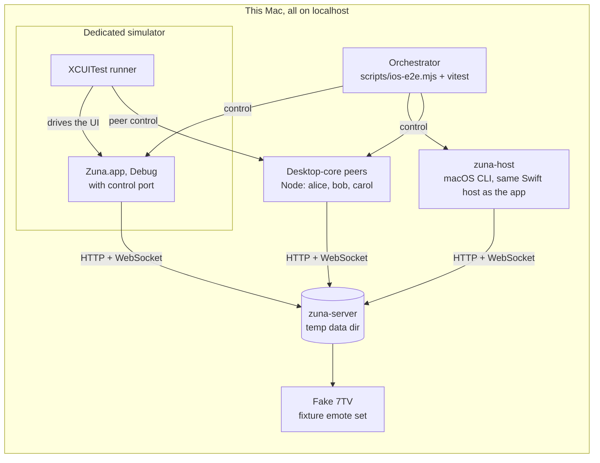

# iOS app: testing plan

Companion to [IOS_PLAN.md](IOS_PLAN.md). The goal is a test setup complete enough that the app can be built feature by feature **without a human in the loop**: every item in the parity matrix gets an automated check that runs headlessly on one Mac, against a real server and a real desktop client, and reports results in a form that can be read and acted on.

## Principles

1. **Prove compatibility with the desktop, not with ourselves.** Every end-to-end scenario has a desktop-core peer on the other side. An iOS client talking to another iOS client proves little.
2. **Hermetic.** Everything runs on localhost: a fresh Go server per run, a fake 7TV, generated fixtures. No internet, no shared state between runs, no use of the developer's own simulators.
3. **Test the host, not the core again.** `@zuna/core` is already covered by `npm run test:core`. The new risk is the iOS host around it (JavaScriptCore shims, native bridges, Swift models, lifecycle) and the native UI. Tests are aimed there.
4. **One command per loop, readable output.** Each command writes a short `summary.md` with failures, file and line, log tails and screenshot paths.
5. **Deterministic waits only.** No sleeps in tests. A test that passes on retry is reported as flaky and fixed, never retried into green.
6. **Desktop stays green.** The existing `npm test` runs in every full regression.

## Topology

## The control channel

The key enabler. The app's core already sits behind an RPC boundary (`packages/core/src/rpc.ts`: `call`, `reply`, `event` messages). Test builds expose that same protocol over a local WebSocket, so a test can drive an iOS client exactly as the UI does, using the existing `RemoteClient`/`RemoteSession` types.

- **Where:** `ZunaHost` starts a `ControlServer` (Network.framework, WebSocket) on `127.0.0.1` when launched with `-ZunaControlPort <port>` (the app) or `--control <port>` (`zuna-host`). The Node peers expose the same protocol, so UI tests drive peers the same way.
- **Wire format:** JSON frames shaped like `rpc.ts` messages. Binary values are tagged as `{"$bytes": "<base64>"}`. Files are tagged as `{"$file": {"path", "name", "mime"}}` when both sides share the filesystem, and sent as bytes otherwise.
- **Release builds never contain it.**
  - The control server and the native hooks are compiled only in Debug.
  - The bundle's JavaScript hooks (a movable clock, access to the client) stay inert unless a Debug host sets `__zunaHost.testHooks`.
  - `npm run test:ios:release` builds Release and fails if the binary contains any test-only string literal. It found a leak while being written: a Swift property name kept in reflection metadata.
- **Test-only methods** (namespace `test.`):

| Method | Purpose |
|---|---|
| `test.messages(key)`, `test.texts(key)` | message views of a conversation, like `TestApp.texts()` in the core harness |
| `test.events(since)` | the `CoreEvent` stream, buffered |
| `test.clockOffset(ms)` | shifts `Date.now()` in the JS runtime, for 7-day key rotation and 21-day key packages |
| `test.network(mode)` | the host's fetch and WebSocket shims go `normal`, `offline`, `flaky(p)` or `latency(ms)` |
| `test.crashOn(pattern)` | the host exits the moment a response matching a URL pattern arrives. For example, `POST /api/groups/*/commit` simulates a crash after the server accepted a commit and before it was merged locally. This needs no core changes. |
| `test.restart()` | tears down the JS runtime and reopens from persisted data, like an app relaunch |
| `test.suspend()`, `test.resume()` | the iOS background and foreground path |
| `test.dropDeviceKey()` | deletes the Keychain item but keeps the databases, like a restore onto a new phone |
| `test.sql(query)` | read-only database queries, for checks of data at rest |
| `test.logs(since)` | recent console and host log lines |

Implemented so far as host commands (`{"kind": "host", "command": …}`):

- `offline`, `exit`;
- `evaluate`, which runs a script in the core's context and is compiled only into Debug builds;
- for the app: `state` (`booting`, `locked`, `ready`, `failed`), `unlock` (with a password) and `lockedAccounts`;
- for driving a real iPhone by hand: `keepAwake` (with `on`), which keeps the phone unlocked while the app is in front, as launching with `-ZunaKeepAwake YES` does from the start; `openChat` (a server's address as `path`, a conversation's key as `channel`); and `roundStart` and `roundStop`, which record a video message in the open chat as holding its button and letting go do.

The control server starts before the core, so a test can also drive the app while it's locked. Messages for the core wait until it's running. Launching with `-ZunaBootSession <name>` simulates a restart of the phone.

The rest follow in F1.

## Test layers

| Layer | What | Runs in | Time |
|---|---|---|---|
| L0 Static | TypeScript typecheck, Swift build with warnings as errors, Release guard (no test hooks) | macOS | < 1 min |
| L1 Crypto | `cargo test` natively; existing WASM tests; cross vectors WASM ↔ native | macOS | < 1 min |
| L2 Host units | JS environment conformance, golden parity, bridge contracts | `swift test` on macOS | < 1 min |
| L3 Core on host | actor scenarios: `zuna-host` against Node peers | macOS | 2–4 min |
| L4 Core in simulator | the same L3 scenarios, with the real app in the simulator as the actor | simulator | 5–8 min |
| L5 UI end to end | XCUITest against peers, plus the screen tour | simulator | smoke 3 min, full 15–20 min |
| L6 Performance | XCTest metrics, with thresholds for regressions | simulator | 5 min |
| L7 Manual | short checklist on a physical iPhone at milestones | your device | – |

### L1. Crypto: native against WebAssembly

The Rust code is shared, so this layer catches mistakes in what's between it and the core: UniFFI, the Swift bridge and the JavaScript shim (byte order, nulls, epochs as numbers, errors that must throw).

- `cargo test --lib` runs the Rust tests natively, next to the existing WebAssembly run.
- `tests/e2e/test/crypto.test.ts` runs the native build where the core calls it: inside `zuna-host`'s JavaScript context, through its `evaluate` hook. The WebAssembly build runs next to it in Node, and the two exchange data live:
  - derived keys and digests: Argon2id, HKDF, SHA-256, `safetyDigest`;
  - sealed data both ways, with tampering refused: AEAD, STREAM chunks, HPKE, signatures;
  - MLS between a desktop (WebAssembly) and a phone (native): a Welcome, commits both ways with the same `exportSecret`, a third device added from the phone, an external join, the phone's state restored from what it persisted, and its removal.

This replaces the planned fixture file: exchanging data live covers both directions in one run, with nothing to regenerate.

### L2. Host units: golden parity

The same pure functions run in Node (V8) and inside the iOS JavaScriptCore runtime over a fixed corpus. The outputs must match byte for byte.

- **Core functions, run inside JavaScriptCore:**
  - `plainText`, `tokenize`/`indexTokens` (fixed key), `parseInviteLink`, `normalizeServerUrl`;
  - `toRecoveryText`/`fromRecoveryText`, `derivePasswordKeys` (minimum allowed parameters), `reactionId`, `safetyEmoji`;
  - `sealEnvelope` and `openEnvelope` across runtimes, `u64Bytes`.
- **The corpus** includes passwords and names with Polish diacritics, decomposed forms (NFD), emoji with zero-width joiners, RTL text and code fences. This catches differences in Unicode normalization or regexes between V8 and JavaScriptCore before they lock someone out of their account.
- **Swift ports of UI logic:** the message markup parser, `jumboSize`, mention and emote extraction, preview text. Golden output comes from the **desktop's own code**: `renderMarkup` rendered with `react-dom/server` and normalized into a canonical tree. The Swift parser must produce the same tree. The desktop code stays untouched.
- **JS environment and bridge contracts:**
  - timers: order, `clearTimeout`, intervals, interleaving with native callbacks;
  - `fetch`: methods, headers, JSON and binary bodies, status codes, `AbortSignal.timeout`, network errors becoming `ApiError(0)`. Tested against a local test HTTP server.
  - `WebSocket`: open, message, close codes including 4401, errors;
  - `TextEncoder`/`TextDecoder` including invalid UTF-8, `atob`/`btoa`, `URL`.
- **SQLite bridge:** one `LocalDb` contract suite in TypeScript runs against both the Node `MemoryDb` and the native bridge. It covers:
  - multi-statement `run`, every `SqlValue` type, BLOBs coming back as `Uint8Array`;
  - nested transactions and rollback on throw;
  - FTS5 with `contentless_delete`, `PRAGMA user_version`.
- **FileAdapter:** range reads, assembling a file, files over 1 MiB.
- **RPC codec:** binary tagging, error `code` and `status` preserved, event ordering.
- **Swift models drift check:** every payload decoded by Swift is re-encoded and its key set compared with the original JSON. A field the core sends but the Swift model lacks fails the run. This runs automatically inside L3–L5 too.

### L3 and L4. Core scenarios with actors

New workspace `tests/e2e` (TypeScript, vitest), built on the existing `TestServer` and `MemoryDbProvider` from `packages/core/test/helpers.ts`.

- **`Actor` interface**, async everywhere: `register`, `login`, `session` (a typed `RemoteSession`), `waitForEvent(predicate)`, `texts(key)`, plus the `test.` hooks above.
  - `NodeActor`: an in-process `ZunaClient`, i.e. the desktop core.
  - `HostActor`: connects to a control port. It is backed by `zuna-host` (L3) or by the app in the simulator (L4), launched with `xcrun simctl launch` and `SIMCTL_CHILD_*` environment variables.
- **Scenarios:** the existing `e2e.test.ts` scenarios ported once into actor form, so that each runs with the iOS actor in every role (sender, receiver, group creator, added member, new device, recovered account, admin). The original suite stays as it is. iOS-specific additions:
  - suspend, peers send 200 messages, resume: everything arrives in order, unread counts are correct;
  - offline send: the message waits in the outbox, the network returns, it is delivered exactly once;
  - crash after the server accepted a commit: on relaunch the commit is merged and the group still works;
  - crash during a multi-chunk upload: the message shows as failed, a retry works;
  - device key lost (restore from backup): the app starts fresh, signs in, gets the full history;
  - clock moved forward 8 days: the next send rotates the epoch, and the peer follows;
  - registering on desktop with a diacritic password and signing in on iOS, and the reverse;
  - files both ways: JPEG, PNG, converted HEIC, MP4, PDF, a 3.5 MiB multi-chunk file, a tampered chunk rejected;
  - read receipts on and off, typing, presence, profile and avatar changes, verification emoji identical on both sides;
  - revoking the iOS device from desktop signs it out, and the reverse; ban; server settings changes arriving live.
- **Data at rest:** after the scenarios, `test.sql` and a raw scan of the database files confirm that no known plaintext (message texts, names, file names) appears anywhere.
- **Matrix:** `node ↔ host` by default; `host ↔ host` and the simulator variant (L4) in the full run.

### L5. UI end to end (XCUITest)

- **Orchestration:** `tests/e2e/src/ui-run.ts` (`npm run test:ios:ui`):
  1. Builds the core bundle and the app (`build-for-testing`).
  2. Starts the fake 7TV, a stand-in for the push relay, a LiveKit, and the servers: the main one, which allows that relay and has voice channels on that LiveKit, and two that nobody has set up yet.
  3. Seeds the main one through desktop clients in Node: alice (the owner), bob's laptop and carol, a DM and a group. More seeding (avatars, pins, reactions, emotes, a 2,000-message conversation) comes with the phases that need it.
  4. Serves those clients to the tests over WebSockets ("peers"), plus `/world` for what no single client can do: signing in to an account on another new device, showing the simulator's Face ID a face (enrolled while preparing the simulator), or counting what reached the relay.
  5. Prepares the dedicated simulator and runs `xcodebuild test-without-building`, passing the world as JSON in `TEST_RUNNER_ZUNA_WORLD`.
- **The tests stay synchronous.** `XCUIApplication` waits for the app by turning the main run loop, and an async test on the main actor blocks it. TestKit runs its network calls in the background and waits for them.
- **TestKit** in the UI test target:
  - `Peer` speaks the control protocol to a desktop client: `send(to:_:)`, `texts(with:)`, and `call` for any session method (a ban, for instance); `WorldControl.newDevice(for:)` signs in elsewhere;
  - `AppUnderTest` launches the app with a control port, fresh data, `en_US` and UTC, and sets up accounts through the app's own core (`signIn(as:)`, `register(_:password:)`), so tests start where they need to;
  - onboarding itself is tested through the real UI, in its own tests;
  - system sheets over the app (the strong password offer, "Save password?") are declined by position, since the simulator may run in another language.
- **Accessibility identifiers** come from one `A11y` enum compiled into both the app and the tests, for example `conversation.row.<key>`, `message.bubble.<id>`, `composer.input`, `composer.send`. Every interactive element and every asserted text gets one.
- **Every test checks both sides:** what the UI shows, and what the desktop peer received. For example:
  - type `**hi** @alice KEKW` and send: alice receives text, `emotes` and `mentions` identical to what the desktop composer would produce;
  - alice reacts with an emote: the chip appears on iOS with the right image.
- **One test file per matrix area:** Onboarding, Servers, ConversationList, ChatReading, Composer, MessageActions, Attachments, Groups, Invites, Verification, Settings, ServerAdmin, Lifecycle, iPad.
- **Media:** `xcrun simctl addmedia` seeds the photo library with HEIC and HEVC fixtures. One test goes through the real PhotosPicker. The other attachment tests inject files through a Debug-only path, so they don't depend on an out-of-process picker.
- **Lifecycle in the UI:** Home button and reactivation, `terminate` and relaunch with an unsent draft and a queued message, network faults through `test.network` showing "Waiting for network".
- **Voice channels:** the app comes into a real LiveKit room, with a tone for its microphone and moving bars for its camera (`Voice/VoiceTesting.swift`, from `-ZunaFakeMicrophone` and `-ZunaFakeCamera`). The peers have no media, so they're in a channel only as far as the server can tell (`setVoiceState`). What crosses between the phone and a real desktop app is checked by `tests/e2e/src/voice-run.ts` (`npm run test:ios:voice`): the web app in Chromium with its fake devices and speech from `say`, a screen share drawn on a canvas in place of the browser's picker, and the phone in the simulator driven through host commands (`voiceJoin`, `voiceCamera`, `voiceState`, `voiceReport`, `voiceLeave`), which report what arrived from each participant once decrypted and decoded.
- **Notifications:** the stand-in relay registers the app (with a made-up token in place of APNs) and hands the server's pushes to the simulator with `simctl push`, as APNs would. A new registration makes the older ones gone, as after reinstalling, so only the test's fresh device is notified. `simctl push` skips the notification extension, so the banner shows the push's own text; the extension's decryption is covered by the cross-client tests, which run it in a process of its own beside a host, without JIT, and check its memory. Which of someone's devices is told about a message, and when, is checked by `tests/e2e/src/notify-run.ts` (`npm run test:ios:notify`): the web app in Chromium, standing for a computer, and the phone in the simulator signed in as the same person, a second phone that's only a push registration, and a stand-in relay, through Telegram's cases (the phone just put away, at the desktop, just leaving it, both in use, only the phone), each with a message read meanwhile. The desktop's focus is real, but its input is the main process's `powerMonitor` saying "active" or "idle", since nothing can make real input without the Accessibility permission; its real idle time is checked once, when nobody has touched the Mac. The phone is put out of sight by opening Settings in the simulator, and reports what it shows through host commands (`notifications`, `pushKeys`, `notificationsAllowed`). simctl can't allow notifications, so the app has to have been allowed them by an earlier run of `NotificationTests`, and the script installs over it.
- **Screen tour:** one test visits every screen with seeded data and attaches screenshots. They are exported to `apps/ios/.e2e/<run>/screens/*.png` for visual review against the desktop design tokens, also with large Dynamic Type and on iPad. On any failure, the test attaches a screenshot and `app.debugDescription`, a text dump of the element tree.

### L6. Performance

XCTest metrics with stored baselines, failing on regressions:

- launch to the conversation list;
- opening a chat;
- scroll hitch rate through 2,000 messages with animated emotes;
- signing in and syncing 10,000 messages (time and peak memory);
- Argon2id time.

The simulator runs on Mac hardware, so these catch regressions only, not absolute device performance. JavaScriptCore on iOS runs without a JIT. F0 found that a plain `JSContext` on macOS also runs at interpreter speed, with or without `JSC_useJIT=0`: about 85 ms for a loop V8 runs in 15 ms. So `zuna-host` on macOS is a fair stand-in for a device's core performance with no extra setup. `npm run test:ios:perf` measures it.

### L7. Manual, at milestones only

On your iPhone, after F0, F5 and before TestFlight. Each round is about 15 minutes with a checklist:

- real performance without a JIT;
- Keychain after a reboot, before the first unlock;
- the OS killing the app in the background;
- camera photos and videos, and video messages from the front camera, held upright and after a call;
- install from TestFlight.

The app's control channel listens on the phone's loopback only, so it's reached over USB with `iproxy <port>:<port> -u <udid>`. Launch with `xcrun devicectl device process launch --device <udid> --terminate-existing chat.zuna.mobile -- -ZunaControlPort <port> -ZunaKeepAwake YES`, so the phone never locks between steps. A test server for the phone has to be on the LAN, which the core only reaches over plain HTTP with a local change to `normalizeServerUrl` in `packages/core/src/api.ts`, built into that phone's app and never committed. The camera and audio session only behave as they do for people on a device: the simulator has no camera, so `-ZunaFakeCamera` draws bars and skips capture altogether.

## Hermetic environment

- **Server:** a new binary and temporary data directory per run, `--auth-burst 1000`, listening on `127.0.0.1`. The core accepts plain HTTP for loopback, and the Debug app allows local networking in ATS.
- **Fake 7TV:** a small HTTP server in the orchestrator serving a fixture set with static, animated and zero-width WebP emotes. This needs the **only server change: two optional environment variables, `ZUNA_7TV_API` and `ZUNA_7TV_CDN`**, overriding `APIBase` and `CDNBase` in `server/internal/emotes`. Without them, emote tests would depend on the real 7TV.
- **Simulators:** dedicated devices created by script, `Zuna E2E iPhone` (iPhone 17, iOS 27.0) and `Zuna E2E iPad`. Tests use only these. Before each UI run:
  - uninstall the app;
  - `xcrun simctl keychain <udid> reset` (the simulator keychain survives uninstalling);
  - grant photo permissions up front;
  - add an interruption monitor for any system alert.
- **Fixtures**, generated with macOS tools and committed so later runs need nothing extra:
  - photos with `sips` (JPEG, PNG, HEIC);
  - videos with `avconvert` (H.264, HEVC);
  - random multi-chunk binaries;
  - emote WebPs with `img2webp` (from Homebrew's `webp`, a one-time step).
  - Desktop-only formats such as WebM and Ogg only need the right MIME type to test the fallback card.

## Commands and results

| Command | Runs | Status |
|---|---|---|
| `npm run build:ios` | builds the Rust XCFramework, SQLite and the core bundle | since F0 |
| `npm run test:ios` | L3: cross-client scenarios against `zuna-host` | since F0 |
| `npm run test:ios:sim` | L4: the same scenarios with the real app in the E2E simulator | since F0 |
| `npm run test:ios:perf` | L6 for the core: sign-in and sync of 10,000 messages | since F0 |
| `swift test --package-path apps/ios/ZunaKit` | L2 bridge tests | since F0 |
| `npm run test:ios:ui -- [--only LaunchAndUnlockTests[/testName][,OtherTests]]` | L5: XCUITest against peers, writes `apps/ios/.e2e/latest/summary.md` | since F1 |
| `ZUNA_E2E_SIMULATOR="Zuna E2E iPad" npm run test:ios:ui -- --only PadTests` | L5 on an iPad simulator, made on first use | since F8 |
| `npm run build -w @zuna/web && npm run test:ios:voice [-- screenshot-dir]` | a voice channel between the phone in the simulator and the web app in Chromium, through a real LiveKit | since voice channels |
| `npm run build -w @zuna/web && npm run test:ios:notify [-- screenshot-dir]` | which of someone's devices is notified, and when: the web app in Chromium, the phone in the simulator and a second phone | since Telegram's notification timings |
| `npm run test:ios:release` | the Release guard | since F1 |
| `npm run test:ios:check` | L0, L1, L2 together, with the app built with warnings as errors | since F1 |
| `npm run test:ios:all` | everything, plus the desktop's `npm test` | since F1 |

On each release (a `v*` tag), the `ios` job in `.github/workflows/ci.yml` runs `test:ios:check`, `test:ios`, the Release guard and the UI tests on a macOS runner. It keeps each run's summary, screenshots and logs as an artifact.

Each run writes `apps/ios/.e2e/<run>/` (and `latest/`) containing:

- `summary.md`: passes and failures, the failing assertion with file and line, and the last lines of each log;
- `server.log`, `peers.log`, `host.log`;
- `device.log` from `xcrun simctl spawn <udid> log stream` (subsystem `chat.zuna`);
- the `.xcresult` bundle and exported screenshots.

`xcresulttool` output is converted to the summary, so a failure can be understood without opening Xcode. Long runs go in the background with a hard timeout, so a hung simulator can't stall the work.

## How I work with this

For each item in the parity matrix:

1. Write the scenario first: L3 when the feature touches the core or the host, L5 for the UI, both directions with a desktop peer.
2. Implement until `ios:check` and the area's tests pass.
3. Look at the screen tour for that area and fix what looks wrong.
4. Run the full regression (`ios:all`, including the desktop's `npm test`).
5. Commit directly to `main` with an English message, one commit per finished feature, and push it as CLAUDE.md says.

A feature counts as done when its scenario passes against the desktop peer in both directions, its screenshots are reviewed, and nothing else regressed.

## Built in phase F1, before any features

The infrastructure comes first, so everything after it can be verified on its own:

1. The control channel in `ZunaHost`, and `zuna-host`.
2. `tests/e2e` with `NodeActor` and `HostActor`.
3. The orchestrator, simulator setup and fake 7TV.
4. The result summaries.
5. The golden corpus and the crypto vectors.

## Limits of autonomy

- **No physical device:** real-device performance, the background behavior of a real OS, the camera (L7).
- **Real pushes:** a push from APNs, which would run the notification extension on the simulator too, needs the app's APNs key and the deployed relay.
- **Signing:** distribution needs your Apple Developer team. Simulator builds need no signing.
- **The out-of-process photo picker** is tested by one UI test; the rest go through the Debug injection path.
- **App Store questions** (account deletion, reporting and blocking users, licensing) are decisions, not tests.
