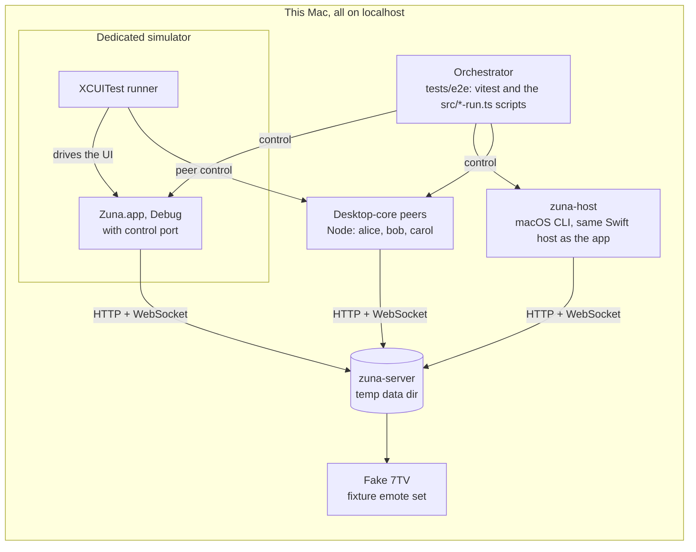

# Testing the iPhone and iPad app

How the iPhone and iPad app is tested. [IOS.md](IOS.md) is its design. The setup is complete enough that a feature can be built **without a human in the loop**: each gets an automated check that runs headlessly on one Mac, against a real server and real desktop clients, and reports results in a form that can be read and acted on.

## Principles

1. **Prove compatibility with the desktop, not with ourselves.** Every end-to-end scenario has a desktop-core peer on the other side. An iOS client talking to another iOS client proves little.
2. **Hermetic.** Everything runs on localhost: a fresh Go server per run, a fake 7TV, generated fixtures. No internet, no shared state between runs, no use of the developer's own simulators.
3. **Test the host, not the core again.** `@zuna/core` is already covered by `npm run test:core`. The new risk is the iOS host around it (JavaScriptCore shims, native bridges, Swift models, lifecycle) and the native UI. Tests are aimed there.
4. **One command per loop, readable output.** The UI run writes a short `summary.md` with failures, file and line, log tails and screenshot paths, and the others print each check as it passes or fails.
5. **Deterministic waits only.** No sleeps to wait for something to happen; a short one only to show that something hasn't. A test that passes on retry is reported as flaky and fixed, never retried into green.
6. **Desktop stays green.** The existing `npm test` runs in every full regression.

## Topology

## The control channel

The key enabler. The app's core already sits behind an RPC boundary (`packages/core/src/rpc.ts`: `call`, `reply`, `event` messages). Test builds expose that same protocol over a local WebSocket, so a test can drive an iOS client exactly as the UI does, using the existing `RemoteClient`/`RemoteSession` types.

- **Where:** the app and `zuna-host` start a `ControlServer` (`ZunaKit/Sources/ZunaControl`, Network.framework, WebSocket) on `127.0.0.1` when launched with `-ZunaControlPort <port>` (the app) or `--control <port>` (`zuna-host`). The Node peers expose the same protocol, so UI tests drive peers the same way.
- **Wire format:** JSON frames shaped like `rpc.ts` messages. Binary values are tagged as `{"$bytes": "<base64>"}`. Files are tagged as `{"$file": {"path", "type"}}` when both sides share the filesystem, and blobs as `{"$blob": {"bytes", "type"}}` otherwise.
- **Release builds never contain it.**
  - The control server and the native hooks are compiled only in Debug.
  - The bundle's JavaScript hooks (a movable clock, access to the client) stay inert unless a Debug host sets `__zunaHost.testHooks`.
  - `npm run test:ios:release` builds Release and fails if the binary contains any test-only string literal. It found a leak while being written: a Swift property name kept in reflection metadata.
Host commands (`{"kind": "host", "command": …}`), compiled only into Debug builds:

- `offline`, `exit`, and `crashOn`, with a method and a URL pattern: the host exits the moment a matching response arrives, as for `POST /api/groups/*/commit` after the server accepted a commit and before it was merged locally;
- `evaluate`, which runs a script in the core's context and is compiled only into Debug builds;
- for the app: `state` (`booting`, `locked`, `ready`, `failed`), `unlock` (with a password), `lockedAccounts` and `lockEntries`, `background` and `foreground` (the iOS background and foreground path), and `attachFile`, which stages a file in the open chat as a picked one would;
- for a linked Telegram account, in a build given its api_id: `telegramReclaim`, which has Telegram's door lose its sockets as iOS takes a suspended process's back, which the simulator never does: the account should be connecting for a few seconds, and online again, as the door listens again, at its next look or at once when the app comes back (`docs/TELEGRAM_PLAN.md`, "The door" on the iPhone). Launched with `-ZunaTelegramEndAtStart YES`, a Debug build ends itself as TDLib would just before TDLib is given its parameters, so that two launches in a row show what keeps such a TDLib from ending the app at every start ("The marks starts leave" there);
- for driving a real iPhone by hand: `keepAwake` (with `on`), which keeps the phone unlocked while the app is in front, as launching with `-ZunaKeepAwake YES` does from the start; `openChat` (a server's address as `path`, a conversation's key as `channel`); and `roundStart` and `roundStop`, which record a video message in the open chat as holding its button and letting go do.

The bundle's test hooks are reached through `evaluate`: `__zunaTest.setClockOffset(ms)` moves `Date.now()`, and `__zunaTest.client()` is the client.

The control server starts before the core, so a test can also drive the app while it's locked. Messages for the core wait until it's running. Launching with `-ZunaBootSession <name>` simulates a restart of the phone.

## Test layers

| Layer | What | Runs in | Time |
|---|---|---|---|
| L0 Static | TypeScript typecheck, Swift build with warnings as errors, Release guard (no test hooks) | macOS | < 1 min |
| L1 Crypto | `cargo test` natively; existing WASM tests; cross vectors WASM ↔ native | macOS | < 1 min |
| L2 Host units | JS environment conformance, golden parity, bridge contracts | `swift test` on macOS | < 1 min |
| L3 Core on host | cross-client scenarios: `zuna-host` against desktop clients in Node | macOS | 2–4 min |
| L4 Core in simulator | the same L3 scenarios, with the real app in the simulator | simulator | 5–8 min |
| L5 UI end to end | XCUITest against peers, with screenshots | simulator | smoke 3 min, full 15–20 min |
| L6 Performance | the core on `zuna-host`: timings logged, no thresholds | macOS | 5 min |
| L7 Manual | short checklist on a physical iPhone at milestones | your device | – |

### L1. Crypto: native against WebAssembly

The Rust code is shared, so this layer catches mistakes in what's between it and the core: UniFFI, the Swift bridge and the JavaScript shim (byte order, nulls, epochs as numbers, errors that must throw).

- `cargo test --lib` runs the Rust tests natively, next to the existing WebAssembly run.
- `tests/e2e/test/crypto.test.ts` runs the native build where the core calls it: inside `zuna-host`'s JavaScript context, through its `evaluate` hook. The WebAssembly build runs next to it in Node, and the two exchange data live:
  - derived keys and digests: Argon2id, HKDF, SHA-256, `safetyDigest`;
  - sealed data both ways, with tampering refused: AEAD, STREAM chunks, HPKE, signatures;
  - MLS between a desktop (WebAssembly) and a phone (native): a Welcome, commits both ways with the same `exportSecret`, a third device added from the phone, an external join, the phone's state restored from what it persisted, and its removal.

Exchanging data live covers both directions in one run, with nothing to regenerate, so there's no fixture file for it.

### L2. Host units: golden parity

What has to come out the same on both sides is held to the web's or Node's output, byte for byte.

- **The core in JavaScriptCore:** passwords with Polish diacritics, in NFC and NFD, derive the same keys on both sides (`cross-client.test.ts`). A fixed corpus of the core's pure functions run in both isn't built.
- **Swift ports of UI logic:** the message markup parser, `jumboSize`, mention and emote extraction, preview text. Golden output comes from **the web's own code** in `packages/ui`: `renderMarkup` rendered with `react-dom/server` and normalized into a canonical tree. The Swift parser must produce the same tree.
- **JS environment and bridge contracts:**
  - timers: order, `clearTimeout`, intervals, interleaving with native callbacks;
  - `fetch`: methods, headers, JSON and binary bodies, status codes, `AbortSignal.timeout`, network errors becoming `ApiError(0)`. Tested against a local test HTTP server.
  - `WebSocket`: open, message, close codes including 4401, errors;
  - `TextEncoder`/`TextDecoder` including invalid UTF-8, `atob`/`btoa`, `URL`.
- **SQLite bridge** (`BridgeTests.swift`): multi-statement `run` for migrations, every `SqlValue` type, BLOBs coming back as `Uint8Array`, kept statements, errors as exceptions, and FTS5 with `contentless_delete`.
- **FileAdapter:** range reads, assembling a file, files over 1 MiB.
- **RPC codec:** binary tagging, error `code` and `status` preserved, event ordering, and every kind of `CoreEvent` both ways.
- **RPC names:** every call in `CoreAPI.swift`, made against the core bundle with no server joined. The core reads a call's name first, so a name it hasn't got fails differently from one it has, which a rename in the core would otherwise only show at run time.
- **Native bridges on their own:** MLS between two native clients in one context, from a Welcome to a removal; `fetch` and `WebSocket` against servers on loopback, with refusals, cancelling and the network lost; the host's timers, files, account events and notification previews.
- **Swift models drift check:** every payload decoded by Swift is re-encoded and its key set compared with the original JSON. A field the core sends but the Swift model lacks fails the run. This runs automatically inside L3–L5 too.

### L3 and L4. Core scenarios with actors

The workspace `tests/e2e` (TypeScript, vitest), built on the core's `TestServer` and `TestApp` from `packages/core/test/helpers.ts`.

- **`HostApp`** (`tests/e2e/src/host.ts`) drives an iOS client over its control port: `zuna-host` as a process (L3), or the app in the simulator with `ZUNA_E2E_TARGET=simulator` (L4), launched with `xcrun simctl launch` and its launch arguments (`-ZunaControlPort`, `-ZunaResetData` and the like). The desktop side is the core's own `TestApp`.
- **Scenarios** (`tests/e2e/test/cross-client.test.ts`), each with a desktop client on the other side:
  - profiles, direct messages both ways, edits, reactions, replies, pins and deletions, groups made on either side, the server's emotes;
  - files both ways, ones spanning several chunks and ones sent from disk a chunk at a time, metadata taken out of a photo and a film, link previews both ways, forwards, voice messages and muting;
  - a second iOS device given the whole history, and everything kept after a restart;
  - a message queued offline and delivered exactly once, a suspend and catching up, and a crash right after the server accepted a new group;
  - passwords with diacritics on both platforms, a clock an hour off, a device removed while the app was closed, and the account's keys replaced, with the desktop following.
- **Data at rest:** after the scenarios, a raw scan of the database files confirms that no known plaintext (message texts, group names, file names) appears anywhere.

### L5. UI end to end (XCUITest)

- **Orchestration:** `tests/e2e/src/ui-run.ts` (`npm run test:ios:ui`):
  1. Builds the core bundle and the app (`build-for-testing`).
  2. Starts the fake 7TV, a stand-in for the push relay, a LiveKit, and the servers: the main one, which allows that relay and has voice channels on that LiveKit, and three that nobody has set up yet: for the owner's flow, the iPad's list of servers, and choosing a server to share to.
  3. Seeds the main one through desktop clients in Node: alice (the owner), bob's laptop and carol, a DM, a group, channels with a voice channel, and a sound on the soundboard. It serves a site for link previews, with a fake of YouTube's player under `/embed/`. More seeding (avatars, pins, reactions, emotes, a 2,000-message conversation) comes with the tests that need it.
  4. Serves those clients to the tests over WebSockets ("peers"), plus `/world` for what no single client can do: signing in to an account on another new device, showing the simulator's Face ID a face (enrolled while preparing the simulator), or counting what reached the relay.
  5. Prepares the dedicated simulator and runs `xcodebuild test-without-building`, passing the world as JSON in `TEST_RUNNER_ZUNA_WORLD`.
- **The tests stay synchronous.** `XCUIApplication` waits for the app by turning the main run loop, and an async test on the main actor blocks it. TestKit runs its network calls in the background and waits for them.
- **TestKit** in the UI test target:
  - `Peer` speaks the control protocol to a desktop client: `send(to:_:)`, `texts(with:)`, and `call` for any session method (a ban, for instance); `WorldControl.newDevice(for:)` signs in elsewhere;
  - `AppUnderTest` launches the app with a control port, fresh data, `en_US` and UTC, and sets up accounts through the app's own core (`signIn(as:)`, `register(_:password:)`), so tests start where they need to;
  - onboarding itself is tested through the real UI, in its own tests;
  - system sheets over the app (the strong password offer, "Save password?") are declined by position, since the simulator may run in another language.
- **Accessibility identifiers** come from one `A11y` enum compiled into both the app and the tests, for example `chatList.row.<key>`, `chat.message.<id>`, `composer.input`, `composer.send`. Every interactive element and every asserted text gets one.
- **Every test checks both sides:** what the UI shows, and what the desktop peer received. For example:
  - type `**hi** @alice KEKW` and send: alice receives text, `emotes` and `mentions` identical to what the desktop composer would produce;
  - alice reacts with an emote: the chip appears on iOS with the right image.
- **One test file per area** (`ZunaUITests/Tests`): Accessibility, Call, Channels, ChatControls, ChatReading, Composer, ConversationList, Details, Forwarding, LaunchAndUnlock, MessageActions, Notification, Onboarding, Pad, Presence, Settings, Share, Shell, Voice.
- **Media:** the attach menu's grid shows the simulator's own photos (`testSendsPhotosPickedInTheAttachMenu`). Other files are made by the test and staged through the Debug-only `attachFile` command, so no out-of-process picker is needed.
- **Lifecycle in the UI:** Home button and reactivation, and `terminate` and relaunch with an unsent draft and a queued message.
- **Telegram calls:** what the iPhone's WebRTC and the core make of each other's descriptions is checked by `tests/e2e/src/telegram-call-run.ts` (`npm run test:ios:telegram-calls`), through host commands (`telegramCallOffers`, `telegramCallAnswers`); `telegramCallState` says where the app's call stands. A call itself needs a linked account and someone on Telegram's own app to call or be called by, which only a person can do (docs/TELEGRAM_CALLS_PLAN.md, "What the iPhone has to get right").
- **Voice channels:** the app comes into a real LiveKit room, with a tone for its microphone and moving bars for its camera (`Voice/VoiceTesting.swift`, from `-ZunaFakeMicrophone` and `-ZunaFakeCamera`). The peers have no media, so they're in a channel only as far as the server can tell (`setVoiceState`). What crosses between the phone and a real desktop app is checked by `tests/e2e/src/voice-run.ts` (`npm run test:ios:voice`): the web app in Chromium with its fake devices and speech from `say`, a screen share drawn on a canvas in place of the browser's picker, and the phone in the simulator driven through host commands (`voiceJoin`, `voiceCamera`, `voiceState`, `voiceReport`, `voiceLeave`), which report what arrived from each participant once decrypted and decoded.
- **Notifications:** the stand-in relay registers the app (with a made-up token in place of APNs) and hands the server's pushes to the simulator with `simctl push`, as APNs would. A new registration makes the older ones gone, as after reinstalling, so only the test's fresh device is notified. `simctl push` skips the notification extension, so the banner shows the push's own text; the extension's decryption is covered by the cross-client tests, which run it in a process of its own beside a host, without JIT, and check its memory. Which of someone's devices is told about a message, and when, is checked by `tests/e2e/src/notify-run.ts` (`npm run test:ios:notify`): the web app in Chromium, standing for a computer, and the phone in the simulator signed in as the same person, a second phone that's only a push registration, and a stand-in relay, through Telegram's cases (the phone just put away, at the desktop, just leaving it, both in use, only the phone), each with a message read meanwhile. Even the push that goes at once comes after the server's hold of 1.5 s on every push, as nothing says who sent a message (`defaultPushHold` in `server/internal/api/push.go`). The web app's focus and input are the page's own events: a pointer moving every second while someone's at the desktop, and focus coming and going as the window's. The phone is put out of sight by opening Settings in the simulator, and reports what it shows through host commands (`notifications`, `pushKeys`, `notificationsAllowed`). simctl can't allow notifications, so the app has to have been allowed them by an earlier run of `NotificationTests`, and the script installs over it.
- **Screenshots:** the tests keep named screenshots of the screens they pass through (`AppUnderTest.screenshot`), with the largest Dynamic Type in `AccessibilityTests` and on an iPad in `PadTests`. The run exports them to `apps/ios/.e2e/<run>/screens/` and lists them in `summary.md`, for review against the design tokens.

### L6. Performance

`npm run test:ios:perf` (`tests/e2e/test/performance.test.ts`) times the core on `zuna-host`: whether `JSC_useJIT=0` turns the JIT off, a first read of a log of keys of 100,000 records, and signing in and syncing 10,000 messages onto a new device, with opening the chat, a search and Argon2id. It logs the timings and fails only if something wasn't decrypted or found. Launch, scrolling and the app's memory aren't measured.

JavaScriptCore on iOS runs without a JIT. A plain `JSContext` on macOS also runs at interpreter speed, with or without `JSC_useJIT=0`: about 85 ms for a loop V8 runs in 15 ms. So `zuna-host` on macOS is a fair stand-in for a device's core performance with no extra setup.

### L7. Manual, at milestones only

On a real iPhone, from a TestFlight build. Each round is about 15 minutes with a checklist:

- real performance without a JIT;
- Keychain after a reboot, before the first unlock;
- the OS killing the app in the background;
- camera photos and videos, and video messages from the front camera, held upright and after a call;
- install from TestFlight.

Telegram (`docs/TELEGRAM_PLAN.md`) needs a build given its api_id: `scripts/check-ios.mjs` and `scripts/ios-dist.mjs` take it from `TELEGRAM_API_ID` and `TELEGRAM_API_HASH`, or `~/.zuna/telegram.json`, as `iosTelegram` in `scripts/tdlib.mjs` does, which builds TDLib for iOS the first time (about a quarter of an hour), and a Debug build uses Telegram's test servers, unless launched with `-ZunaTelegramTestDC NO`. Linking needs someone to scan the QR code from Telegram's phone app on an account of those servers, and the account stays linked in that simulator or phone until it's unlinked or its data is reset. TDLib runs in the app's own process, with its folder in the app's own container (`Library/Application Support/telegram`), so there's no box to probe. What only a phone shows: whether iOS ends the app as it's suspended for the locks TDLib holds (runningboardd's "suspended with locked system files", then a termination with `0xdead10cc`), how soon the account is online after the app comes back, and the app's memory with a real account.

The app's control channel listens on the phone's loopback only, so it's reached over USB with `iproxy <port>:<port> -u <udid>`. Launch with `xcrun devicectl device process launch --device <udid> --terminate-existing chat.zuna.mobile -- -ZunaControlPort <port> -ZunaKeepAwake YES`, so the phone never locks between steps. A test server for the phone has to be on the LAN, which the core only reaches over plain HTTP with a local change to `normalizeServerUrl` in `packages/core/src/api.ts`, built into that phone's app and never committed. The camera and audio session only behave as they do for people on a device: the simulator has no camera, so `-ZunaFakeCamera` draws bars and skips capture altogether.

## Hermetic environment

- **Server:** a new binary and temporary data directory per run, `--auth-burst 1000`, listening on `127.0.0.1`. The core accepts plain HTTP for loopback, and the app allows local networking in ATS. The UI run's server has `ZUNA_TEST_TOKEN_SCALE=100` too, which issues someone a period's tokens that many times over: each test signs bob in on an app with nothing kept, which fetches a batch of its own, and ten batches are all a person gets in six hours.
- **Fake 7TV:** a small HTTP server in the orchestrator serving a fixture set with static, animated and zero-width WebP emotes. The server takes two optional environment variables for it, `ZUNA_7TV_API` and `ZUNA_7TV_CDN`, overriding `APIBase` and `CDNBase` in `server/internal/emotes`. Without them, emote tests would depend on the real 7TV.
- **Simulators:** dedicated devices created by script, `Zuna E2E iPhone` (an iPhone 17, or the newest plain iPhone) and `Zuna E2E iPad` (an iPad Pro 11-inch), each on the newest iOS runtime installed. Tests use only these. Before each UI run:
  - uninstall the app;
  - `xcrun simctl keychain <udid> reset` (the simulator keychain survives uninstalling);
  - grant the microphone and photos up front;
  - each test answers the system alerts it brings up, through SpringBoard.
- **Chinese and Japanese:** the iOS 26.0 simulator runtime (23A343) can't load its own PingFang, so it draws every Han character in the system font as a box, in any app, the language picker's 日本語 and 简体中文 and chat text alike. The 26.4 and 27 runtimes draw them, so check such text on one of those.
- **Fixtures:** the emotes, WebPs made by `tests/e2e/fixtures/make-emotes.swift` with `img2webp` (from Homebrew's `webp`, a one-time step), and the recorded voice and video messages in `ZunaKit/Tests/ZunaHostTests/Fixtures`. Pictures and files are made by the tests as they run. Desktop-only formats such as WebM and Ogg only need the right MIME type to test the fallback card.

## Commands and results

| Command | Runs |
|---|---|
| `npm run build:ios` | builds the Rust XCFramework, SQLite and the core bundle |
| `npm run test:ios` | L3: cross-client scenarios against `zuna-host` |
| `npm run test:ios:sim` | L4: the same scenarios with the real app in the E2E simulator |
| `npm run test:ios:perf` | L6 for the core: sign-in and sync of 10,000 messages |
| `swift test --package-path apps/ios/ZunaKit` | L2 bridge tests |
| `npm run test:ios:ui -- [--only LaunchAndUnlockTests[/testName][,OtherTests]]` | L5: XCUITest against peers, writes `apps/ios/.e2e/latest/summary.md` |
| `ZUNA_E2E_SIMULATOR="Zuna E2E iPad" npm run test:ios:ui -- --only PadTests` | L5 on an iPad simulator, made on first use |
| `npm run build -w @zuna/web && npm run test:ios:voice [-- screenshot-dir]` | a voice channel between the phone in the simulator and the web app in Chromium, through a real LiveKit |
| `npm run build -w @zuna/web && npm run test:ios:notify [-- screenshot-dir]` | which of someone's devices is notified, and when: the web app in Chromium, the phone in the simulator and a second phone |
| `npm run test:ios:telegram-calls [-- --update]` | a Telegram call's peer connection in the app (`Voice/TelegramCall.swift`) against the core's signalling, connecting nowhere: its offers in each shape as the core's `ios-` fixtures, and the core's answers to them taken, with ICE's roles right. `--update` writes the offers and answers again |
| `npm run test:ios:release` | the Release guard |
| `npm run test:ios:check` | L0 but the Release guard, L1 and L2 together, with the app built with warnings as errors |
| `npm run test:ios:all` | `npm test`, then `test:ios:check`, `test:ios`, `test:ios:sim`, `test:ios:ui` and `test:ios:release`; not voice, notifications, Telegram calls or performance |

On pull requests, and by hand with `gh workflow run ci.yml -f jobs=ios`, the `ios` job in `.github/workflows/ci.yml` runs `node scripts/ios-dist.mjs archive`, as a nightly makes its archive but uploading nothing, then `test:ios:check`, `test:ios`, the Release guard and the UI tests on a macOS runner. It keeps each run's summary, screenshots and logs as an artifact.

`npm run test:ios:ui` writes `apps/ios/.e2e/<run>/` (and `latest/`) containing:

- `summary.md`: passes and failures, the failing assertion with file and line, and the last lines of each log, and `world.json`;
- `xcodebuild.log`, `livekit.log` (LiveKit's SDK in the app) and `livekit-server.log`;
- `device.log` from `xcrun simctl spawn <udid> log stream` (subsystem `chat.zuna`);
- the `.xcresult` bundle, exported screenshots, and the pushes it handed `simctl`.

The other runs print each check as it passes or fails, and `test:ios:voice`, `test:ios:notify` and `test:ios:telegram-calls` take a folder for screenshots.

`xcresulttool` output is converted to the summary, so a failure can be understood without opening Xcode. Long runs go in the background with a hard timeout, so a hung simulator can't stall the work.

## Adding a feature

For each feature:

1. Write the scenario first: L3 when the feature touches the core or the host, L5 for the UI, both directions with a desktop peer.
2. Implement until `test:ios:check` and the area's tests pass.
3. Look at the screenshots for that area and fix what looks wrong.
4. Run the full regression (`test:ios:all`, including `npm test`).
5. Commit and push it as CLAUDE.md says.

A feature counts as done when its scenario passes against the desktop peer in both directions, its screenshots are reviewed, and nothing else regressed.

## Limits of autonomy

- **No physical device:** real-device performance, the background behavior of a real OS, the camera (L7).
- **Real pushes:** a push from APNs, which would run the notification extension on the simulator too, needs the app's APNs key and the deployed relay.
- **Signing:** distribution needs your Apple Developer team. Simulator builds need no signing.
- **Pickers:** the system's photo picker isn't tested; the attach menu's own grid is, and files go through the Debug injection path.
