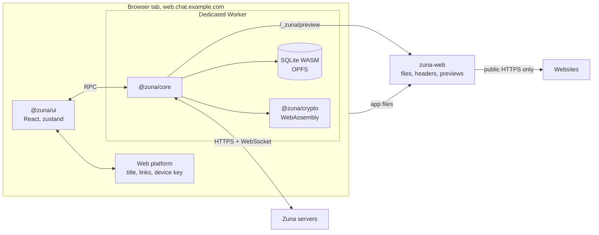

# Web app: plan

Status: agreed 2026-11-01, in progress. It replaces the old "No browser client" decision in `CLAUDE.md` and "Why there's no web client" in `SECURITY.md`.

Scope: everything the desktop app does, in a browser, like web.telegram.org. **Notifications are left out on purpose:** no system notifications, no sound, no badge. The tab's title shows the unread count instead: `(3) Zuna`.

## Summary

- **A separate program, not part of the chat server.** The web app is its own deployment on its own address, such as `web.chat.example.com`. A chat server never serves it, so a hacked chat server can't change the code that holds your keys.
- **Fully self-hosted.** One binary, `zuna-web`, serves the app's files with strict security headers and fetches pages for link previews. It contacts nothing else: no CDN, no analytics, no third-party fonts.
- **One interface for desktop and web.** The renderer moves into a shared package, `@zuna/ui`. Desktop and web are two hosts of it, the way `@zuna/core` already has three hosts. Parity is then structural: a feature added once appears in both.
- **The core runs unchanged.** It already runs in a Worker with SQLite WebAssembly on OPFS, and `npm run dev:web` already shows the UI in a browser. What's missing is what Electron provides: the device key, link-preview fetching, single-instance, and the security headers.
- **The chat server needs no changes.** It already allows any origin, because sign-in uses bearer tokens and never cookies (`withMiddleware` in `server/internal/api/server.go`, `handleWebSocket` in `hub.go`). One optional change is proposed: an "Open in browser" button on invite pages.
- **Browsers:** current Chrome, Edge, Firefox and Safari.
- **Layout:** the desktop's, at 860 × 540 or more. A narrower window shows a "Make the window wider" notice. Phones have the iOS app.

## Trust model

This is the part to agree on first.

A web app's code comes from its host on every visit. Whoever controls `zuna-web`'s host can send code that reads keys and messages. Installed apps don't have this problem, which is why `SECURITY.md` says there's no web client.

What this plan does about it:

- **The host is not the chat server.** The chat server's operator, or someone who breaks into it, can't touch the web app. Running your own `zuna-web` means the only code host you trust is yourself.
- **It must be its own origin.** Never the same scheme, host and port as a chat server. Browsers share storage within an origin, so a chat server's pages on the same origin could read the web app's data.
- **Nothing third-party loads.** Every file comes from the host, and the content security policy is the desktop's (`apps/desktop/src/main/index.ts`): no inline scripts, `'wasm-unsafe-eval'` only, images only from memory.
- **A build can be checked.** Each release lists the SHA-256 of every file it serves, and a script compares a running instance with a release.
- **Local data is less protected than on the desktop.** Browsers have no keychain a page can use, so the device key sits in the browser's storage. Copying the browser profile copies the key. The Security screen says so, as the desktop does on Linux without a secret store, and suggests the desktop app for shared computers. Asking for a password on every visit would protect it, but that adds a step, which the decisions in `CLAUDE.md` rule out.

`SECURITY.md` gets a "Web app" section that says all of this plainly, in place of "Why there's no web client".

## Architecture

### Shared interface: `@zuna/ui`

`apps/desktop/src/renderer/src` moved to `packages/ui/src` (done in W1). Everything it asks of Electron goes through one `Platform` object that each host passes to `startApp` (`packages/ui/src/platform.ts`):

- `bootCore` starts the host's worker. The shared worker code is `packages/ui/src/core/serve.ts`, so each host's worker only says how it fetches pages for previews.
- `setUnreadCount` is the dock, taskbar or tray on the desktop, and the tab's title on the web.
- `notify` is missing on the web, and the notification settings go with it.
- `microphone`, `idleState`, `onPresence`, `onFocus`, the deep-link calls and `setCloseToTray` are optional. Whatever a host leaves out, the interface does without.
- `keyWarning` is what Security says when the device key isn't protected.

The desktop keeps `index.html`, and its `main.tsx`, `platform.ts` and `worker.ts` in `apps/desktop/src/renderer/src` make its `Platform`. `apps/web` has its own versions.

### Web host: `zuna-web`

A Go program at `server/cmd/zuna-web`, next to `zuna-push`. It's a separate binary with its own deployment, but it shares the server module so it can reuse `internal/ratelimit`, `internal/clientip` and the automatic-HTTPS setup from `cmd/zuna-server`. It never opens a database, and it knows nothing about chat servers.

It does two things.

**It serves the built app**, embedded in the binary, with these headers:

| Header | Value |
|---|---|
| `Content-Security-Policy` | The desktop's, with `frame-ancestors 'none'`. `connect-src` is narrowed to the allowed servers when they're configured |
| `Cross-Origin-Opener-Policy` | `same-origin` |
| `Cross-Origin-Resource-Policy` | `same-origin` |
| `X-Frame-Options` | `DENY` |
| `X-Content-Type-Options` | `nosniff` |
| `Referrer-Policy` | `no-referrer` |
| `Permissions-Policy` | Microphone for itself, everything else off |
| `Strict-Transport-Security` | When served over HTTPS |
| `Cache-Control` | `no-cache` for `index.html` and `version.json`, a year and `immutable` for hashed files |

**It fetches pages for link previews,** at `GET /_zuna/preview?url=…&max=…`. This speaks exactly what `zuna-web://fetch` speaks on the desktop, so the core's `WebAdapter` doesn't change. The rules are the desktop's: only `https`, only public addresses, every redirect checked, at most 5 redirects and 5 MiB, 10 seconds, no cookies sent or kept, and its own user agent.

It can do better than the desktop in one place: the address is checked when the connection is made, through the dialer, not just looked up beforehand. That closes the DNS gap `SECURITY.md` mentions under "Link previews".

To stop it becoming an open proxy, it answers only requests with `Sec-Fetch-Site: same-origin` and a custom header, which a page on another site can't send without a preflight that's refused. It also limits requests per address.

Privacy changes in one respect, and `SECURITY.md` will say so: the web host's operator can see which links you preview. The chat server still never sees them. Websites see the web host's address, not yours.

Settings, as flags or environment variables in the style of `zuna-server`:

| Variable | What it does |
|---|---|
| `ZUNA_WEB_DOMAIN` | Automatic HTTPS on ports 80 and 443 |
| `ZUNA_WEB_LISTEN`, `ZUNA_WEB_TLS_CERT`, `ZUNA_WEB_TLS_KEY` | Your own address or certificates, such as behind a reverse proxy |
| `ZUNA_WEB_TRUST_PROXY`, `ZUNA_WEB_TRUSTED_PROXIES` | Client addresses from a reverse proxy, for rate limits |
| `ZUNA_WEB_PREVIEWS` | `off` turns link previews off |
| `ZUNA_WEB_SERVER` | A server address filled in on the first screen |
| `ZUNA_WEB_SERVERS` | If set, the only servers this web app can join. `connect-src` lists only them |

### Storage

- **The database** is the desktop's: SQLite WebAssembly in the OPFS pool (`core/sqlite.ts`). It needs `FileSystemSyncAccessHandle` in a worker, which the four browsers have.
- **The device key** is 32 random bytes in IndexedDB (`apps/web/src/device.ts`). The desktop's `dev:web`, with its dev-only key in `localStorage`, is gone: `npm run dev:web` now runs the web app.
- **Asking to keep the data:** after the first sign-in the app calls `navigator.storage.persist()`. If a browser later clears the site's data anyway, the person signs in again and their history comes back from the vault, as on any new device. The lost browser stays in Devices until it's removed there.
- **Safari** clears a site's storage after 7 days without a visit. That means signing in again, not losing messages. A one-line note on the sign-in screen says so in Safari.

### One tab at a time

The database can only be open in one tab, and two cores on one device would compete. Telegram Web and WhatsApp Web solve this the same way, and so will Zuna:

- The tab that starts the core holds a Web Lock, `zuna-core`.
- Another tab shows "Zuna is open in another tab" with a "Use here" button.
- "Use here" asks the first tab over a `BroadcastChannel` to stop its core and release the lock. That tab then shows the same screen.

### Tab title

- `Zuna` normally, `(n) Zuna` when chats have unread messages. `n` is the desktop's badge count (`updateBadge` in `store.ts`): unread messages in chats that aren't muted, on every server.
- It changes as soon as a chat is read, and while the tab is in the background.
- No sound, no system notifications, no blinking, no favicon dot.

### Where the phone gets notified

The desktop tells the server when the person is at the computer, so their phone stays quiet (`state/activity.ts`). The web app does the same: the person is here while the tab is visible and focused and there was input within the chosen time. The "Away after" setting stays, and the other notification settings go.

### Everything else Electron does

| Desktop | Web |
|---|---|
| Title bar with the connection state | No title bar. The connection state shows at the top of the conversation list, where Telegram Web shows it |
| `zuna://` links | Not possible in a browser. `https://web.example/#join=<invite link>` opens the join screen. The invite link goes in the fragment, so its community key never reaches a server |
| Automatic updates | `version.json` is checked every 30 minutes and when the tab is focused. A new version shows "Zuna was updated" with a Reload button |
| Tray and "Keep running when closed" | Not on the web, by design |
| Spelling suggestions in the text field's menu | The browser's own menu |
| `will-navigate` stops the window leaving the app | A file dropped outside the drop area would open in the tab, so drops are caught across the page. Leaving while files upload or messages wait in the outbox asks first |
| Asking the OS for the microphone | The browser's own prompt |
| `--zuna-clock` from the system | `Intl.DateTimeFormat().resolvedOptions().hourCycle` |
| Device name "Mac", "Windows PC" | "Chrome on macOS" and the like |
| Opening links with `shell.openExternal` | A new tab with `noopener,noreferrer` |
| Saving the recovery key to a file | A download |

## Changes to the repository

| Where | What |
|---|---|
| `packages/ui` (new) | The renderer, moved from `apps/desktop/src/renderer/src`, and the `Platform` interface |
| `apps/desktop` | `platform.ts` and `worker.ts` make the desktop's `Platform`. No change people can see |
| `apps/web` (new) | `index.html`, `main.tsx`, the web `Platform`, its worker, the device key, the tab lock, the title and tests |
| `server/cmd/zuna-web` (new) | The web host. The built app is copied into a gitignored folder there before building |
| `server/internal/webhost` (new) | Its handlers and the preview fetcher, with Go tests |
| `server/internal/api/pages.go` (optional) | `ZUNA_WEB_URL` adds "Open in browser" to invite pages |
| `scripts/build-web.mjs` (new) | `npm run build:web`: builds the app, then `zuna-web` for each platform, into `dist/web` |
| `scripts/dev-web.mjs` (new) | `npm run dev:web` at the root: Vite on port 5174 with `/_zuna` sent to a local `zuna-web`. It replaces the desktop's `dev:web` |
| `deploy/` | `docker-compose.web.yml`, `zuna-web.service` and a Dockerfile |
| `.github/workflows/ci.yml` | On `v*` tags: build `zuna-web`, its image and the checksum list |
| Root `package.json` | `typecheck` covers `@zuna/ui` and `@zuna/web` |
| Docs | `SECURITY.md` (Web app, previews), `docs/ARCHITECTURE.md` (four hosts), `docs/SELF_HOSTING.md` and a new `docs/WEB.md`, `README.md`, `CLAUDE.md` (commands, the decision, quick reference), `.agents/FEATURE_PARITY.md` (a Web column) |

## Feature parity

Everything in `.agents/FEATURE_PARITY.md` comes from the shared interface, so it's `yes` on the web except:

| Feature | Web | Notes |
|---|---|---|
| `zuna://` links | no | By design. `#join=` links instead |
| Notifications: on or off, sound, previews, badge | no | By design. The tab's title has the unread count |
| Connection state | yes | At the top of the conversation list, as there's no title bar |
| Tray, title bar, automatic updates | no | By design. A reload prompt for new versions |
| Content security policy | yes | Sent by `zuna-web`. There are no Electron fuses |
| Device key protected by the OS | no | A warning in Security |
| Recovery key saved | yes | A download |

## Phases

Each phase ends with its checks passing and is committed and pushed in small steps, as `CLAUDE.md` asks.

**W0. Spikes.**
- Try the risky parts in each browser before building on them: SQLite on OPFS in Safari, voice recording in Firefox (see Risks), and the Web Lock handover.

**W1. Shared interface.**
- Move the renderer to `packages/ui` and put every Electron call behind `Platform`.
- Done when the desktop works exactly as before: `npm run typecheck`, and `smoke.mjs`, `ui-check.mjs`, `send-check.mjs` and `attack-check.mjs` in `apps/desktop/test`, with their screenshots compared.

**W2. The web app.**
- `apps/web` with its `Platform`, worker, device key, tab lock, storage request, tab title, connection state, version check, drop guard and the Settings differences.
- Done when it signs up, signs in and works through every row of the parity file against `npm run dev:server`, in all four browsers.

**W3. `zuna-web`.**
- Files, headers, previews, rate limits and settings.
- Go tests for: private addresses, redirects to them, a name that changes address between lookup and connection, the size and time limits, cookies, requests from other sites, and the headers on every kind of file.

**W4. Web checks.**
- Playwright scripts in `apps/web/test`, run against a built `zuna-web` in Chromium, Firefox and WebKit:
  - `smoke.mjs`: start, sign up, send, reload, and the data is still there.
  - `ui-check.mjs`: every screen, as the desktop's does.
  - `attack-check.mjs`: hostile messages, and the headers from the host.
  - `tabs-check.mjs`: a second tab, and "Use here".
  - `title-check.mjs`: the title as messages arrive and are read, with muted chats left out.
  - `storage-check.mjs`: the site's data cleared, signing in again, and history coming back.
- WebKit isn't Safari, so Safari also gets a manual pass. Needs `npx playwright install`.

**W5. Deploying and docs.**
- The Dockerfile, compose file and systemd unit, `build:web`, CI on tags, the checksum list and the script that checks a running instance.
- All the docs in the table above.

**W6, optional. "Open in browser" on invite pages.**
- Only if the chat server should know about a web app. It's the one change to the server, behind `ZUNA_WEB_URL`, and off by default.

## Risks and open questions

- **Voice messages from Firefox.** iOS plays AAC in MP4 only (`apps/ios/Zuna/Chat/Voice.swift`), and the desktop records that (`lib/voice.ts`). If Firefox's `MediaRecorder` can't record MP4, it falls back to WebM with Opus, which iPhones can't play. The fix would be encoding AAC with WebCodecs where the browser can, then MP4 in a small muxer. W0 finds out.
- **Background tabs.** Chrome's Memory Saver can discard a tab nobody has looked at in a while. The title then stops changing until the tab is opened again, when the core starts and catches up. W4 measures whether the open WebSocket and Web Lock keep the tab alive.
- **Rolling back `zuna-web`.** A database written by a newer version may not open in an older one. The app should say so, not fail.
- **Keyboard shortcuts.** `Ctrl+K` and `Cmd+K` can be taken from the browser, but each shortcut is checked in W2. Browser-reserved ones like `Cmd+W` aren't used by the desktop.
- **Storage limits.** The browsers give a site a share of the disk, from about 10% in Firefox to about 60% in Chrome and Safari. Files are only kept in memory, so this is very likely enough, but W4 checks a large account.
